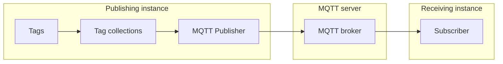

# Prohelion Documentation Style Guide

This style guide defines the standards for all Prohelion documentation. Follow these guidelines to maintain consistency across all documentation. This guide holds the rules. The reasoning behind them, the products they were drawn from, and the tooling roadmap are in [BEST_PRACTICE_GUIDE.md](BEST_PRACTICE_GUIDE.md).

## 1. Document structure

### Front matter
Every document must start with YAML front matter:
```yaml
---
title: Document Title
---
```

New and refactored pages also carry three further fields:
```yaml
---
title: Document Title
type: task
owner: Documentation
last_reviewed: 2026-10-14
---
```

- `type` is one of `tutorial`, `task`, `reference`, `concept` or `component` (see Page types and templates).
- `owner` is the team accountable for keeping the page correct, not an individual.
- `last_reviewed` is the date the page was last checked against the released product, in ISO format.

Existing pages gain these fields when they are refactored. Do not add them to a page without also checking its content.

### Page types and templates

Every page does one job. Choose its type before writing, and keep to it: a page that teaches, instructs and describes at once serves none of those readers.

| Type | The reader wants to | Contains | Never contains |
|---|---|---|---|
| `tutorial` | Learn by doing, safely | One guided path to one guaranteed outcome | Options, alternatives, theory |
| `task` | Get a specific job done | Prerequisites, numbered steps, a check that it worked | Teaching, background |
| `reference` | Look up a fact | Complete, consistently laid-out entries | Instruction or opinion |
| `concept` | Understand why and how | Explanation, a diagram, relationships to other parts | Step-by-step procedure |
| `component` | Choose and configure a component | Purpose, diagram, quick start, settings table, tags, example, troubleshooting | Long background (link to a concept page) |

Where a reader needs two types, link between two pages instead of combining them. A concept page links to the task that applies it, and a task links back to the reference for each setting it uses.

Page shapes are maximums, not minimums. Use only the parts a page needs, in the order shown, and leave out any part that would be one line long or empty. A short page is better than a padded one. Prerequisites and a check that it worked are always required, but on a short task they are a sentence in the introduction and a sentence after the last step, not headings.

- **Task:** outcome in one sentence; prerequisites and permissions; numbered steps, one action each, with the expected result; how to verify it worked; the three most likely failures and their fixes (only where there are real ones); related pages (only where they add something the body has not already linked).
- **Component:** what it does and its category; a diagram of where it sits in the data flow; a quick start with the minimum configuration; a settings table (name, type, default, effect); tags produced or consumed; an example configuration; troubleshooting; related components.
- **Concept:** what it is in two sentences; why it exists and when to use it; how it works, with a diagram; how it relates to other parts of Profinity; where to go next.
- **Tutorial:** what the reader will have at the end, shown first; time needed and prerequisites; a single path with no branches; a checkpoint after each stage; what to try next.
- **Reference:** a one-line description, then complete entries in a consistent format, grouped logically.

Every page, whatever its type, opens with a sentence that states its purpose, has a title the reader would search for, and ends by pointing to a next step.

### Heading hierarchy
- H1 (#): Main document title
- H2 (##): Major sections
- H3 (###): Subsections
- H4 (####): Minor subsections
- Avoid going deeper than H4
- Write headings, table-of-contents entries and admonition titles in sentence case: capitalise only the first word and proper nouns. Product names, feature names and acronyms keep their own form, so "Set up InfluxDB", "Turn on the custom home dashboard" and "Running V1 and V2 on one machine". Code spans and quoted software output keep their own form.
- Do not end a heading with a full stop or a colon.
- Name a task heading with a verb ("Create a user"), a concept or reference heading with a noun ("Roles and permissions"), and never use a heading that does not say what the section contains.
- Existing Title Case headings are converted to sentence case when a page is refactored. Do not convert a page's headings without also checking its content, and add a redirect if the change alters a URL.

## 2. Voice and tone

*This section is grounded in direct analysis of Prohelion's existing human-authored documentation (Profinity V1, Battery Management Systems, Motor Controllers, Solar Charge Controllers, Solar Car Racing / ArrowPoint) — not a generic style checklist. Follow it closely: the goal is documentation that reads as if a Prohelion engineer wrote it, not AI-generated copy. Section 2.6 lists the specific tells to avoid.*

### 2.1 Register by content area

Prohelion's docs aren't one voice — they shift with content type. Match the register to what you're writing, and default to the hardware/reference register when unsure — it's the dominant house style. The two registers below are the ones to write commercial documentation (including Profinity) in:

- **Hardware / reference** (Battery Management Systems, Motor Controllers, DBC/protocol specs): terse, third person, jargon-dense, no contractions, no exclamation marks except safety-critical emphasis. The product or system is the grammatical subject — "The BMS State Machine is responsible for engaging and disengaging the battery contactors", not "We designed the state machine to engage the contactors".
- **Software procedural** (Profinity UI instructions): more discursive. Longer sentences chain trigger → action → result in one breath: "Items can be added to your profile by right mouse clicking on the profile and selecting 'Add / New Item', at which point a panel is shown with all of the available items that can be added." Second person ("you") is used for reader actions; the product name is still often the subject ("Profinity can...", "Profinity provides...").

Two registers found in the source material are explicitly **out of scope — do not imitate either for commercial product documentation such as Profinity**:

- **Open-source / community** (ArrowPoint, Contributing guides): first-person plural ("we") and contractions show up naturally here — it reads closer to a GitHub README. "First off, thank you for..." / "if you've..." / "go ahead and make one!" This voice fits ArrowPoint because it's a community open-source project, not a Prohelion commercial offering. Profinity and the other commercial products should not borrow this casual, "we"-driven tone.
- **Marketing/landing pages** (e.g. the Solar Car Racing homepage) use superlatives and sales language ("industry-leading", "Ready to power your solar racing success?"). This is a deliberate outlier — do not imitate it for technical documentation, even on an overview/index page.

### 2.2 Person and voice

- Third person is the default for descriptive and reference content: the system, device or document is the subject ("The BMU collates and summarises data from the CMUs...").
- Use second person ("you"/"your") specifically when addressing the reader's actions in a procedure or troubleshooting step — not as a general narrative device.
- Avoid a generic first-person-plural "we" brand voice. Prohelion mostly refers to itself in the third person, even in its own docs: "Contact Prohelion immediately if there is a discrepancy" (not "contact us"). In the source material, "we" shows up almost only in (a) ArrowPoint/open-source docs — out of scope, see 2.1 — or (b) a specific claim about Prohelion's own past engineering decisions, e.g. "Originally developed by Prohelion to manage our own products...". For commercial product documentation, keep (b) as the only acceptable use of "we" and don't extend it into a general narrating voice.
- Write in active voice by default. Passive voice is acceptable specifically for liability/consequence statements where the actor doesn't matter: "a panel is shown"; "Operating the controller beyond the limits specified... will result in the voiding of the controller warranty."

### 2.3 Sentence rhythm

Sentence rhythm depends on the page type. Prohelion's existing prose runs long and additive, and that suits content where the reader is following an explanation. It does not suit content where the reader is following a procedure or scanning for a fact.

- **Concept and reference prose** may chain trigger → action → result, or condition → caveat → consequence, inside one sentence using commas and "and"/"which"/"so that", where the relationship is the point:
  > "Right mouse clicking on a line allows you to select an option to 'Send Can Message like this', clicking this option will open the Send CAN Packet window and pre-populate it with the data from the message that you have received."
- **Task and tutorial content** uses short, imperative sentences, one action each. Write "Select **Save**", not "You should now select Save, at which point the panel will close". State the expected result in a separate sentence after the step.
- **Parallel items** (settings, options, supported devices, prerequisites) go in a list or a table, not a long sentence.
- **Paragraphs** carry one idea and lead with the point. Keep them to four sentences or fewer.
- **Task content** aims for sentences under 25 words. Cut filler such as "there is", "in order to" and "it is important to", and start statements with a verb where the sentence allows.
- **Lead with what matters.** Put the most important information and the action first, and the explanation after.
- Short fragments are for contrast or pacing, not the default: "Power flow is bi-directional, so it can also perform regenerative braking... Power flow is bi-directional." is a deliberate beat, not a template to repeat.
- Do not break an explanation of how things relate into bullet fragments. A list is right for items that are parallel, and a sentence is right for a relationship.

### 2.4 Tone and confidence

- State facts as settled and declarative. Avoid hedging qualifiers ("might", "should probably", "in most cases") around technical or safety-critical claims — write "could result in damage", not "may potentially cause some damage in certain situations".
- Be candid about limitations and work-in-progress features rather than smoothing them over: "For the moment, Profinity provides a DBC Viewer..."; "Prohelion's API solution is currently evolving rapidly as we develop new capabilities." This honesty is part of the voice — don't polish it into evergreen marketing language.
- Safety content escalates to blunt, short, emphatic language — capitals, short imperatives — rather than softened warnings: "Wear eye protection. Use insulated tools. Take extreme caution. Go slow." Use the admonition blocks in §3 for this, titled with a direct statement rather than a generic label — e.g. `!!! danger "Working around batteries is DANGEROUS"`, `!!! danger "Ensure your pack is correctly fused"`.
- Date capability statements rather than treating them as timeless, when a feature is versioned: "As of Profinity 1.11, Prohelion has migrated to a modern container and API centric architecture."
- Write in the present tense. Avoid "will", "would" and "should" except in a tutorial or to describe a genuine future event, and do not announce future features or make statements that will soon be out of date. Prefer positive phrasing to negative.
- Mark a feature that was added or changed in a release in a self-contained note at the bottom of the relevant section, for example "New in Profinity 2.3" or "Changed in Profinity 2.3: the default is now...". Do not mention the version anywhere else in the section, and write the note so it can be removed without reworking the text around it.
- Do not use minimising words: "simply", "just", "easily", "straightforward", "merely", "obviously". A step that is not simple for the reader makes the page feel unfriendly, and a step that is simple needs no label.
- Repeating a page shape or an opening sentence template across sibling pages is normal and expected, not something to "vary for freshness". Repeating a fact is different: each fact (a setting's meaning, a licensing rule, an environment variable) lives on one authoritative page, and every other page links to it, so the copies cannot drift apart.
- Near-identical opening paragraphs recur deliberately across product generations — the D1000 Gen1 and Gen2 Warnings pages share nearly the same opening two paragraphs; the WS22 and WS200 datasheets both open "This document describes the specifications, performance and properties of the Prohelion WaveSculptor [X] Motor Controller." When documenting a family of similar products, reuse the same sentence template rather than manufacturing artificial variation between pages.

### 2.5 Terminology

- Assume a technically literate reader. Domain jargon (CAN Bus, DBC, BMU, CMU, HVIL, ASIL D, precharge, regen) is used freely, expanded once on first use if it's an acronym, then used bare — not re-explained on every page.
- Product, feature and UI element names are proper nouns and always capitalised: Profinity, Profile, Adapter, WaveSculptor200, Battery Management Unit. Reference on-screen UI labels exactly as they appear, in quotes or Title Case: `'Add / New Item'`, the "Engage Contactors" button.
- Version numbers use three forms, and only these:
  - In sentences and headings, write the product and the number with no letter: Profinity 2.3, Profinity 2.2, "As of Profinity 1.11". If the product name is already in the sentence, "version 2.3" is fine. Do not write V2.3 or v2.3 in prose.
  - On a button, a git tag, or a quoted installer banner, use a lowercase v: "Download Profinity v2.2", `v2.3.x.x`.
  - **Profinity V2**, capital V and no minor number, is the product generation. "Security (V2 Only)" and "Profinity V2 installed" stay in that form.
  - Leave paths, document keys, and other products as they are. Folder names such as `Profinity_Version_2.3`, YAML stamps such as `version: "2.3"`, API paths such as `/api/v2`, and third-party names such as InfluxDB v2 are not Profinity release names. Quote software output literally.
- Expand an acronym in full on its first use on every page, for example "Message Queuing Telemetry Transport (MQTT)", because readers arrive on a page from search; later uses on the same page are bare. Universal terms (API, CAN, URL, YAML, JSON, HTTP, HTTPS, UI, CSV, PDF, ID) are not expanded.
- Write on-screen UI labels (buttons, tabs, menu items and field names) in **bold**, exactly as they appear, without quotation marks. Reserve backticks for values the reader types, file names, paths, YAML keys and code identifiers.
- Keep configuration fields, parameters and code identifiers literal — don't "prettify" `serialNumber` into "Serial Number" where the text is referring to the actual field name.

- Write Australian English: colour, organisation, licence (noun), license (verb), catalogue, enrolment, artefact. This applies to prose only; configuration keys, UI labels as shipped, API fields and quoted output keep their literal spelling.
- Use the serial comma in a list of three or more items: "Android, iOS, and Windows".
- Use "for example" or "such as", not "e.g.", and "that is", not "i.e.".
- Match official capitalisation exactly for every third-party product and protocol: Z-Wave, InfluxDB, PostgreSQL, MQTT. When the same term has a Profinity-specific form, the term list below is the single source.
- Do not name other companies in technical documentation unless unavoidable (a supported device, a plugin, a migration guide). Describe how Profinity works with a partner product, and link to the partner's own documentation for theirs.
- Use gender-neutral language: "they", "their" for a hypothetical person, and role names instead of gendered nouns. Do not use idioms, sports metaphors or culture-specific references, so the text translates cleanly and reads clearly for a global audience.
- Describe an element by what it is, not where it sits. Write "the **Settings** panel", not "the panel above". Do not use "please".

### 2.6 Signs of AI-generated prose to avoid

None of these patterns appear in Prohelion's existing documentation. Treat them as tells to actively edit out of any drafted content:

- Contractions anywhere in commercial product documentation (Profinity, BMS, Motor Controllers, etc.) — this is an ArrowPoint/open-source community trait, and ArrowPoint is explicitly out of scope for commercial docs (see 2.1)
- Exclamation marks used for anything other than genuine safety emphasis
- Emoji
- Em dashes: none of Prohelion's human-authored documentation uses them, so use a comma, colon or full stop, or restructure the sentence, and use "to" for ranges. Quoted software output and literal UI labels that contain a dash are left as they are
- Marketing adjectives and superlatives — "powerful", "seamless", "cutting-edge", "industry-leading", "comprehensive suite"
- Stock AI openers and filler — "In today's fast-paced world...", "Let's dive in...", "Great question!", "It's worth noting that...", "In conclusion..."
- Rhetorical questions as section openers
- Hedging around facts that should be stated plainly
- Bullet fragments in place of a sentence that explains how two things relate
- The same scaffolding on every page, headings over one-line sections, bold lead-in phrases, and lists or tables for content that fits a sentence (see 2.6a)
- Re-defining jargon a technical reader would already know
- Negative-parallelism constructions ("It's not just X, it's Y")
- A generic first-person-plural brand voice ("we" as narrator) — this belongs to ArrowPoint's open-source register only, which is out of scope for commercial docs (see 2.1)

This section was built from a mix of direct source review and automated page-fetch summaries. Formatting claims in particular are worth spot-checking against the live `.md` source before treating them as absolute — direct review of the BMS `Warnings.md` and `Precharge.md` source, for example, confirmed `!!! danger` / `!!! info` / `!!! tip` admonitions **are** used in that section, contrary to one research pass's read of the rendered page.

### 2.6a Structure has to earn its place

Over-structured pages read as machine-written, whatever the wording. The same scaffolding on every page, a heading over every two-line section, and bullets for everything are the strongest tell, and they make a page harder to read as well. Numbered steps for a procedure are not the problem: readers need them to keep their place. Use structure only where it helps.

- **Lists.** Use a bulleted list only for three or more parallel items. Two items, or items that need explaining, belong in a sentence.
- **Tables.** Use a table only when each item has two or more attributes the reader will compare, such as settings, roles and permissions or comparison of components. Do not use a table for a short list.
- **Headings.** Add a heading only when a section is long enough that a reader would navigate to it. Do not put a heading over a section of one or two sentences, and do not give every page the same set of headings.
- **Bold.** Bold is for UI labels only. Do not use bold lead-in phrases ("**Note:** ...", "**Important:** ...") or bold for emphasis in a sentence.
- **Admonitions.** One or two per page at most, and only when the reader could be harmed or lose data (see Admonitions).
- **Short tasks.** On a procedure of about five steps or fewer, state prerequisites in the introduction and the check in a sentence after the last step. Add "Before you begin" and "Check it worked" headings only on longer procedures.
- **Rhythm.** Mix paragraphs, lists and tables as the content needs. A page that is a heading, a bullet list, a heading, a bullet list is a template showing through.
- **Related pages.** Link in the text where the reader needs the page. Add a "Related pages" list only when it holds links the text does not already carry.

Read each refactored page aloud before it is published. No linter can detect a page that feels machine-written, so a person reading it is the check. If a page reads like a form being filled in, remove structure until it reads like someone explaining the product.

### 2.7 Technical level
- Assume technical competence but don't assume expertise
- Define specialised terms on first use, briefly and in-line — not as a separate glossary entry
- Link to reference materials for advanced concepts, and link the first mention of any concept that has its own page (see Links and cross-references)
- Explain relationships between concepts in narrative form, and present parallel items as lists or tables (see 2.3)

### 2.8 Write for the user, not the builder

Published documentation is read by people who use Profinity, not by people who built it. The reader has the product in front of them and nothing else: no access to the source code, internal plans, task lists, review findings, ticket numbers or the history of how a feature was designed. Every page must make sense to that reader alone.

- Describe what the user sees and does: which screen to open, what a setting controls, what happens when they change it, and what to expect afterwards. Start from the user's goal, not from how the feature is implemented.
- Do not reference class names, method names, file paths in the source repository, database tables, internal service names or architecture layers unless the reader must type or select that exact thing. Where a name is visible in the product (a menu item, a field, a file the user edits, an API route the user calls), use it exactly as it appears; where it is not, describe the behaviour instead.
- Do not explain why the code is structured the way it is. Design rationale, refactoring history, "previously this was..." and "this was changed because..." belong in release notes or engineering records, not in the user guide. State the current behaviour as settled fact, dated to a version where it matters (see 2.4).
- Do not point to internal artefacts: plan files, `tasks/` documents, review or finding IDs, branch names, pull requests, internal ticket numbers. If a limitation or upcoming change matters to the reader, state it in plain terms ("For the moment, Profinity does not...") without citing where it was tracked.
- Do not use internal shorthand or codenames the reader has never been shown. If a term is not in the product UI, the public documentation or the glossary, define it in place or replace it with plain words.
- Prefer a worked example in user terms ("To alert when pack temperature exceeds 45 °C, open Alerts and...") over a description of the underlying mechanism. Include mechanism only when it changes what the user should do, such as a timing, ordering or limit that affects their configuration, and then explain it in one or two plain sentences.
- Cover failure from the user's side: the message or symptom they will see, the likely cause in their setup, and the action that fixes it. Do not describe which internal component raised the error.

Test every page before publishing by asking whether a new customer, with only the product and these docs, could follow it end to end. If any sentence only makes sense to someone who has read the code or the plan, rewrite it in terms of what the user sees and does, or delete it. This applies equally to hand-written and AI-drafted pages; drafts generated from code or planning documents are especially prone to carrying internal wording across.

### 2.9 Search and AI readiness

Readers arrive from a search engine or an AI assistant, often on a single page, with no context. Assistants retrieve and quote one page at a time, so each page has to be understood on its own.

- **Description.** Every page has a `description:` in front matter: one sentence of 70 to 160 characters that says what the page lets the reader do or find out, in the words a reader would search for. Do not repeat the title, and do not start with "This page".
- **Answer first.** The first paragraph states the answer or the outcome. Background follows it.
- **Headings name the topic.** Write "Configure an SSH deploy key", not "Step 3" or "Overview". An excerpt of one section has to make sense alone.
- **Strict hierarchy.** One H1 per page, matching the title, and no skipped levels (H2 then H4).
- **Self-contained pages.** A reader or assistant should be able to act on the page without opening another. Where a page depends on a fact owned elsewhere, restate it in one sentence and link to the owner. This is the exception to one home per fact: restate a dependency in one line, and never copy a section, a procedure or a settings table.
- **Consistent terms.** Use the same term for the same thing across pages, so retrieval finds all of them. The glossary and 2.5 are the source.
- **Explicit types and limits.** For settings, API fields and parameters, state the type, allowed values, default and unit, because an assistant cannot infer them.
- **Complete examples.** Examples are copyable as they stand (see section 4).
- **Alt text and captions.** Describe what an image shows in text. A diagram that carries meaning is also explained in the surrounding prose.
- **Stable URLs.** Do not rename or move a page without a redirect, and record the redirect in `mkdocs.yml`.
- **Prune.** Delete placeholder pages and outdated procedures, and merge duplicates. Less content retrieves better than more.

## 3. Content elements

### Images and diagrams
```markdown
<figure markdown>

<figcaption>Descriptive Caption</figcaption>
</figure>
```

- Every image has alt text that says what it shows, not "screenshot" or "diagram".
- Do not carry information by colour alone.
- Concept and component pages include a diagram of where the subject sits in the data flow. Sibling pages in the same category reuse the same diagram shape, so readers can compare them.
- Draw diagrams as Mermaid, not as image files. Mermaid is enabled in `mkdocs.yml`, so a diagram is plain text in the page, reviewed in a pull request and edited like any other content. Use an image only for a screenshot of the product, or for a drawing Mermaid cannot express.
- Wrap a Mermaid diagram in the same `figure` and `figcaption` as an image. A Mermaid diagram has no alt text, so the caption states what the diagram shows, and the surrounding text states the flow in a sentence.
- Show where each part runs by grouping nodes in a `subgraph` titled with the place, such as "Publishing instance", "MQTT server" or "Receiving instance". Draw the arrows between nodes, not between groups.
- Keep diagrams narrow. Mermaid shrinks a diagram to fit the page width, so a wide diagram ends up with small, hard-to-read text. Use a left-to-right `flowchart` of five or fewer nodes in one row, with labels of one to three words that match the names the reader sees in the product, and no labels on the arrows. Put the trigger, format or condition in the caption and the text around the diagram. Use top-to-bottom (`flowchart TB`) when one node fans out to several, and split a diagram that needs more than about eight nodes.
- Do not put colour, styling or click handlers in a diagram. Its colours (white nodes with black text and outline, black arrows, grey group boxes) come from the site stylesheet, so every diagram looks the same and a change is made in one place.

````markdown
<figure markdown>

<figcaption>The MQTT Publisher in the publishing instance sends tag collections to the broker on an MQTT server, and the broker delivers them to every subscriber in the receiving instance</figcaption>
</figure>
````

### Admonitions
Use admonitions sparingly. Reserve `danger` and `warning` for safety, data loss and irreversible actions, and use `info` and `tip` no more than once or twice a page. If everything is flagged, nothing is.
```markdown
!!! danger "Danger"
    Critical safety information

!!! warning "Warning"
    Important caution information

!!! info
    Additional helpful information

!!! tip
    Helpful suggestions and best practices
```

## 4. Code and technical elements

### Code formatting
- Use inline backticks (`) for:
  - File names
  - Directory paths
  - Command names
  - Parameter names
  - Variable names
  - Short code snippets

### Code blocks
- Use triple backticks with language specification
- Include comments for complex code
- Provide context when necessary
- Every example the reader is told to use must be complete, copyable and run against the released product. Do not use pseudocode or fragments that need guessing at.
- Where an example type has a validator in `scripts/`, run it before publishing (for example `validate-dashboard-examples.js` for dashboard YAML).
- Show the expected result beside the example where the reader can check it.
- Omit the command prompt from command examples, and show a command's output in a separate block from the command itself, so the command can be copied as it stands.
- Write placeholders in angle brackets, such as `<tag-name>`, in command examples, and in capitals such as `YOUR_API_KEY` in YAML. Explain what each placeholder stands for immediately after the block.
- Format configuration examples so they paste into the file the page names, and say which file that is.
```python
# Example code block
def example_function():
    return "Hello, World!"
```

## 5. Lists and procedures

### Bulleted lists
- Use for items that are parallel and non-sequential: options, prerequisites, supported devices, feature lists
- Use a table instead when each item has several attributes, such as a setting with a type, default and effect
- Do not use a list to explain how things relate; write a sentence
- Keep items parallel in structure
- Capitalise the first word of each item, unless a case-sensitive term requires otherwise
- End every item with a full stop if any item is a complete sentence, and with none otherwise
- Sort items alphabetically unless the order carries meaning
- Use a definition list or a two-column table for terms and their meanings

### Numbered lists
- Use for every procedure of two or more steps in a `task` or `tutorial` page. A single step is written as a plain sentence or a one-item bullet, not a numbered list.
- Open the procedure with an introductory sentence that gives context the heading does not, ending in a colon when the list follows directly. Skip it if the heading already says everything.
- Put one action in each step, starting with an imperative verb and written as a complete sentence: "Select **Save**." Split a step that grows long.
- Put a condition before the instruction: "If you use a server licence, select **Server**."
- State where the action happens before the action: "In the **Settings** panel, select **Licensing**."
- Join sequential menu selections with `>`: "Select **Administration > Licensing**."
- Put the expected result in the same paragraph as its action, after it, in a separate sentence.
- Mark an optional step by starting it with "Optional:".
- Label sub-steps with lowercase letters and sub-sub-steps with lowercase Roman numerals, and end a parent step that has sub-steps with a colon.
- Document one method per procedure. If a second method is genuinely needed, put it on its own page, under its own heading, or in a tab.
- Put prerequisites and permissions before the first step, never partway through.
- End the procedure with how to verify it worked.
- Link to an existing procedure instead of repeating it.
- Name UI elements exactly as they appear, in bold (see 2.5)

## 6. Technical references

### Links and cross-references
- Use descriptive link text: link the words that name the thing being linked to, never "click here" or "this page". Where a page is named, use its exact title as the link text.
- Introduce a cross-reference with "refer to", not "see" or "check out", and say what the reader will find there. Do not point at "this file" or "the section below".
- Provide context for external links
- Use relative paths to the `.md` file for internal links, for example `[Derived Tags](../Tags/Derived_Tags.md)`, so MkDocs can check them at build time

#### Linking concepts in prose
When a sentence mentions a Profinity concept, component or feature that has its own page, link the first mention to that page, so a reader who does not know the term can follow it without searching. This applies to features and UI areas (Profiles, Derived Tags, Historians, the Visual Editor, Kiosk Mode), component and script types, administration topics (Roles and Permissions, Licensing) and the how-to guides that put a reference page into practice.

- Link the first mention on a page, using the words already in the sentence. Link again only where a long page returns to the concept in a distant section, and never repeat the same link within a paragraph.
- Do not link in headings, admonition titles, code spans or code blocks, image alt text or table header rows, and never link a page to itself. Where a heading names a concept, link it in the first sentence beneath.
- Link where the reader benefits from the destination: a definition, a procedure or a reference they would otherwise have to find. Skip generic words ("tag" in a sentence about something else, "profile" used loosely) and terms the page is itself explaining.
- Reference and concept pages should point to the how-to that applies them, and how-to guides should point back to the reference pages for each concept they use. Where one guide naturally follows another, say so with a link.
- Keep link density readable: as a guide, a handful of links per page, not several per sentence. If a paragraph is mostly blue, keep only the links the reader is most likely to need.
- Do not reword a sentence to fit a link. If the link text does not read naturally in place, leave the word unlinked.
- Link to the page for the version being documented. Pages under `Profinity_Version_2.3` link to other `Profinity_Version_2.3` pages, never to earlier versions, unless the sentence is about that earlier version.

### Citations
- Cite sources when referencing external material
- Include version numbers where applicable
- Link to official documentation when available

## 7. Safety and warning information

### Safety notices
- Place safety warnings prominently at the start of relevant sections
- Use appropriate admonition levels
- Clearly state risks and consequences
- Include preventive measures

### Warning hierarchy
1. DANGER: Life-threatening risks
2. WARNING: Potential for injury or serious damage
3. CAUTION: Potential for minor damage
4. NOTICE: Important information not related to physical harm

## 8. File organisation

### File naming
- Use clear, descriptive names
- Separate words with underscores
- Use lowercase letters
- Include category prefixes when helpful

### Directory structure
- Organise by what the reader is trying to do, and name sections with plain words a reader would search for
- Keep content that belongs to a hardware manual in that manual, and link to it from here
- Group related documents in directories
- Use clear directory names
- Maintain a logical hierarchy
- Include index.md files in each directory

## 9. Formatting conventions

### Text formatting
- Bold (**) for UI elements, and for the lead term of a bulleted item. Do not bold whole table cells or use bold for emphasis within a sentence.
- Italic (*) for a term at its first, defining use
- Code formatting for commands, file names, paths, configuration keys and values the reader types
- Tables for structured data. Keep them narrow, with few columns and short cell text, because wide tables are hard to read on small screens.
- Start each sentence on a new line in the Markdown source. The rendered page is unchanged, and diffs and reviews become far easier to read.

### Numbers and units
- Spell out numbers under 10
- Use numerals for 10 and above
- Version numbers always use numerals, including versions under 10 (Profinity 2.3). See 2.5 Terminology for when to add a v.
- Include units where applicable
- Use SI units with imperial in parentheses

## 10. Review and maintenance

### Document updates
- Keep `last_reviewed` and `owner` current (see Front matter)
- A feature change is not finished until its pages are updated; documentation is part of the definition of done
- Maintain a changelog for significant changes
- Review and update links regularly
- Archive obsolete content appropriately

### Quality checks
- Verify all links work, and that the first mention of each concept that has its own page is linked (see Links and cross-references)
- Check code examples are current
- Ensure images are clear and relevant
- Validate technical accuracy
- Confirm the page reads as a user guide: no source-code names, internal plan or ticket references, or design-history commentary (see 2.8)
- Confirm the page has one type, follows that type's shape, and states its purpose in the first sentence (see Page types and templates)
- Read the page aloud and remove structure it does not need (see 2.6a)
- Confirm each Mermaid diagram renders on the built page, and that its caption and the text around it state what it shows
- Confirm every fact on the page has one authoritative home and is linked rather than copied
- Run the mkdocs build and spellcheck, and `scripts/verify-2.3-doc-urls.js`, with no new warnings
- Add genuine product terms to the spellcheck word list instead of rewording around them
- Check the page against the quick reference below before it is published

## 11. Quick reference for drafting

Use this list when drafting or reviewing a page, and when briefing an AI assistant to draft one. Each line points to the section that holds the full rule.

1. Choose one page type and use its shape (section 1).
2. State the page's purpose in the first sentence, and end with a next step (section 1).
3. Write for a customer with only the product and these docs (2.8).
4. Use sentence case for headings, and a verb in task headings (section 1).
5. Write task steps as numbered, imperative, one action each, with the condition first and the result after (section 5).
6. Keep paragraphs to four sentences or fewer, and task sentences under 25 words (2.3).
7. Use present tense and active voice, with no minimising words, no "please" and no future promises (2.4).
8. Put parallel items in a list or table, and relationships in sentences (2.3, section 5).
9. Name UI elements in bold, exactly as shown, and code values in code format (2.5).
10. Use Australian English and the serial comma, with no contractions, em dashes, emoji or marketing words (2.5, 2.6).
11. Give every fact one home and link to it from everywhere else (2.4).
12. Make every example complete, copyable and tested, with placeholders explained (section 4).
13. Link the first mention of each concept that has its own page, with descriptive link text (section 6).
14. Set `type`, `owner` and `last_reviewed` in front matter (section 1).
15. Give the page a 70 to 160 character `description`, answer first, topic-naming headings, and no page that needs another page to make sense (2.9).
16. Use only the structure the page needs, and read the page aloud before it is published (2.6a).

---

This style guide is a living document. Updates and improvements will be made as needed to ensure the highest quality documentation. 