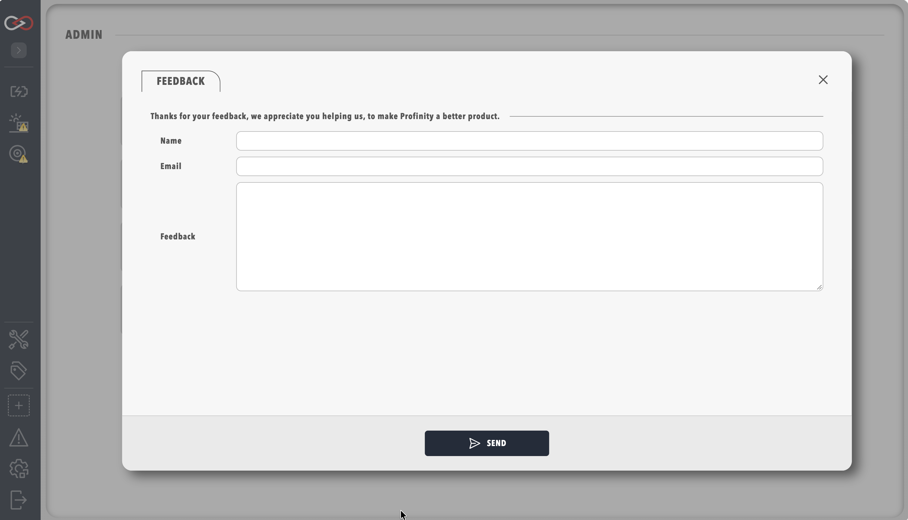

# Feedback

Profinity includes a built-in feedback form for suggestions, issue reports and general comments about the product, which Prohelion uses to improve Profinity and to support its users.
To open the form, select **ADMIN** in the side menu, and select the **Feedback** pill.

<figure markdown>

<figcaption>Profinity Feedback Form</figcaption>
</figure>

Each submission needs your full name, your contact email address and a detailed description of your feedback or issue.
For a problem report, adding the steps to reproduce it, your operating system and Profinity version, and any error messages or screenshots helps Prohelion understand and resolve it faster.

Once you submit your feedback, the Prohelion team reviews the submission and contacts you at the email address you supplied when more information is required.

For immediate assistance or urgent issues, visit the [Prohelion Support Portal](https://prohelion.atlassian.net/servicedesk/customer/portals) for support resources, or [contact Prohelion](https://www.prohelion.com/contact-us/) directly through the Prohelion website.
