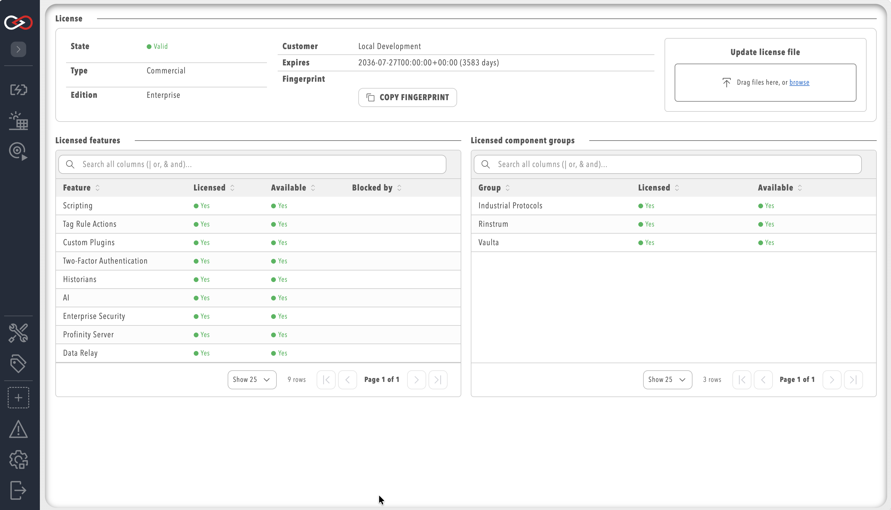

# License page

The **License** page under **ADMIN** shows the licence state of an instance, its fingerprint, and which features and component groups are licensed and available.
Select **ADMIN** in the side menu, then **License**.
A user needs the **Security administration** permission to view or change this page.

The page shows:

- **State**: `Valid`, `Trial`, `Expiring`, `Expired`, `Invalid`, `WrongInstance`, `UnsupportedVersion`, or `Missing`.
  A licence file whose expiry is 30 days or less away is reported as `Expiring` instead of `Valid` or `Trial`.
- **Type**: `Commercial`, `Trial`, or `LocalTrial` (the automatic in-product trial).
- **Edition**: the commercial edition name, shown for information only, because availability follows the individual features and components in the licence.
- **Customer**: the customer name or ID recorded on the licence.
- **Expires**: the expiry date and, where applicable, the number of days remaining.
- **Fingerprint**: the unique identifier for this installation, with a button to copy it.
- **Licensed features**: a table of every product feature, whether it is licensed, whether it is currently available (licensed **and** not blocked by configuration), and, if unavailable, what is blocking it.
- **Licensed component groups**: the same status for licensed component groups, such as protocol or hardware-integration bundles.

<figure markdown>

<figcaption>The License page under ADMIN, showing status, entitlements and fingerprint</figcaption>
</figure>

A feature can be licensed but still unavailable, for example when it has been turned off in site configuration.
The **Licensed** column always reflects the licence file; the **Available** column reflects the actual runtime state and names the layer responsible when it is blocked.

Component groups are licensed separately from product features.
For example, the BACnet, EtherNet/IP, Modbus, OPC UA and S7 [industrial protocol plugins](../Components/Industrial_Protocols/index.md) all require the **Industrial Protocols** component group, whereas [Tag Relays](../Components/Tag_Relays/index.md) require the **Data Relay** feature.
Without the matching entitlement the components show as unavailable, even when the plugin is installed.

To change the licence, refer to [Apply a licence](../Installation/Applying_a_Licence.md).
For what each edition includes, refer to [Licensing](Licensing.md), and for the trial and the fingerprint, refer to [Trial licence, Desktop use and machine fingerprint](Trial_Desktop_Use_and_Fingerprint.md).
