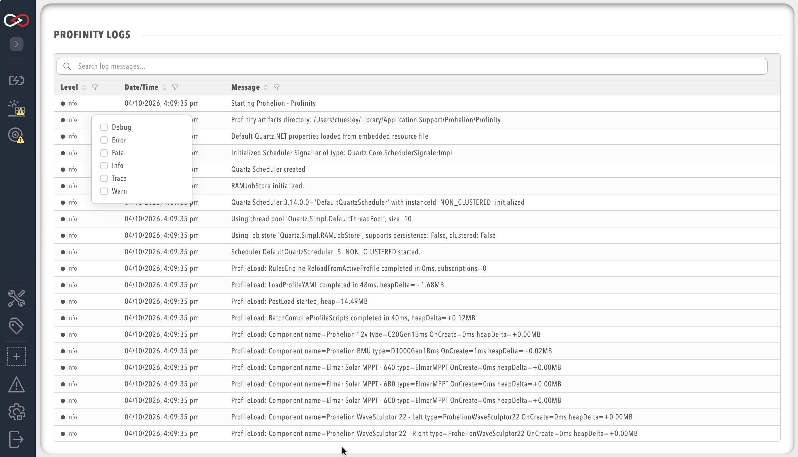

# Logs

Profinity has a built-in logging mechanism that captures information about the operation of the system and is designed to assist in diagnosing system issues.
To view the system logs, select **ADMIN** in the side menu, then the **Logs** pill.
If a log line goes off the right-hand side of the page because it is too big, select the line to expand that log message.

<figure markdown>

<figcaption>Profinity System Logs</figcaption>
</figure>

Each log entry contains a timestamp, a message level (for example `Info`, `Warn`, or `Error`), and a message description.
The levels that are recorded are set by **Log Level** on the **Logging** tab of **System Configuration**, which helps diagnose particular issues by limiting the system logs to particular message levels.
A higher level records fewer messages, and the viewer shows what has been recorded at the persisted level.
**Log Rollover Size (MB)** and **Retained Logs** are set on the same tab, and [Logging](System_Configuration/Logging.md) describes the log levels and these settings.
