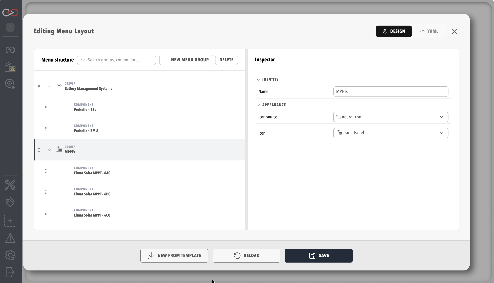
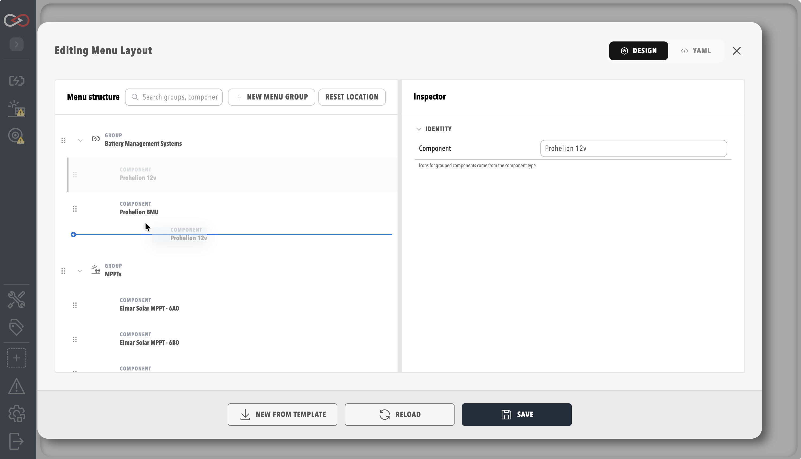

# Menu Layout

The top section of the side menu holds the components of the active profile, grouped by type, and the **Menu Layout** editor changes which group each component sits in, the order of groups and components, and the name and icon of each group.
Only this top section can be customised.
The bottom system section of the menu (CAN utilities, Tags, and Admin) is fixed and cannot be rearranged, and its entries appear according to the user's permissions and in a fixed order.

## Opening the editor

Select **ADMIN** in the side menu and open the **Menu Layout** pill, which opens the **Editing Menu Layout** window.
The pill is shown to a user with the **Modify profiles** permission while a profile is loaded, as described in [Roles and Permissions](./Users_and_Access/Roles_and_Permissions.md).
A [profile](./Profiles.md) uses the layout as soon as it is saved, so no setting needs to be switched on.

<figure markdown>

<figcaption>Menu Layout Editor Showing a Group Selected</figcaption>
</figure>

## Arranging groups and components

The **Menu structure** list on the left shows each group with its components beneath it.
Drag the handle beside a group or a component to move it, so a component can be dragged into a different group or to a new position in the same group.
The search box filters the list by group or component name, **NEW MENU GROUP** adds a custom group, and **DELETE** removes the selected custom group.
With a component selected, **RESET LOCATION** returns it to the group it belongs to by default.

Selecting a group opens its settings in the **Inspector**.
**Name** sets the label shown in the menu, and the **Appearance** section sets the icon, either a standard icon or an image from the profile.
Groups take their icon from the component type unless one is set.
Selecting a component shows its name.

<figure markdown>

<figcaption>Dragging a Component Into Another Group</figcaption>
</figure>

When the arrangement is right, select **SAVE** to apply it to the side menu.
**RELOAD** discards unsaved changes and reloads the saved layout, and **NEW FROM TEMPLATE** loads a template layout.
The **YAML** tab beside **DESIGN** shows the same layout as text for users who prefer to edit it directly.
