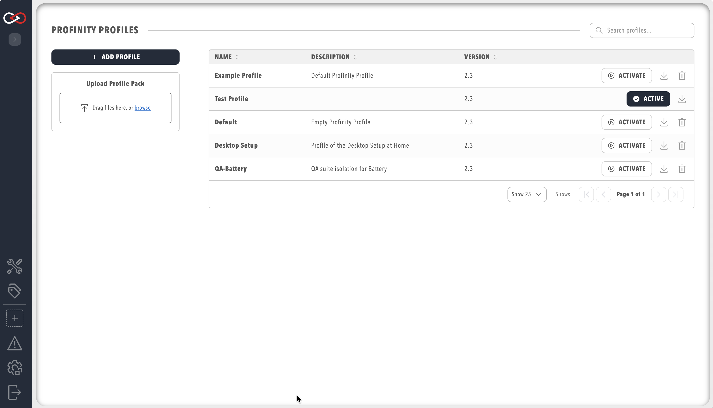

# Profiles

A Profile is the core mechanism by which Profinity maintains the configuration of your system.
Any component that you add to your system becomes associated with the active Profile, and the configuration for each device is retained after Profinity is shut down.
Profinity keeps track of your Profiles and loads the most recently used one each time you start the tool.

The **Profile** pill is located on the **ADMIN** page, which is opened by selecting **ADMIN** in the side menu, and it is shown to users with the **Modify profiles** permission, as described in [Roles and Permissions](./Users_and_Access/Roles_and_Permissions.md).

<figure markdown>

<figcaption>Profinity Profiles Menu</figcaption>
</figure>

## Changing the active profile

Only one profile can be active at a time.
To change the active profile:

1. Select **ADMIN** in the side menu and open the **Profile** pill.
2. On the row of the profile you want, select **ACTIVATE**.

The profile becomes active immediately and Profinity loads the configuration associated with it.
The active profile carries the **ACTIVE** marker on its row.

## Editing profile settings

To edit a profile's name and description:

1. Select **ADMIN** in the side menu and open the **Profile** pill.
2. Click the name of the profile, which opens a dialog with **Profile Name** and **Description**.
3. Edit the fields and select **Save**.

**Profile Name** must be unique across all profiles, and **Description** is an optional text that describes the profile's purpose.

The active profile cannot be renamed.
To rename it, change to a different profile with **ACTIVATE**, click the name of the profile to rename, edit the name and save, and then activate the renamed profile again if needed.
A temporary profile created for this purpose can be deleted afterwards.

## Creating a new profile

The steps to create a profile, from **+ ADD PROFILE** to adding components, are in [How to create a new profile](../How_To_Guides/Create_New_Profile.md).

To import a profile pack prepared on another instance of Profinity instead, open the **Profile** pill, select **UPLOAD PROFILE PACK** and choose the ZIP file.
The profile is imported with all of its associated configuration.

!!! note "Profile packs with scripts need the Scripting feature"
    Profinity rejects an uploaded profile pack that contains script content when the licence does not include the **Scripting** feature, and shows the message "Profile pack contains script content, which requires Scripting on the license."
    Refer to [Licensing](Licensing.md).

A profile pack built on another site can carry component and collection security grants that name roles which do not exist on this site.
These appear as unresolved roles that never grant access, as described in [Component and Collection Security](Users_and_Access/Component_And_Collection_Security.md#unresolved-roles-after-a-profile-import).

## Setting Kiosk Mode in a profile

[Kiosk Mode](./Kiosk_Mode.md) signs a display in automatically for a profile, bypassing the login page, which suits kiosk displays, monitoring stations and automated systems.
The profile does not need to be active when you change its settings, and the steps are in [How to set up Profinity as a kiosk application](../How_To_Guides/Set_Up_Profinity_as_Kiosk.md).
Anyone at a kiosk inherits the permissions of its Kiosk Mode User, so choose a user with only the permissions the display needs, as described in [Kiosk Mode](./Kiosk_Mode.md#choosing-the-kiosk-user).

## Downloading profile packs

To download a profile pack, open the **Profile** pill and click the download icon beside the profile.
Profinity saves a ZIP file containing the profile and its related files.

Profinity ships with an example profile called the Example Profile, which contains a Prohelion 12v battery, a Prohelion BMU, three Elmar Solar MPPT devices and two Prohelion WaveSculptor 22 Motor Controllers, as described in the [Quick Start Guide](../Getting_Started/Quick_Start.md).
Prohelion recommends copying it to a new profile before using it as a basis for your own work, because the file is overwritten each time a new version of Profinity is installed.

## Profile packs

A profile pack packages everything related to an instance of Profinity, so that several machines can be configured to run the same system.
It is downloaded as a ZIP file and uploaded to a different instance to share a configuration.
Depending on the system, a profile pack contains the profile and its configured devices, [DBC](../CAN_Utilities/CAN_Bus_DBC.md) files, [scripts](../Developing_with_Profinity/Scripting/index.md), and CAN logs.

## Profile files

Profinity stores profiles and their related files in the `profiles` folder of the [artefacts directory](../Installation/Artifacts_Directory.md), which gives the location for each operating system.
Editing a profile file directly in a text editor is possible but not recommended, and Profinity reloads the file once the change is saved.

Each profile directory has four folders: `images`, `models`, `styles` and `content`.

| Folder | Holds | Served from |
|---|---|---|
| `images` | Images such as icons, device diagrams, logos, and status indicators | `/Profile/Images/{filename}` |
| `models` | 3D model files used by a `model` component, such as `.glb`, `.gltf`, `.stl` and `.obj` | `/Profile/Models/{filename}` |
| `styles` | Custom CSS stylesheets for colour schemes and layout overrides | `/Profile/Styles/{filename}` |
| `content` | General files such as HTML templates and Markdown files | `/Profile/Content/{filename}` |

For example, a dashboard references an image as `image: "my-icon.svg"` and a stylesheet as `profile.css`.

## Profile features

Profiles support [Kiosk Mode](./Kiosk_Mode.md), which signs a display in automatically, a [Profile Dashboard](./Profile_Dashboard.md), which provides a custom home page from a dashboard YAML file, and a [Menu Layout](./Menu_Layout.md) for the side menu.
