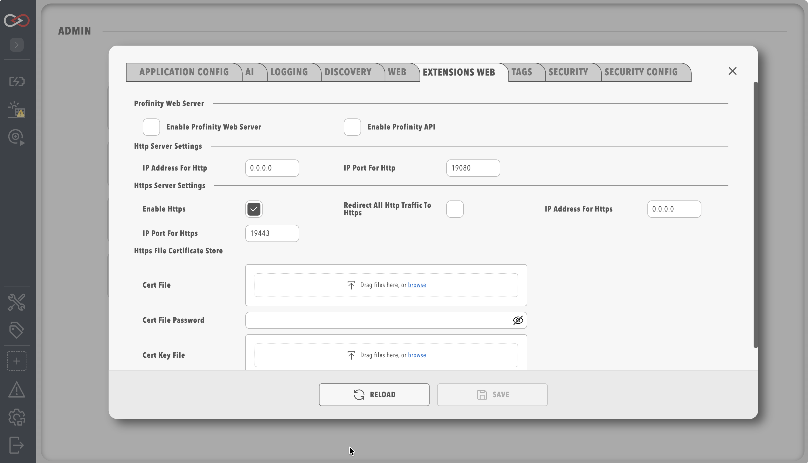

# Extensions Web

Saving changes on any System Configuration tab restarts Profinity.
Refer to [System Configuration](index.md) for what to expect.

Profinity can run a second, separate web server that serves custom applications and provides access to the same APIs that Profinity itself uses for all functionality.
You configure this second server on the **Extensions Web** tab.
It is disabled by default and needs a Server licence (Server or Enterprise edition).
Without a Server licence, the **Extensions Web** tab is not shown and the second web server stays off.
Profinity also forces any address configured for it to 127.0.0.1.

The Extensions Web server hosts custom [kiosk](../Kiosk_Mode.md) applications and custom web applications, such as an in-vehicle display, that call the Profinity API.

<figure markdown>

<figcaption>Extensions Web Menu</figcaption>
</figure>

The HTTP, HTTPS, and certificate options are the same as on the **Web** tab, described in [Profinity Web](Profinity_Web.md) and [HTTPS certificates](Profinity_Web.md#https-certificates).
The default ports differ: 19080 for HTTP and 19443 for HTTPS, so that they do not collide with the main Profinity Web ports.
The tab has these additional options:

| Parameter | Default | Description |
|-----------|---------|-------------|
|`Enable Profinity Web Server` | Off | Starts the second web server, so that extensions can be served on their own ports. |
|`Enable Profinity API` | Off | Makes the Profinity API available through the second web server. |
|`Enable Swagger on API` | Off | Shows the [Swagger UI](https://swagger.io/tools/swagger-ui/), an interactive API page on your Profinity instance. It can be enabled only when the Profinity API is enabled. |
