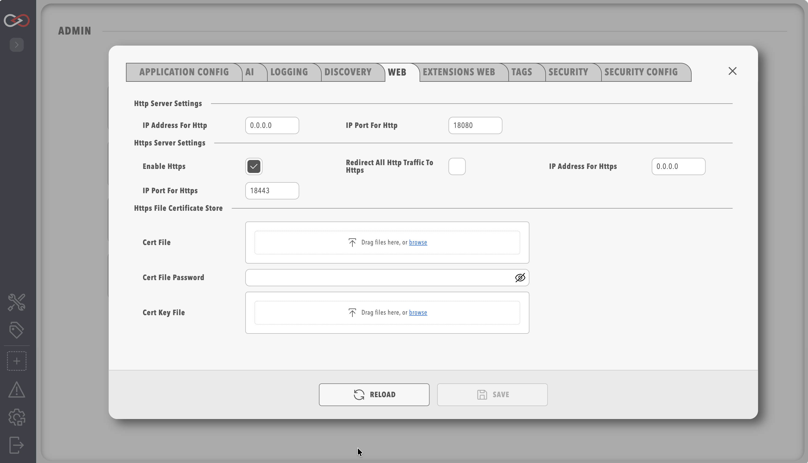

# Profinity Web

Saving changes on any System Configuration tab restarts Profinity.
Refer to [System Configuration](index.md) for what to expect.

The **Web** tab holds the parameters that control how Profinity offers its web server connections to users.
Profinity supports HTTP and HTTPS connections, and custom HTTPS certificates.

<figure markdown>

<figcaption>Profinity Web Menu</figcaption>
</figure>

| Parameter | Default | Description |
|-----------|---------|-------------|
| **IP Address for Http** | All IP addresses (0.0.0.0) | The IP address Profinity runs on for HTTP. You can set localhost (127.0.0.1) or a specific IP address instead. Without a Server licence this setting is not shown and the address is always 127.0.0.1. |
| **IP Port for Http** | 18080 | The port used for HTTP. Setting this below 1024 requires administrator permissions on the host. |
| **Enable Https** | Enabled | Enable or disable the HTTPS server. |
| **IP Address for Https** | All IP addresses (0.0.0.0) | Same as the HTTP address but for HTTPS, and hidden under the same licence restriction. |
| **IP Port for Https** | 18443 | Same as the HTTP port but for HTTPS. |
| **Redirect all Http traffic to Https** | Off | Forces the system to use HTTPS for all traffic. It can be enabled only when HTTPS is enabled. |

The certificate options are shared with the **Extensions Web** tab and are described in [HTTPS certificates](#https-certificates).

Without a Server licence, including on a Windows desktop installation, the IP address settings are not shown on this tab.
Profinity forces both the HTTP and the HTTPS address to `127.0.0.1`, even if `config.yaml` holds another value.
The web interface can then be reached only from the same computer.
Entering `0.0.0.0` does not change this, and the log records a message that remote web access requires a Server licence.
The full rule is in the remote web access warning on [Licensing](../../Licensing.md).

## Troubleshooting

If Profinity cannot be reached from another computer, check the licence on the **License** page first.
Without a Server licence, Profinity uses only `127.0.0.1`.

With a Server licence, check these three things:

- The address is `0.0.0.0` or the host's own address.
- The host firewall allows the HTTP and HTTPS ports.
- No other program already uses the port. If one does, enter a different port here.

## HTTPS certificates

These options apply to both the **Web** and [Extensions Web](Extensions_Web.md) tabs.
Each server has its own copy of them.

| Parameter | Description |
|-----------|-------------|
| **Windows Cert Store** | Selects a certificate from the Windows Certificate Store for HTTPS on Windows. Use it when the certificate is installed in the system's certificate store. |
| **Windows Cert Store Location** | The location of the certificate store. The location is `CurrentUser` for user-specific certificates or `LocalMachine` for system-wide certificates. |
| **Windows Cert Store Subject** | The subject name of the certificate as it appears in the Windows Certificate Store. It must match the certificate's subject name exactly. |
| **Cert File** | An alternative to the Windows Certificate Store: a certificate file, normally in `.pfx` or `.p12` format, for HTTPS. |
| **Cert File Password** | When a certificate file is used, the password used to protect the certificate file. |
| **Cert Key File** | The private key file (`.pem` or `.key`) when the certificate is in Privacy-Enhanced Mail (PEM) format. It is optional. When it is empty, Profinity looks for a file named `privkey.pem` in the same folder as the certificate. |

When **Cert File** and the Windows certificate store fields are empty, Profinity creates a self-signed certificate the first time HTTPS starts.
That certificate stays in place across restarts, and HTTPS stays enabled.
It names `localhost`, the computer's host name, and the network addresses on the computer at the time it was created.
Open the site with one of those names.
A browser warns that the certificate is not from a trusted authority until you trust it, or until you choose your own certificate in the fields above.
After the host name or an address changes, stop Profinity, delete `profinity_generated.pfx` from the `certificates` folder of the [artefacts directory](../../Installation/Artifacts_Directory.md), and start Profinity again.
Profinity creates a new certificate for the names and addresses it finds then.
Trust that certificate again in each browser that trusted the old one.

To find the certificate store location and subject name on Windows:

1. Open Windows Certificate Manager (`certmgr.msc`).
2. Go to the appropriate store, such as Personal or Trusted Root.
3. Double-click your certificate.
4. Read the subject name in the "Subject" field.
   The certificate manager's navigation tree shows the store location.
