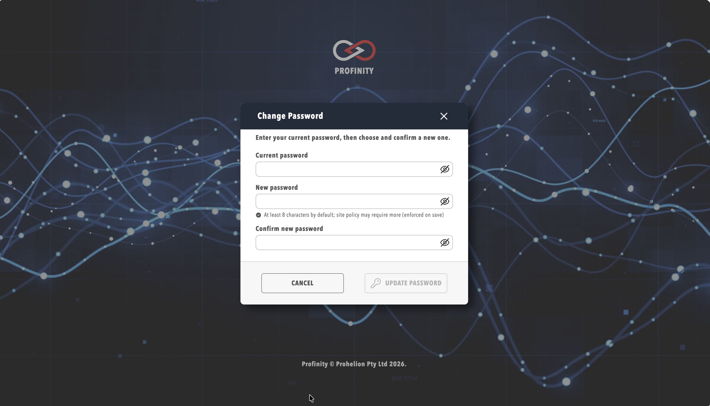
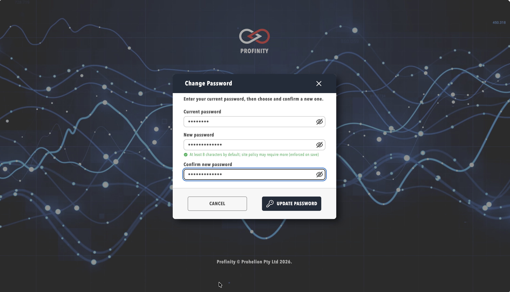

# Password policy

The password policy sets the length, complexity, and age rules for every local user's password.
It applies when the site **Sign-in method** is **Local**.
Users who sign in through single sign-on (SSO) authenticate with the identity provider, so these rules do not apply to them.
Refer to [SSO and sign-in method](./SSO_and_Sign_In.md).

## Configuring the password policy

You need the **System administration** permission to set the policy.

1. Select **ADMIN** in the side menu, then **System Configuration**.
2. On the **Security** tab, open the **Password Policy** group.
3. Change the settings in the following table, then save the tab.

Saving the tab restarts Profinity and interrupts active sessions.

| Setting | Default | Range | Description |
|---------|---------|-------|-------------|
| **Minimum password length** | 8 | 1 to 256 | The minimum number of characters in a local user's password. |
| **Require uppercase letter** | Off | On or off | The password must contain at least one uppercase letter. |
| **Require lowercase letter** | Off | On or off | The password must contain at least one lowercase letter. |
| **Require digit** | Off | On or off | The password must contain at least one digit. |
| **Require special character** | Off | On or off | The password must contain at least one special character. |
| **Maximum password age (days)** | Empty (no expiry) | 1 to 3650 | When set, local users must change their password after this many days. |

The shipped policy accepts any password of eight characters or more, with no complexity rules and no expiry.
A site that handles safety-critical equipment raises the minimum length and switches on the complexity rules.
It also sets **Maximum password age (days)** to match its organisation's identity policy.
The dialog for changing a password shows the minimum length as the user types.

## Forced password change

A user with the **Security administration** permission can require another user to change their password at the next sign-in.
You can do this in two ways:

- Enable **Require password change on next login** in the user's settings in **Users & Groups**.
- Select **Reset Password** on the user's **User Actions** tab.

**Reset Password** sets the same requirement and signs out the user's active sessions.
It is the preferred way to recover a compromised account, because no temporary password has to be shared.
**Reset Password** is not shown on an administrator's own account.

A user with this requirement sees a **change password** dialog after signing in.
They cannot use Profinity until they save a new password that meets the policy.
The default `admin` account has this requirement already set, so the first sign-in as `admin` always forces a password change.
The default `admin` credentials are listed in the [Security guide](../../../Installation/Security.md).
Refer to [Who can sign in, by installation type](../../../Installation/Applying_a_Licence.md#who-can-sign-in) for which installations have that account.

<figure markdown>

<figcaption>Password Change Required Before Continuing</figcaption>
</figure>

## Changing your own password

A local user can change their own password.
The **Change My Password** pill is shown only when the site sign-in method is **Local** and the session is not a kiosk session.

1. Select **ADMIN** in the side menu, then the **Change My Password** pill.
2. Enter the current password.
3. Enter and confirm a new password.
4. Select **Update Password**.

Profinity enforces the site policy when it saves the new password.

<figure markdown>

<figcaption>Changing Your Own Password</figcaption>
</figure>

## Related pages

- [Two-factor authentication](./Two_Factor_Authentication/index.md)
- [MFA account management](../../Users_and_Access/MFA_Account_Management.md)
- [Roles and permissions](../../Users_and_Access/Roles_and_Permissions.md)
- [Managing users](../../Users_and_Access/Manage_Users.md)
