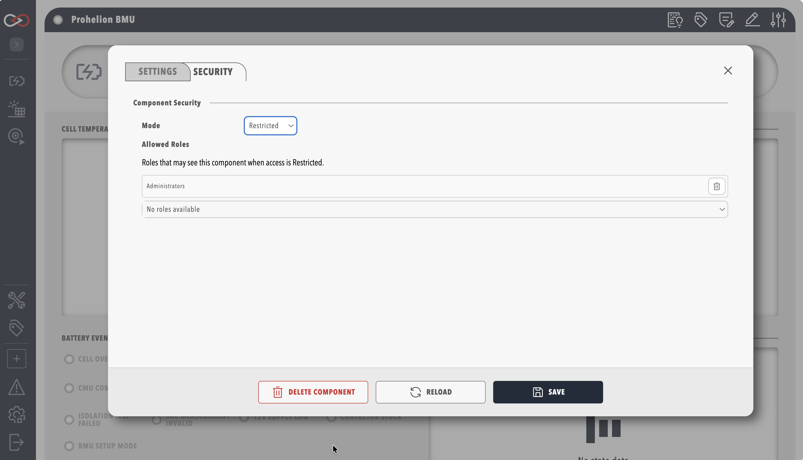
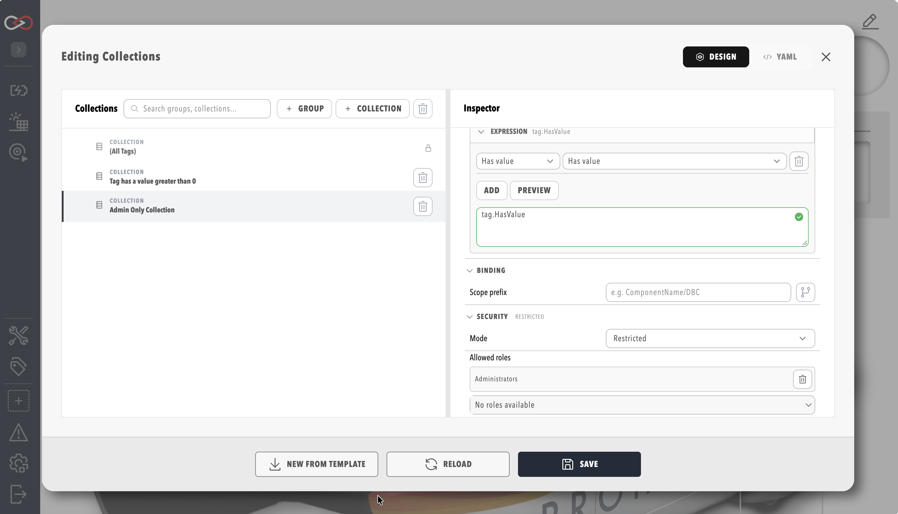

# Component and collection security

Component and collection security controls which users can **see** a profile component or a tag collection, independent of who can **modify** it.
A user without the **Modify components** or **Modify tag collections** permission already cannot change a component or a collection.
This feature goes further and removes the resource from that user's view entirely.
The resource disappears from these places:

- The tag tree
- The actions list
- CAN database (DBC) definitions
- Firmware
- Alerts
- Model Context Protocol (MCP) results
- The tag collections picker

A restricted component keeps running.
Rules, scripts, loggers, CAN, and relay traffic for a hidden component are unaffected.
This is a visibility control for users and APIs, not component isolation.

Only a user with the **Security administration** permission can see or change these settings.
**Modify components** and **Modify tag collections** control editing of the resource itself, but neither permission gives access to its **Security** tab or panel.
[Roles and permissions](Roles_and_Permissions.md) explains how permissions and roles are assigned generally.

## Restricting a component

To restrict a component:

1. Open the component's settings dialog from the profile menu or the component list.
2. Select the **Security** tab, which sits beside **Settings** and **Firmware** (when present).
3. Set **Mode** to **Restricted**.
4. Add one or more roles to **Allowed roles**.
5. Save the tab.

The component is now visible only to users who hold one of the allowed roles, plus the users described in [Who bypasses a restriction](#who-bypasses-a-restriction).
To check, sign in as a user without an allowed role and confirm the component no longer appears.
Setting **Mode** back to **All** removes the restriction.

The **Security** tab is shown only to a user with **Security administration**.
Any other user, including one with **Modify components**, does not see the tab at all.

<figure markdown>

<figcaption>Security tab on a component settings dialog</figcaption>
</figure>

## Restricting a collection

To restrict a collection:

1. Open the **Collections** editor.
2. Select the collection in the tree.
3. Open the **Security** panel in the inspector.
4. Set **Mode** to **Restricted**.
5. Add one or more roles to **Allowed roles**.

The panel is the same for the built-in **(All Tags)** collection and for every custom collection.
Changes save with the rest of the collection's settings.

<figure markdown>

<figcaption>Security panel on a collection in the Collections editor</figcaption>
</figure>

## Mode and allowed roles

Each component and each collection carries its own security policy, made up of two fields.

| Field | Description |
|-------|-------------|
| **Mode** | **All** (the default) shows the resource to every user with the underlying view permission. **Restricted** shows it only to users with one of the **Allowed roles**. |
| **Allowed roles** | The roles permitted to see the resource when **Mode** is **Restricted**. A user needs only one of them. The list is ignored when **Mode** is **All**. |

A component or collection with no security policy behaves as **Mode** **All**.

## Who bypasses a restriction

Two groups always see a restricted component or collection, regardless of role assignment.
A user with **Security administration** sees it, and so does a user with **Modify profiles**, so that engineers configuring a profile's layout are never locked out of their own work.

A service account is treated the same as an interactive user, so it must be assigned one of the allowed roles to see a restricted resource.
The same visibility filter applies whether it calls the web interface's APIs or an MCP tool.

## The built-in (All Tags) collection

**(All Tags)** is a reserved collection that cannot be deleted or edited.
It has the same **Security** panel as any custom collection, and a user with **Security administration** can restrict it the same way.
A custom collection cannot be created with the ID `All`, because that ID is reserved, and Profinity rejects the save with `400 Bad Request`.

When **(All Tags)** has no security policy it is visible to every user with **View tags**.
When it is restricted, only users with one of the allowed roles, plus **Security administration** and **Modify profiles**, see it in the tag collections picker.

Component security still applies underneath collection security.
**(All Tags)** returns every tag that a user's component security already permits, not every tag on the profile.
A visible collection is empty, not missing, when every tag it would return belongs to a component that the user cannot see.

## Fail-closed behaviour

!!! warning "A misconfigured restriction denies access, it does not grant it"
    Setting **Mode** to **Restricted** with an empty **Allowed roles** list hides the resource from every user except those with **Security administration** or **Modify profiles**.
    The same happens when the list holds only role names that no longer exist on this site.
    It does not fall back to **Mode** **All**.

    This applies in two situations in particular.
    The first is restricting a component or collection and saving before adding any role to the allow list.
    The second is importing a profile pack whose grants name a role that does not exist on the destination site.
    The unresolved names never match a user, even though the resource is still marked **Restricted**.
    Refer to [Unresolved roles after a profile import](#unresolved-roles-after-a-profile-import).

If a user cannot see a component, action, tag branch, or collection that they should have access to, check the **Security** tab or panel.
Look for an empty or fully unresolved **Allowed roles** list before you look for a permissions problem elsewhere.

## Unresolved roles after a profile import

Role and user definitions are specific to a site, but security grants travel with the profile pack.
A profile pack built on a different site can therefore name a role that does not exist locally.
A user with **Security administration** sees these names as unresolved, read-only entries in the **Security** tab or panel, with helper text naming the missing role.
Uploading a profile pack with unresolved grants also shows a summary warning.
An unresolved role name never grants access, so remove it or replace it with a role that exists on the site.
Profile packs are described in [Profiles](../Profiles.md).

## What stays unaffected

A hidden component keeps running.
Rule evaluation, the collection members that rules use, and the tree that relays send are not filtered, because the restrictions apply only to what users and the API see.

A direct API request for a hidden component, collection, or tag path returns `404 Not Found` and not `403 Forbidden`.
A caller cannot tell a resource that does not exist from one that is hidden from them.
List responses, the tag catalogue, tag queries including historian queries, alerts, and MCP tool results omit hidden items without an error.

The CAN utilities and the script log are not filtered by component security.
The Collections editor lists every collection, including restricted ones, to any user with **View tag collections**.
Only the tag collections picker and the collection's members are filtered.

## Related documentation

- [Tag Layer](../../Tags/index.md), the tag tree that component security prunes
- [Collections](../../Tags/Collections/index.md), which covers creating and editing tag collections, including the built-in (All Tags) collection
- [Endpoint Reference](../../Integrating_to_Profinity/APIs/Endpoint_Reference.md#component-and-collection-security), the routes for integrators
