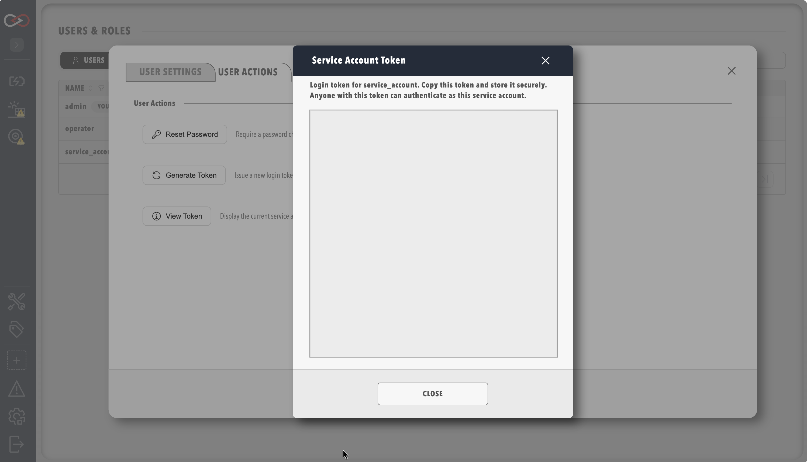

# Service accounts

A service account is a user record that exists for automation rather than a person.
It signs in with a long-lived **API token** instead of a password, which suits integrations and Model Context Protocol (MCP) clients.
A user with the **Security administration** permission manages service accounts in **Users & Groups**, which needs a Server licence.

A service account token never expires, unlike the sign-in of an ordinary user.
The token stays valid until an administrator generates a new one, changes the account's roles, or disables the account.
Treat the token like a password, store it in a secrets manager, and give the account only the permissions its integration needs.

## Creating a service account

1. Select **ADMIN** in the side menu, then **Users & Groups**.
2. Select **Add user**, or click an existing automation user.
3. Switch on **Service Account**.
4. Assign the roles the account needs under **Assigned roles**, and save.
5. Click the user's row to open its settings dialog.
6. Select the **User Actions** tab.
7. Select **Generate Token**. The bearer token appears in a dialog.

On an account that already has a token, **View Token** also appears and displays the current token again.

<figure markdown>

<figcaption>Service account token dialog</figcaption>
</figure>

!!! danger "Generating a token stops the old one working"
    **Generate Token** issues a new token, and the previous token stops working immediately.
    Every integration that uses the old token fails until you update it with the new one.
    Copy the token into a secrets manager when it is shown, so that it is available to configure the integration.

## Permissions

A service account is given roles in the same way as an interactive user.
The following table shows common patterns.

| Use case | Suggested permissions |
|----------|----------------------|
| Read-only monitoring | A role holding view permissions only, as suggested in [Roles and permissions](Roles_and_Permissions.md#which-roles-to-create) |
| Tag and query automation | **View tags**, plus any other view permission the integration reads |
| MCP access | **MCP integration**, which the default **Administrators** role includes and which any other role must be given explicitly |

MCP access also needs the **AI** licensed feature, which the **Server** and **Enterprise** editions include.
Refer to [Licensing](../../Licensing.md).

## Using the token

Send the token as a bearer token on `/api/v2` requests:

```http
Authorization: Bearer <your-service-token>
```

Replace `<your-service-token>` with the token from **Generate Token** or **View Token**.

For MCP setup and testing, refer to [MCP Server](../../Integrating_to_Profinity/MCP_Server/index.md).

## Revoking access

To revoke a service account's access, do one of the following:

- Disable the account in **Users & Groups**.
- Change its roles, which also issues a new token and stops the old one working.
- Select **Generate Token** on its **User Actions** tab, which stops the old token working.

## Related documentation

- [Managing users](Manage_Users.md)
- [Component and collection security](./Component_And_Collection_Security.md), which describes how restricted components and collections apply to service accounts
