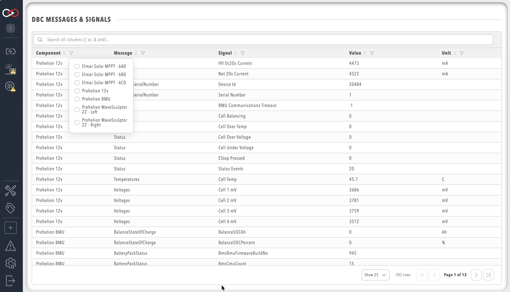

# CAN bus DBC

[DBC](http://socialledge.com/sjsu/index.php/DBC_Format) (CAN database) is a file format that describes the format and nature of Controller Area Network (CAN) bus data.
A DBC file breaks CAN data down into Messages and Signals, the building blocks of a DBC file, so you can understand the data more clearly.
For the moment, Profinity provides a DBC Viewer.
The DBC Viewer takes a DBC file and shows the CAN bus traffic travelling through Profinity as Messages and Signals.

Many of the components that Profinity supports have DBC support built in.
Examples are the [Elmar Solar MPPT](../Components/MPPT/Elmar_Solar_MPPT.md) (Maximum Power Point Tracker) and the [WaveSculptor](../Components/Motor_Controller/index.md).
These components show their Messages and Signals without a separate DBC file.

Prohelion publishes the DBC files that describe its devices with the hardware documentation.
Examples are the [WaveSculptor22 DBC file](../../../Motor_Controllers/WaveSculptor22/User_Manual/DBC.md) and the [EV Driver Controls DBC file](../../../Solar_Car_Racing/EV_Driver_Controller/Communications_Protocol/DBC.md).
You can supply either file to a Custom Component as a third-party DBC file.

## Opening the DBC viewer

Select **CAN UTILITIES** in the side menu, then **DBC MESSAGES & SIGNALS**, to see every Message and Signal in the profile.
This needs the **View DBC definitions** permission.
A component that has DBC support also has a **Messages and Signals** item in its menu.
That item opens the same viewer, already filtered to that component.

<figure markdown>

<figcaption>CAN DBC Viewer</figcaption>
</figure>

To use the DBC Viewer with a third-party DBC file, [add a Custom Component](../How_To_Guides/Add_Component_to_Profile.md) to your [profile](../Getting_Started/Profiles.md).
Provide the file in its **Upload DBC File (Optional)** setting.
Once the file has parsed, the component appears in your profile with the **Messages and Signals** menu item.
Refer to [Using a Custom Component](../Components/Custom_Components/Using_a_Custom_Component.md) for the full steps.

## Filters

The DBC Viewer filters messages and signals by Component, Message, Signal, Value, and Unit, so that the view shows only the CAN bus traffic of interest.
Leaving a filter empty shows every result for that column.
Filters on several columns apply together.
The global search box filters across all columns at once.

### Text filters

The Message and Signal columns take a text filter that is not case-sensitive.
Space-separated terms must all match, so `battery voltage` shows rows containing both words.
The operators `&` and `AND` behave the same way.
The operators `|`, `OR`, and a comma match any of the terms instead, so `error, warning, fault` shows every row that contains at least one of the three.
The global search box accepts the same operators.

```text
BMU temperature
BMU | MPPT
error, warning, fault
```

In these examples:

- The first line shows rows containing both `BMU` (Battery Management Unit) and `temperature`.
- The second line shows rows containing either `BMU` or `MPPT`.
- The third line shows rows containing any of the three words.

The Component and Unit columns offer a checklist of the values present, instead of a text box.

### Numeric range filter

The Value column takes a minimum and a maximum.
The filter works like this:

- With only a minimum, it shows values greater than or equal to that number.
- With only a maximum, it shows values less than or equal to that number.
- With both, it shows values within the range, inclusive.

For example, a minimum of `0` and a maximum of `100` shows values from 0 to 100.
A minimum of `50` with the maximum left empty shows values of 50 and above.
