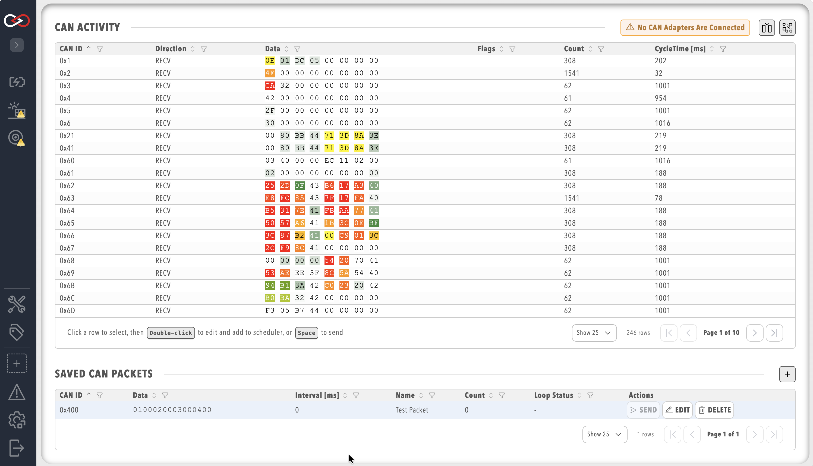
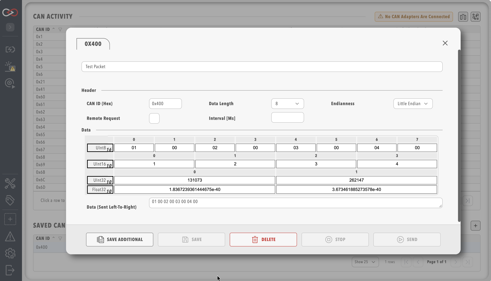

# Send / receive CAN bus messages

Profinity can monitor Controller Area Network (CAN) bus traffic on your network and also transmit messages back on to the CAN network from within the Profinity toolset, using the **SEND & RECEIVED CAN** window documented below.
The [CAN Data Log Replayer](Logging_Replaying_CAN_Bus_Messages.md#can-data-log-replayer) is a separate tool that plays recorded messages into Profinity, and it never transmits them on to the bus.

Before you send or receive any CAN packets, check that the current user holds the associated permission: **View CAN data** to receive and **Send CAN messages** to send, which includes **View CAN data**.
The replayer requires **Replay CAN logs**.
A user with only **View CAN data** sees the menu item as **RECEIVED CAN** instead of **SEND & RECEIVED CAN**.
Refer to [Roles and permissions](../Administration/Users_and_Access/Roles_and_Permissions.md).

!!! warning "A sent packet can command connected hardware"
    A packet sent from Profinity goes on to the live CAN bus and is acted on by every connected device, so a packet can start a motor controller, open a contactor or change a device setting. Check what is connected to the bus and what the packet's CAN ID and data mean before sending it, and be especially careful with a scheduled packet, which keeps sending until it is deleted.

## Receive CAN packets

Select **CAN UTILITIES** in the side menu, then the **SEND & RECEIVED CAN** menu item to see a view of all the CAN bus messages currently travelling across your network.

<figure markdown>

<figcaption>Receive CAN Packets</figcaption>
</figure>

Clicking on the **CAN Activity** table headers filters or sorts the messages by CAN ID, direction, flags, and so on.
Adapters that support them also show endian representation and local traffic filtering in the same header, as described in [CAN Bus Adapters](../Components/CAN_Bus_Protocols/CAN_Bus_Adapters.md).

Two toggle buttons sit at the top of the window.
The **Spaced data** button, which has a column-insert icon, breaks the CAN traffic data into individual hex bytes to make it easier to read.
The **Heatmap** button, which has a heat map icon, colours each byte by how often it changes, so bytes that change value frequently are shown in warmer colours and bytes that remain relatively constant are shown in cooler colours.
Both options are on by default and can be switched off.

## Scheduled CAN packets

The Scheduled CAN Packets list at the bottom of the screen shows every scheduled packet.
Select the `+` icon in the bottom panel to add a packet, or double-click or select a packet in the **CAN Activity** panel and select the **Open in Schedule Editor** `+` icon at the top of the page to start from a received packet.

A packet can be sent once, or saved so that Profinity adds it to the Scheduled CAN Packets list and continues to send it in the background.
If you set up a CAN packet in Profinity to send regularly and then log off from Profinity, the packet continues to send.
To stop a packet sending, delete it in the Scheduled CAN Packets list.

Saved packets are stored in your [Profile](../Getting_Started/Profiles.md), so if you change Profile or restart Profinity they are not lost, and they are restored.
However, packets do not automatically start sending again on a schedule, and you need to restart them manually.

### Adding a scheduled packet

Select the `+` icon to open the schedule editor and define the packet to send.
The default byte order is little endian, which is used by most Prohelion devices, including the WaveSculptor, whose data fields are sent least significant byte first (refer to the [WaveSculptor22 CAN protocol appendix](../../../Motor_Controllers/WaveSculptor22/User_Manual/Appendix_C.md)).

<figure markdown>

<figcaption>Send CAN Packet</figcaption>
</figure>

The schedule editor transmits messages back on to the CAN bus network from Profinity.
From this tool you can set the CAN ID and endian, as well as the values for either Bytes, Int16, Int32, Floats or the raw packet data.
When you change one of these values the raw data updates to reflect that, and when you change the raw data the values update to reflect that change.

Setting an interval causes Profinity to send your CAN packet at your chosen loop rate, so setting **Interval [ms]** to 100 sends the packet every 100 ms.
The interval must be a whole number from 0 to 4,294,967,295 milliseconds, and the editor shows "Value must be a valid integer" or the range message beside the field when it is not.

### Sending a packet on demand

If your packet is not set up on a schedule, you can send it manually at any time by selecting the send arrow in the Scheduled CAN Packets list, or by selecting the line of the packet and pressing the space bar.
If a packet does not appear on the bus, check that a CAN bus adapter is connected and that the current user holds the **Send CAN messages** permission.

For step-by-step guidance, refer to [How to Send and Receive CAN Bus Messages](../How_To_Guides/Send_Receive_CAN_Bus.md) and [How to Connect to CAN Bus](../How_To_Guides/Connect_to_CAN_Bus.md).
To play back recorded messages, refer to [Log / Replay CAN Bus Messages](Logging_Replaying_CAN_Bus_Messages.md).
