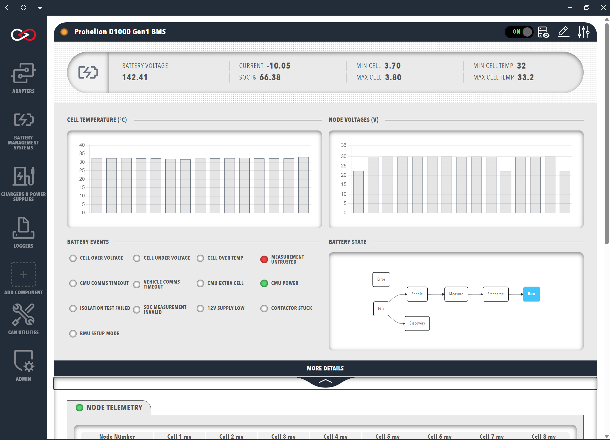
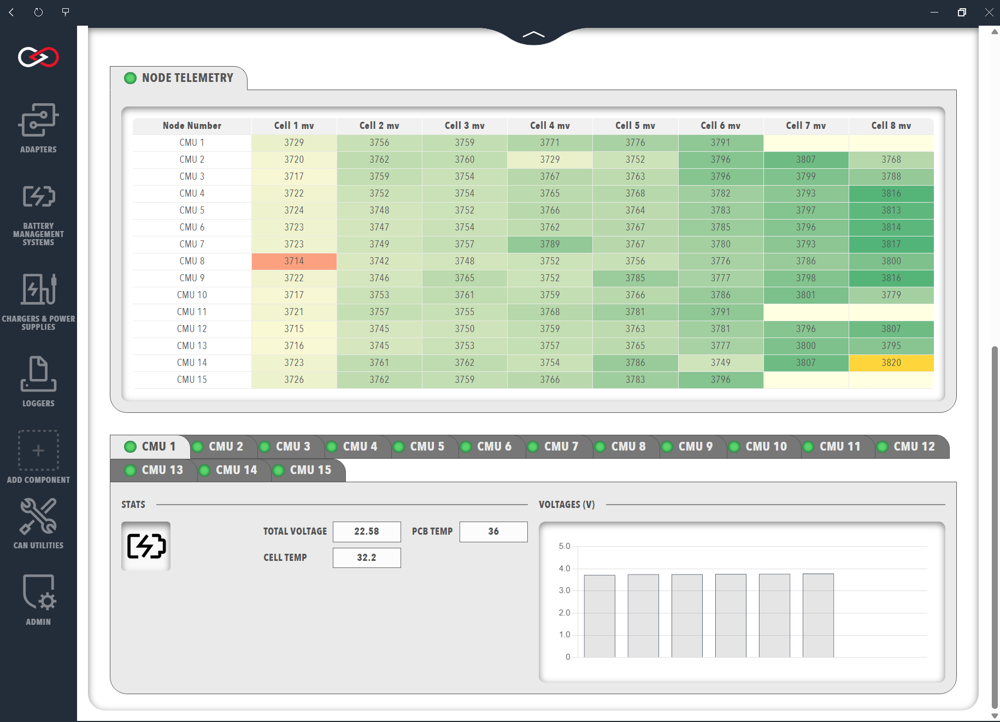

# BMU dashboard

The Battery Management Unit (BMU) dashboard shows the data of a Prohelion Battery Management System (BMS).
It appears as a tab in the sidebar once a [Prohelion BMU](Prohelion_BMU.md) is added to the [Profile](../../Getting_Started/Profiles.md).

<figure markdown>

<figcaption>Prohelion BMU</figcaption>
</figure>

The top section of the dashboard shows data from the BMU.
Select the **MORE DETAILS** banner to expand it and display telemetry from the Cell Management Units (CMUs).
The controls at the top-right open the CAN signals and messages from the BMS in the [CAN database (DBC) viewer](../../CAN_Utilities/CAN_Bus_DBC.md).

## BMU data

The top row summarises these values:

- The battery voltage.
- The current, which is negative when it flows into the battery.
- The state of charge (SOC) as a percentage of the user-set pack capacity (**SOC %**).
- The maximum and minimum cell voltage in the pack.
- The maximum and minimum cell temperature in the pack.

The summary row is followed by graphs of the cell temperatures and node voltages that the CMUs observe.
Hover over a graph to see the data in greater resolution.

The status indicators show battery events.
The indicators depend on the BMS in use and include:

- Cell over voltage and under voltage.
- Cell over temperature.
- Untrusted measurements.
- CMU and vehicle timeouts.
- An invalid SOC estimation.

The D1000 Gen2 dashboard instead shows the reasons reported by the BMS, including a separate **PRECHARGE FAIL REASON** group for a failed precharge.
In that group, **HVIL** means the High-Voltage Interlock Loop is measuring a high impedance, which points to a connector failure.
**BJU** means the Battery Junction Unit (BJU) has not responded to requests for measurements.

A flowchart shows the progression of the BMU state machine, with the current state in the grey box.
The states depend on the model and firmware.
The dashboard extends the D1000 Gen1 state machine with a Discovery state.
The table of models links the reference pages for each model.

| Model | Status flags | State machine | Configuration parameters |
|-------|--------------|---------------|--------------------------|
| D1000 Gen1 | [Transmitted CAN Packets](../../../../Battery_Management_Systems/Prohelion_BMS_D1000_Gen1/Communications_Protocol/Transmitted_CAN_Packets.md) | [BMS State Machine](../../../../Battery_Management_Systems/Prohelion_BMS_D1000_Gen1/Operation/BMS_State_Machine.md) | Not listed separately |
| D1000 Gen2, Firmware V1.2 | [Messages and Signals](../../../../Battery_Management_Systems/Prohelion_BMS_D1000_Gen2/Firmware/V1.2/Messages_and_Signals.md) (BMS Info message) | [State Machine](../../../../Battery_Management_Systems/Prohelion_BMS_D1000_Gen2/Firmware/V1.2/State_Machine.md) | [Configuration Parameters](../../../../Battery_Management_Systems/Prohelion_BMS_D1000_Gen2/Firmware/V1.2/Configuration_Parameters.md) |
| D1000 Gen2, Firmware V1.1 | [Messages and Signals](../../../../Battery_Management_Systems/Prohelion_BMS_D1000_Gen2/Firmware/V1.1/Messages_and_Signals.md) (BMS Info message) | [State Machine](../../../../Battery_Management_Systems/Prohelion_BMS_D1000_Gen2/Firmware/V1.1/State_Machine.md) | [Configuration Parameters](../../../../Battery_Management_Systems/Prohelion_BMS_D1000_Gen2/Firmware/V1.1/Configuration_Parameters.md) |
| M48 Gen1 | Not listed separately | [Software Specifications](../../../../Battery_Management_Systems/Prohelion_BMS_M48_Gen1/Software_Specifications.md) | [Software Specifications](../../../../Battery_Management_Systems/Prohelion_BMS_M48_Gen1/Software_Specifications.md) |

## Node telemetry {#cmu-or-node-data}

The **Node Telemetry** table lists the connected CMUs and the voltage of each cell they monitor.
The columns depend on the BMS model.
For a D1000 Gen1 they are:

- The CMU serial number (**Node Number**).
- The CMU board and external cell temperatures (**PCB C** and **Cell C**).
- The voltage of each cell in millivolts (**Cell 1 - 8 mV**).
A negative voltage is a trust error, where the two redundant measurement channels disagree.
The value `-32768` indicates a cell position that the BMU has not configured as present, as described in [Transmitted CAN Packets](../../../../Battery_Management_Systems/Prohelion_BMS_D1000_Gen1/Communications_Protocol/Transmitted_CAN_Packets.md).

<figure markdown>

<figcaption>Prohelion CMU</figcaption>
</figure>

The colour of each voltage reading shows additional information:

- A blue background marks a cell that is balancing.
- Green and orange mark the highest and lowest voltage cells.
- Yellow marks a trust error.
- A pale-yellow background with no text marks a cell that is not present.

To change the BMU configuration or flash its firmware, refer to [Update BMU configuration and firmware](Update_BMU_Configuration_and_Firmware.md).
