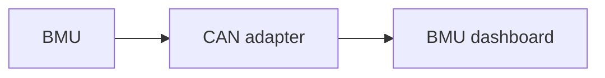

# Prohelion BMU

Profinity monitors and manages every Prohelion Battery Management System (BMS) through the BMU dashboard.
The dashboard appears as a tab in the sidebar once a Battery Management Unit (BMU) is added to the [Profile](../../Getting_Started/Profiles.md).
The model and generation that you select when you add the BMS must match the hardware.

<figure markdown>

<figcaption>The BMU, which manages its CMUs, sends CAN messages through a CAN adapter, and the BMU dashboard in the Profile shows the data for the whole BMS</figcaption>
</figure>

| Model | Description | Default base address |
|-------|-------------|----------------------|
| [D1000 Gen1](../../../../Battery_Management_Systems/Prohelion_BMS_D1000_Gen1/index.md) | A 1000 V BMS with a BMU and Cell Management Units (CMUs) on a dedicated CMU CAN bus. | `0x600` |
| [D1000 Gen2](../../../../Battery_Management_Systems/Prohelion_BMS_D1000_Gen2/index.md) | A 1000 V BMS with a BMU, a Battery Junction Unit (BJU) and CMUs, available with Firmware V1.1 or V1.2. | `0x600` |
| [M48 Gen1](../../../../Battery_Management_Systems/Prohelion_BMS_M48_Gen1/index.md) | A 48 V BMS. | `0x600` |
| M48 Gen2 | The 48 V Generation 2 BMS. | `0x600` |
| C48 Gen2 | The 48 V 100 A 16S BMS. | `0x600` |
| C20 Gen1 | The 20 V Generation 1 BMS. | `0x100` |

The settings in the BMU management section apply to every model in the table, except where a row names a specific model.
The BMU data, firmware configuration and firmware flashing on the linked pages also apply to every model, except where a section names a specific model.

In every model the BMU organises its CMUs, which are also called Nodes.
Add only the BMU to the Profile, which gives control of and data from the entire BMS.
Larger and split packs, such as those used in racing, can have two or more BMUs.
Add one BMU for each unit, each with a different base CAN address.
The hardware is described in the [Prohelion BMS documentation](../../../../Battery_Management_Systems/index.md).

## BMU management

When you add a Prohelion BMU to the Profile, Profinity prompts for the information in the following table.
The **Change Settings** button on the BMU dashboard changes these details later.

| Parameter | Description | Default |
|----------------------|-----------------------------------------------------------------------------------------------------|---------|
| **Name** | The name of the component. Must be unique. | The model name |
| **Control Pack** | Enables software control of the BMS from Profinity (engaging and disengaging the pack), for the BMS units that support it. | Off |
| **Milliseconds Valid** | The timeout of the device, from 1 to 60000. If no traffic is received from the device within this time, Profinity treats the connection as lost. | 5000 |
| **Base Address** | The CAN address of the BMU, as described in the protocol documentation of each model. | `0x600`, or `0x100` for the C20 Gen1 |
| **Firmware Configuration Key** | D1000 Gen2, M48 Gen2 and C48 Gen2 only. Unlocks the Admin firmware parameters for the current sign-in session. Refer to [Unlock administration firmware parameters](Update_BMU_Configuration_and_Firmware.md#unlock-administration-firmware-parameters). | No active session |

A D1000 Gen2 charges through the Profinity **Charge** screen once **Control Pack** is on.

The CAN address of each model is described on these pages:

- [D1000 Gen1 Communications Protocol](../../../../Battery_Management_Systems/Prohelion_BMS_D1000_Gen1/Communications_Protocol/index.md)
- [D1000 Gen2 Messages and Signals](../../../../Battery_Management_Systems/Prohelion_BMS_D1000_Gen2/Firmware/V1.2/Messages_and_Signals.md)
- [M48 Gen1 CAN Communication](../../../../Battery_Management_Systems/Prohelion_BMS_M48_Gen1/CAN_Communication.md)

The [BMU dashboard](BMU_Dashboard.md) describes the BMU data and the node telemetry.
To change the firmware settings, unlock the Admin parameters or flash the firmware, refer to [Update BMU configuration and firmware](Update_BMU_Configuration_and_Firmware.md).
