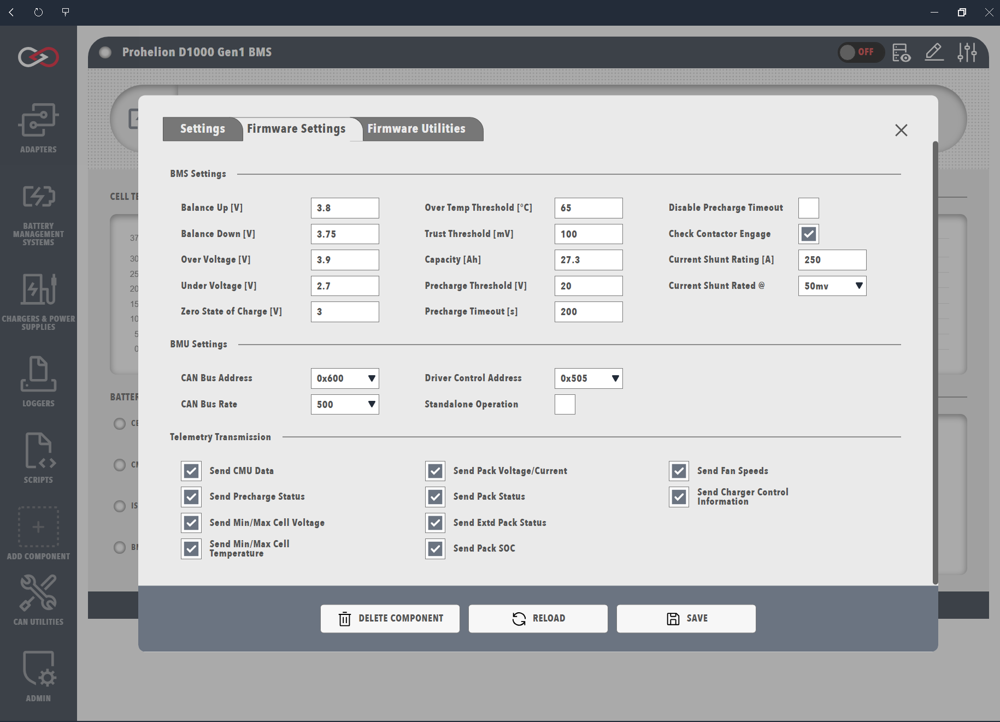

# Update BMU configuration and firmware

Change the firmware configuration of a Prohelion Battery Management Unit (BMU), unlock its Admin parameters, or flash its firmware, using the **Change Settings** button on the BMU dashboard.

## Before you begin

Add the BMU to a profile first, as described in [Prohelion BMU](index.md).
The **Firmware Settings** and **Firmware Utilities** tabs appear only when Profinity can reach the BMU on the CAN network and the BMU is in a state that accepts firmware changes.
If the tabs are missing, check that the CAN adapter status is green, the **Base Address** matches the BMU and the BMU is powered.

Unlocking the Admin parameters needs the **Modify components** permission and a firmware configuration key.
The Admin key is not published, so contact Prohelion if you believe you need it.
Flashing a Gen1 BMU needs a [CAN to Ethernet bridge](../../../../../Solar_Car_Racing/CAN_Ethernet_Bridge/index.md) or a [Prohelion Virtual CAN Bus Adapter](../../CAN_Bus_Protocols/Virtual_CAN_Adapter.md), and a Gen2 BMU can be flashed with any supported CAN adapter.

## Change the BMU configuration

!!! danger "Wrong firmware settings can damage the pack"
    Settings that do not match the pack can allow unsafe voltages or currents.
    Change a value only when the configuration parameters page for the firmware describes its purpose.

1. Open **Change Settings** on the BMU dashboard.
2. Select the **Firmware Settings** tab.
3. Change a setting.
   Profinity saves each setting to the device as you change it.

Each D1000 Gen2 parameter has a User or Admin permission level.
The Configuration Parameters pages in the table of models on the [BMU dashboard](BMU_Dashboard.md) page list these levels.
The M48 Gen1 parameters are on its Software Specifications page.
To check the change, reopen the **Firmware Settings** tab and confirm that the setting shows the new value.

<figure markdown>

<figcaption>Updating the BMU Firmware Config</figcaption>
</figure>

## Unlock administration firmware parameters

The D1000 Gen2, M48 Gen2 and C48 Gen2 make their Admin parameters available only while a session unlock is active.
The unlock is a **Firmware Configuration Key** entered in the **Firmware Configuration Key** row of the component settings.
Profinity holds the key for the sign-in session only and never saves it to the Profile.
Without an active session, Profinity works at the User permission level.

To unlock the Admin parameters, a user with the **Modify components** permission follows these steps.

1. Open **Change Settings** on the BMU dashboard.
2. On the **Prohelion BMU Settings** tab, in the **Firmware Configuration Key** row, select **Enter**.
3. Type the key.
   The key can be decimal or hexadecimal, from 0 to 65535.
4. Set the session duration in minutes.
   The duration defaults to 30 and accepts 1 to 1440 minutes.
5. Select **Apply**.
   The dialog reloads and the Admin parameters appear.
   The row shows **Session active** with the expiry time and the permission level that the key gives.

The row offers **Change** to enter a different key and **Clear** to end the session straight away.
The session also ends when the duration expires, when the user signs out and when Profinity restarts.
Each signed-in user holds a separate session.
After a session ends, the dialog reloads and the Admin parameters disappear.

## Flash the BMU firmware

1. Open **Change Settings** on the BMU dashboard.
2. Select the **Firmware Utilities** tab.
3. Run the **Update Firmware** action, and confirm the dialog that warns that the update writes firmware to the device and cannot be undone.
   A progress indicator shows the update.
4. If an error message appears, select its link to view the logs, and fix the problem they report.
   When the progress completes with no error, check the BMU dashboard to confirm that the BMU reports data.

The step-by-step procedure for Gen1 units, including the CAN bus requirements, is in the [M48 Gen1 Firmware Update Procedure](../../../../../Battery_Management_Systems/Prohelion_BMS_M48_Gen1/Firmware_update_procedure.md) in the hardware manual.
