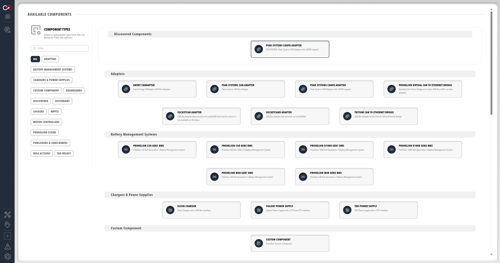

# CAN bus adapters

An adapter connects Profinity to a Controller Area Network (CAN) bus.
Profinity supports the following adapters.

| Adapter | Connection |
|---------|------------|
| [Prohelion and Tritium CAN to Ethernet bridges](../../../../Solar_Car_Racing/CAN_Ethernet_Bridge/index.md), listed as **Tritium Can to Ethernet Bridge** | Ethernet, over UDP or TCP |
| **Prohelion Virtual CAN to Ethernet Bridge**, covered on the [Prohelion Virtual CAN Bus Adapter](Virtual_CAN_Adapter.md) page | Ethernet, relaying to another adapter |
| SocketCANd, using the [socketcand](https://github.com/linux-can/socketcand) daemon | Ethernet, over TCP |
| [Peak CAN to USB Adapter](https://www.peak-system.com/PCAN-USB.199.0.html?&L=1), including a Peak adapter running CAN FD | USB |
| Ewert Energy CANdapter | USB (COM port) |
| Native [SocketCAN](https://docs.kernel.org/networking/can.html) | The local operating system, on Docker and Linux installs only |

Native SocketCAN is available when Profinity runs in [Docker](../../Installation/Docker_Installation.md) or on a Linux host, including a [Linux archive install](../../Installation/Linux_and_macOS_Archive_Installation.md), and is not available on Windows or macOS.
SocketCAN is a Linux kernel feature.
A Peak or CANdapter adapter that you plug into a Linux host also appears there as a SocketCAN interface, so on Linux use the SocketCAN adapter, or the SocketCANd adapter from another machine, instead of the Peak or CANdapter adapter.

Install the Peak driver before starting Profinity, because the Peak CAN to USB Adapter needs it.
Use the supplied Peak tools to confirm the adapter works, then add the adapter with Auto Discovery as normal.

Adapters are added in one of two ways, through Auto Discovery or manually.
The parameters that manual configuration asks for are in [CAN bus adapter settings](CAN_Bus_Adapter_Settings.md).

## Adapter auto discovery

Auto Discovery finds the supported CAN bus adapters that are visible to Profinity.
If an adapter is visible on the network but is not yet in the current [Profile](../../Getting_Started/Profiles.md), a **Discovered** category appears in the **ADD COMPONENT** window and lists every adapter that Profinity can currently see.
An adapter that is missing from the list has configuration issues that need [manual configuration](CAN_Bus_Adapter_Settings.md#adapter-manual-configuration), or is not discoverable.

<figure markdown>

<figcaption>Add an Adapter via AutoDiscovery</figcaption>
</figure>

If a CAN to Ethernet bridge does not appear in the **Discovered** category, refer to [If a CAN to Ethernet bridge is not found](CAN_Bus_Adapter_Troubleshooting.md#if-a-can-to-ethernet-bridge-is-not-found).
For the adapter status colours and the bit rate that every CAN device must share, refer to [CAN bus adapter troubleshooting](CAN_Bus_Adapter_Troubleshooting.md).

For the steps to connect a CAN bus, refer to [How to Connect to CAN Bus](../../How_To_Guides/Connect_to_CAN_Bus.md).
