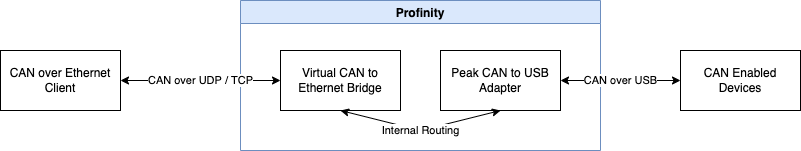

# Prohelion Virtual CAN Bus Adapter

The Prohelion Virtual CAN Bus Adapter is added to a [Profile](../../Getting_Started/Profiles.md) as the **Prohelion Virtual CAN to Ethernet Bridge** component.
It relays Controller Area Network (CAN) traffic between the other CAN adapters in the Profile and any client that connects to it.
To those clients, it looks like a Tritium or Prohelion [CAN to Ethernet bridge](../../../../Solar_Car_Racing/CAN_Ethernet_Bridge/index.md).
Use it to run tools that were developed for the Tritium and Prohelion bridges, such as the bridge configuration and firmware tools, when no physical bridge is present.

In the Virtual Adapter topology, a client connects to the Virtual Adapter, which works together with a Peak USB adapter to reach the physical CAN network.
Traffic is routed in both directions.

<figure markdown>

<figcaption>Virtual Adapter</figcaption>
</figure>

A different CAN adapter, such as a SocketCAN or Peak USB adapter, connects Profinity to the CAN network.
The Virtual Adapter has no setting that selects its partner adapter.
It forwards traffic between itself and every other active CAN adapter in the Profile.
Add the [Peak or SocketCAN adapter](CAN_Bus_Adapters/index.md) to the same Profile first.

## Virtual adapter settings

To relay traffic, add a Virtual Adapter to the Profile after the adapter for the physical CAN network, and set the parameters in the following table.

| Parameter | Description | Default |
|-----------|-------------|---------|
| **Network Protocol** | `TCP` or `UDP`. UDP is always available, even when TCP is running. | `TCP` |
| **Bridge Protocol Version** | `V1`, `V2` or `All`. `All` speaks both protocols. | `All` |
| **Network Adapter** | The network interface on which the Virtual Bridge runs. | The first available multicast interface |
| **Bus Number** | The bus number of the bridge. Profinity limits it to 0 to 13 for `V1` or `All`, because the version 1 protocol allows only a 4-bit bus number. | 13 |
| **UDP TTL** | The time to live of the UDP packets that Profinity transmits, from 1 to 1024. | 128 |
| **Auto Connect** | Enables the adapter when the profile loads. Refer to [Connections and reconnecting](../Connections_and_Reconnecting.md). | On |

The Virtual CAN Bridge runs inside Profinity, so the operating system of that machine sets its IP address.
The CAN Bridge Config tools and Profinity cannot change the address remotely.
Profinity can only select the network interface.

!!! warning "Two bridges with the same bus number relay data between each other"
    Two bridges with the same bus number on one network relay data from one bridge to the other.
    This joins two separate CAN bus networks into one virtual bus over Ethernet.
    Two bridges on the same CAN bus that are also on the same Ethernet network form a cyclic network.
    In a cyclic network, every message is resent indefinitely until the CAN bus is overloaded.
    Give each bridge a unique bus number unless you are joining two buses deliberately.
    Refer to [Network Topologies](../../../../Solar_Car_Racing/CAN_Ethernet_Bridge/User_Manual/Network_Topologies.md) and the [bus number guidance](CAN_Bus_Adapters/CAN_Bus_Adapter_Settings.md#tritium-can-to-ethernet-bridge) for the physical bridge.

If a client cannot connect, check these things:

- The **Network Adapter** is the interface that the client can reach.
- The client speaks a protocol version covered by the **Bridge Protocol Version**.

For how the Virtual Bridge speaks both the V1 and V2 bridge protocols and serves several clients at once, refer to [Virtual CAN adapter protocol and client support](Virtual_CAN_Adapter_Protocols.md).

For the physical adapters that the Virtual Adapter relays to, refer to [CAN bus adapters](CAN_Bus_Adapters/index.md).
For the bridge that the Virtual Adapter imitates, refer to the [CAN to Ethernet bridge documentation](../../../../Solar_Car_Racing/CAN_Ethernet_Bridge/User_Manual/index.md).
