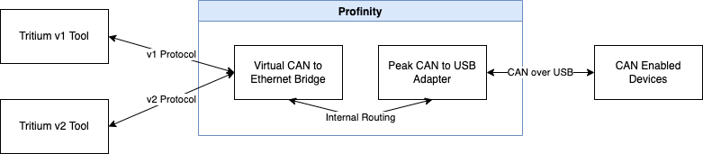
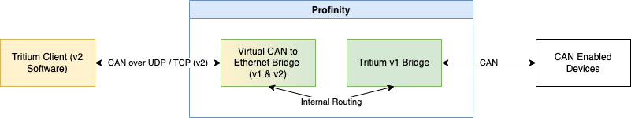
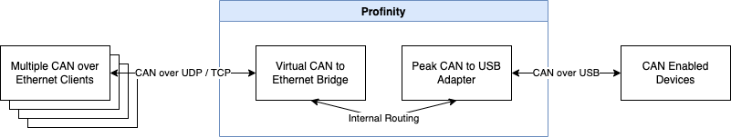

# Virtual CAN adapter protocol and client support

The Virtual CAN Bridge in Profinity speaks both the V1 and V2 Tritium and Prohelion bridge protocols, and it accepts several clients at once.
These two abilities let it replace a physical CAN to Ethernet bridge in cases where that bridge is limited by its firmware version or by its single TCP connection.
To add the adapter and set it up, refer to [Prohelion Virtual CAN Bus Adapter](Virtual_CAN_Adapter.md).

## Multi-protocol support

Tritium and Prohelion CAN to Ethernet bridges have two major firmware releases, V1 and V2.
The two releases speak different protocols.
They also differ in the width of the bus identifier: 4 bits for V1 and 16 bits for V2, as set out in [CAN-UDP Bridging](../../../../Solar_Car_Racing/CAN_Ethernet_Bridge/Ethernet_Interface/CAN_UDP_Bridging.md).
Refreshing the firmware of a V1 bridge updates it to V2, but many bridges remain on V1 firmware.

Tritium software tools shipped in either a V1 or a V2 variant.
A V1 tool cannot talk to a V2 bridge.
The [Fundamentals](../../../../Solar_Car_Racing/CAN_Ethernet_Bridge/Fundamentals.md) page recommends using the tools that match the bridge version.

The Virtual Bridge resolves this by speaking both protocols at once, which is the `All` option of the **Bridge Protocol Version** setting.
It presents itself as two bridges, one V1 and one V2.
A tool then finds the bridge version that it can speak to.

<figure markdown>

<figcaption>Multi-Protocol Support</figcaption>
</figure>

The Virtual Bridge also lets a physical V1 bridge talk to tools designed for the V2 protocol.
In this scenario, the Virtual Adapter sits in front of a Tritium V1 bridge and routes its traffic.
The bridge can then communicate with tools that support the V2 protocol.

<figure markdown>

<figcaption>V1 and V2 Protocol Support</figcaption>
</figure>

## Multi-client support {#multi-client-tcp-support}

The physical bridge handles a single TCP connection at a time, so a second TCP connection fails.
UDP is the alternative for several clients.
The Virtual Bridge handles multiple clients at once.
It can therefore act as a TCP CAN bridge server, where many clients connect over TCP and keep the connection open to receive CAN data.
This suits real-time CAN monitoring in remote locations.

<figure markdown>

<figcaption>Multi-Client Support</figcaption>
</figure>

## Where to go next

To set the protocol version, the network protocol, and the other settings, refer to [Prohelion Virtual CAN Bus Adapter](Virtual_CAN_Adapter.md).
For the bridge that the Virtual Adapter imitates, refer to the [CAN to Ethernet bridge documentation](../../../../Solar_Car_Racing/CAN_Ethernet_Bridge/User_Manual/index.md).
