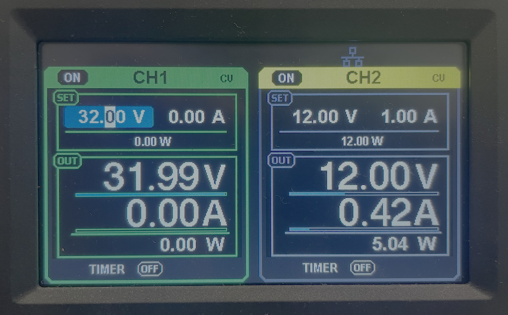
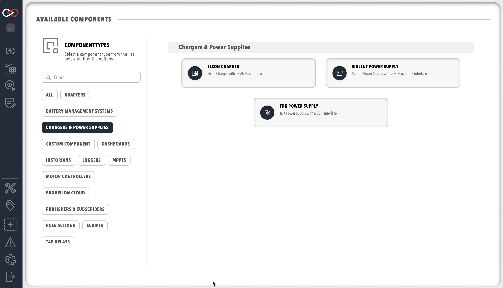

# Charger components

Profinity charges a pack by controlling a charger and a Prohelion Battery Management System (BMS) together.
The charger must be one that Profinity can control remotely.
A BMS that can only switch a charger on and off gives slow or poor balancing of the cells, as the [D1000 Gen1 Charger Control](../../../../Battery_Management_Systems/Prohelion_BMS_D1000_Gen1/Operation/Charging.md) documentation describes.
The D1000 Gen1 Battery Management Unit (BMU) raises the charge current setpoint until the highest cell voltage reaches the Balance Threshold and then reduces it to hold that voltage.
On a D1000 Gen2 the BMS hardware handles charging, so refer to the [D1000 Gen2 documentation](../../../../Battery_Management_Systems/Prohelion_BMS_D1000_Gen2/index.md) for how charging is managed there.

Profinity supports three charger types.
A [Prohelion BMS](../Battery_Management_Systems/Prohelion_BMU/index.md) in the same Profile supplies the pack data.
A user needs the **Control charging** permission to see the charging controls (refer to [Roles and permissions](../../Administration/Users_and_Access/Roles_and_Permissions.md)).

<figure markdown>

<figcaption>A Prohelion BMS in the Profile supplies the pack data, and the charger component controls the charger, over TCP for a TDK or Siglent supply and over CAN for an Elcon charger</figcaption>
</figure>

<figure markdown>

<figcaption>Siglent Charger</figcaption>
</figure>

## Supported chargers

- **TDK Power Supply** controls TDK programmable power supplies such as the Genesys family using Standard Commands for Programmable Instruments (SCPI) over TCP.
  A TDK supply that has only a serial interface needs a TCP to serial converter between it and the network, so that Profinity can reach it over TCP.
- **Elcon Charger** controls an Elcon charger over CAN, so the charger must be connected to a CAN adapter that is already configured in the Profile.
- **Siglent Power Supply** controls Siglent programmable power supplies that accept SCPI commands over TCP, such as the SPD3303X-E, which suits desktop testing.

## Add a charger to the Profile

Add a charger from **ADD COMPONENT** in the same way as any other device (refer to [How to add a component to your profile](../../How_To_Guides/Add_Component_to_Profile.md)).
The Profile must also contain a Prohelion BMS with **Control Pack** switched on.
**Control Pack** is off by default, and Profinity can engage and disengage the pack, which a charge needs, only when it is on.
Once the charger is added it appears under **Chargers & Power Supplies** in the main menu with its own dashboard.

<figure markdown>

<figcaption>Add a Charger</figcaption>
</figure>

[Charger settings](Charger_Settings.md) lists the limits and communication settings that each charger asks for.
To run a charge from the dashboard, refer to [Start a charge](Start_a_Charge.md).
For the messages and faults that stop a charge, refer to [Charging troubleshooting](Charging_Troubleshooting.md).
