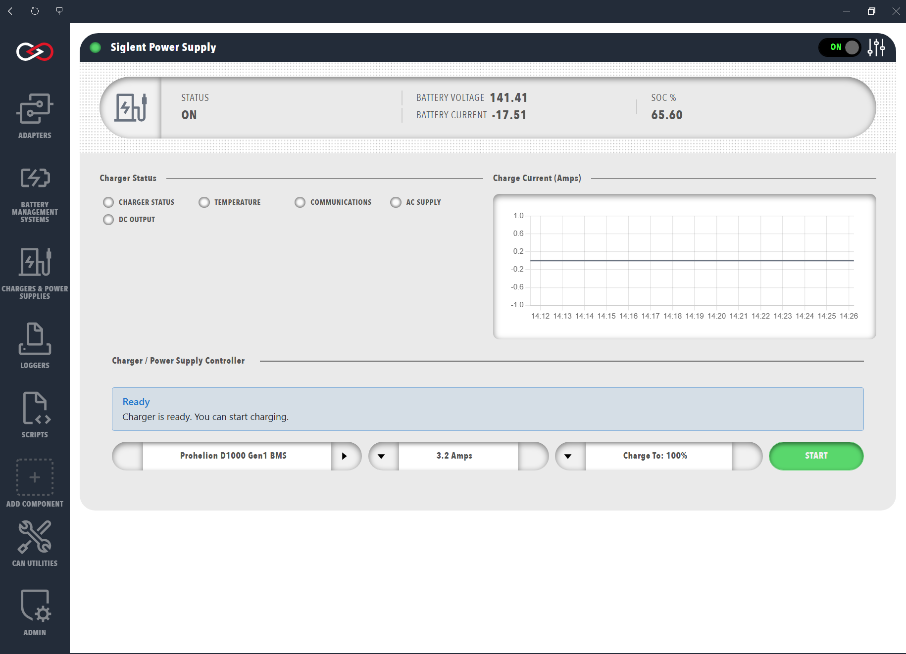

# Start a charge

Start a charge from the dashboard of a charger component that is in the same Profile as a Prohelion Battery Management System (BMS) with **Control Pack** switched on (refer to [Charger components](Charger_Components.md)).

Open the charger from **Chargers & Power Supplies**.
The dashboard shows the **Charger Status** lamps (**CHARGER STATUS**, **TEMPERATURE**, **COMMUNICATIONS**, **AC SUPPLY** and **DC OUTPUT**), the **Charge Current (Amps)** chart and, for a user with the **Control charging** permission, the **Charger / Power Supply Controller** panel.
With **Auto Connect** off on a TDK or Siglent supply, connect the charger first (refer to [Connections and reconnecting](../Connections_and_Reconnecting.md)).
Once it is connected, the message in the **Charger / Power Supply Controller** panel shows **Ready** with the text "Charger is ready. You can start charging."

The panel has four controls, from left to right:

- The battery selector chooses which Prohelion BMS to charge when the Profile has more than one.
- The current control sets the charge current in amps, in steps of 0.5 A, up to the maximum the screen allows.
- **Charge To** sets the state of charge, in percent, at which charging stops.
- **START** begins the charge and becomes **STOP** while charging is running.

<figure markdown>

<figcaption>Start the Charge</figcaption>
</figure>

To start a charge, follow these steps.

1. Select the battery to charge.
2. Set the maximum charge current, at or below the cell manufacturer's charge limit.
3. Set **Charge To** to the state of charge at which charging stops.
4. Select **START**.
   The button changes to **STOP**.
5. Check that the charge has started.
   The message in the panel shows **Charging Status** with the charging current and voltage, for example "Charging at 5.0A • 280.4V • On".
   The **DC OUTPUT** lamp is green, and the **Charge Current (Amps)** chart rises above zero.
   If the message stays on **Ready** or **START** returns, refer to [Charging troubleshooting](Charging_Troubleshooting.md).

Selecting **START** engages the pack itself, so there is no separate step to close the contactors.
Profinity runs these stages in order:

1. Set the charger to the estimated pack voltage.
2. Check that the charger is ready for precharge.
3. Engage the pack through the BMS.
4. Start the charge.

If any stage fails, Profinity stops the charge and disengages the pack.
Selecting **STOP** stops the charger and disengages the pack.

!!! warning "Set the supply and charge limits before charging"
    A **Supply Current Limit** above what the wall circuit is rated for can overload that circuit.
    A charge current above the cell manufacturer's recommended charge current can damage the battery.
    Set the limits described in [Charger settings](Charger_Settings.md) before a first charge.

If a charge does not start, refer to [Charging troubleshooting](Charging_Troubleshooting.md).
