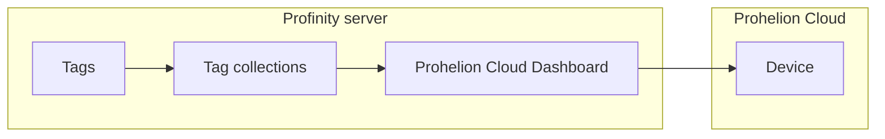

# Prohelion Cloud Dashboard

The Prohelion Cloud Dashboard component publishes the values of selected [tag collections](../../Tags/Collections/index.md) from a Profile to a device in Prohelion Cloud at a fixed interval, where they can be viewed on cloud-hosted dashboards.
Prohelion Cloud is an Internet of Things (IoT) platform that stores the data reported by field devices and lets an organisation monitor and manage those devices and assets remotely.

[Rules](../../Tags/index.md), [Dashboards](../../Customising_Profinity/Dashboards/index.md), and [Tag Relays](../Tag_Relays/index.md) cover many of the functions that Prohelion Cloud provides, so new deployments are usually better served by those features.
The Cloud Dashboard remains available for existing customers.

<figure markdown>

<figcaption>The Prohelion Cloud Dashboard component sends tag collections from the Profinity server to a device in Prohelion Cloud over Message Queuing Telemetry Transport (MQTT)</figcaption>
</figure>

!!! info "Licence required"
    The Prohelion Cloud Dashboard component requires the **Data Relay** licensed feature, included in the **Server** and **Enterprise** editions.
    Without it the component is unavailable.
    Refer to [Licensing](../../Licensing.md) for what each edition includes.

## Get access to Prohelion Cloud

Access to Prohelion Cloud is by request.
Raise an access request in the [Prohelion Support Portal](https://prohelion.atlassian.net/servicedesk/customer/portals).
Prohelion support assists with device onboarding, dashboard set-up and integration with existing systems.
The component needs an access token and a device ID for the device in Prohelion Cloud.
Both are shown in your account on the Prohelion Cloud dashboard, so have both ready before you add the component.

## Add the component

Only one Prohelion Cloud Dashboard component can exist in a Profile.
Add it from **ADD COMPONENT** (refer to [How to add a component to your profile](../../How_To_Guides/Add_Component_to_Profile.md)) and choose **Prohelion Cloud Dashboard**.
Complete the settings in the following table.

| Setting | Default | Notes |
|---|---|---|
| **Name** | Prohelion Cloud Dashboard | The name shown in the Profile. |
| **Prohelion Access Token** | None | The access token for the device. Required, and stored encrypted. |
| **Prohelion Device ID** | None | The device ID in Prohelion Cloud. Required. |
| **Update Interval (Seconds)** | 60 | Seconds between samples sent to Prohelion Cloud, from 1 to 86400. |
| **Collections** | None | The tag collections to send. At least one is required. |
| **Logging mode** | Snapshot | Chooses between **Snapshot**, **On Change** and **Everything**. Refer to [Logging modes](../Logging_Modes.md) for what each mode sends. |
| **Auto Connect** | On | Starts sending when the Profile loads. Refer to [Connections and reconnecting](../Connections_and_Reconnecting.md). |

The component does not start until you select a collection.
It connects out from the Profinity server to Prohelion Cloud using MQTT on TCP port 1883, so the firewall or network must allow that outbound connection.
No inbound port is needed.

## Troubleshooting

The component cannot be saved without an access token and a device ID.
It reports "You must provide a device access token." or "You must provide a device ID." when either is empty.

If the component is added but no data reaches Prohelion Cloud, check these things:

- The Profile has the **Data Relay** feature licensed.
- The token and device ID match the device in Prohelion Cloud.
- At least one collection is selected.
- Outbound traffic on port 1883 is allowed.

Then read the Profinity logs for the connection error.
For the shared settings of MQTT components, refer to [MQTT Publisher](../Publishers_and_Subscribers/MQTT_Publisher.md).
