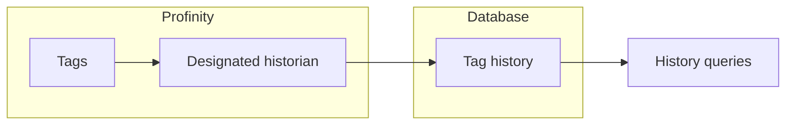

# Designated historian

More than one [historian](index.md) can write in the same profile, but exactly one of them answers long-range tag and history queries.
Enable **Designated tag historian reader** on that one component and leave it disabled on the others.

<figure markdown>

<figcaption>Tag history is written by each historian, and long-range history queries are answered from the store of the historian that has Designated tag historian reader enabled</figcaption>
</figure>

If no component is designated, or more than one is, Profinity has no store to read history from and does not answer long-range queries.
An InfluxDB historian is designated only while its **Allow Retrieval** setting is also enabled.
The setting is described on the page of each historian: [InfluxDB historians](InfluxDB_Historians.md) and [TAG SQL Historian](TAG_SQL_Historian.md).

To set up logging, refer to [How to configure data logging](../../How_To_Guides/Configure_Data_Logging.md).
