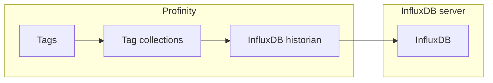

# InfluxDB historians

The **InfluxDB v2 Historian** and the **InfluxDB v3 Historian** write the values of the tags in the [collections](../../Tags/Collections/index.md) you select to an InfluxDB server.
They also allow that history to be read back through the APIs.
They sit in the **Historians** category.
Each recorded value belongs to a [tag](../../Tags/index.md), identified by its [tag tree path](../../Tags/Selecting_Tags/Tag_Tree_Path.md).

Use the **InfluxDB v2 Historian** if your InfluxDB server stores data in buckets that belong to an organisation.
Use the **InfluxDB v3 Historian** if your InfluxDB server stores data in a single database.
Both authenticate with a token.
InfluxDB Cloud is supported as well as a server you host: enter the Cloud URL and a token in the same way.

<figure markdown>

<figcaption>An InfluxDB historian writes the tags in the selected collections to the InfluxDB server, and the APIs read the history back</figcaption>
</figure>

!!! info "Licence required"
    The InfluxDB v2 Historian and the InfluxDB v3 Historian require the **Historians** licensed feature. Refer to [Licensing](../../Licensing.md) for the editions that include them.

Check which InfluxDB version your server runs before adding a component.
InfluxDB v1, v2 and v3 are incompatible, and a component only connects to the version it was built for, so a mismatch causes connection failures.
An InfluxDB v1 server needs the [InfluxDB v1 Logger](../Loggers/InfluxDB_v1_Logger.md), which is a logger rather than a historian.

## Adding an InfluxDB historian

Install InfluxDB v2 or v3 and confirm that it is running, then:

1. Add an **InfluxDB v2 Historian** or an **InfluxDB v3 Historian** to your profile from the **Historians** category.
2. For the v2 historian, enter **InfluxDB Bucket**, **InfluxDB Organisation** and **InfluxDB Token**.
3. For the v3 historian, enter **InfluxDB Database** and **InfluxDB Token**.
4. Under **Collections**, add at least one tag collection. The component does not start until one is configured.
5. In **Influx Server URL**, enter the endpoint URL of your InfluxDB server, or keep the default `http://localhost:8086/`.

Settings cannot be saved while a required field is empty.
Once the historian is running and has connected, its status shows **On**, and your data appears in InfluxDB after the first **Update Interval (Seconds)**.
If it cannot reach InfluxDB, its status shows **Error** until the connection succeeds.

The first three settings identify where the data is stored, and differ between the two historians.

| Setting | Applies to | Default | Purpose |
|---|---|---|---|
| **InfluxDB Bucket** | InfluxDB v2 Historian | None | The InfluxDB bucket that the data is stored in. Required. |
| **InfluxDB Organisation** | InfluxDB v2 Historian | None | The InfluxDB organisation that owns the bucket. Required. |
| **InfluxDB Database** | InfluxDB v3 Historian | None | The InfluxDB v3 database that the data is stored in. Required. |

The remaining settings are the same on both historians.

| Setting | Default | Purpose |
|---|---|---|
| **InfluxDB Token** | None | The security token of the InfluxDB user that Profinity connects as. Required, and stored encrypted. |
| **Influx Server URL** | `http://localhost:8086/` | The endpoint URL that InfluxDB is running on. |
| **Dashboard URL** | Blank | The URL of the InfluxDB dashboard. Optional, and leaving it blank shows no dashboard link. |
| **InfluxDB Health Check** | On | Checks the health of the InfluxDB server when the component connects and about every 30 seconds while it runs. Turn it off for InfluxDB Cloud, which does not support the check. |
| **Collections** | None | The tag collections whose tags are recorded. At least one collection must be configured before the component starts. |
| **Update Interval (Seconds)** | 10 | How often data is sent, from 1 to 86400 seconds. |
| **Logging mode** | `Snapshot` | Sets what is sent on each interval: `Snapshot`, `On Change` or `Everything`. Refer to [Logging modes](../Logging_Modes.md). |
| **Auto Connect** | On | Starts the historian when the profile loads. When off, start it with **Start Logger**. Refer to [Connections and reconnecting](../Connections_and_Reconnecting.md). |
| **Allow Retrieval** | On | Allows data to be retrieved through this historian using the APIs. |
| **Designated tag historian reader** | Off | Makes this historian the store that long-range history queries are read from. Enable it on one component only, and only while **Allow Retrieval** is on. Refer to [Designated historian](Designated_Historian.md). |

## What is stored

Every sample is written with its quality in a `quality` field.
A Good sample also has a `value` field, and a Stale sample keeps its last `value` with quality Stale.
A tag that is Unavailable or Bad is written as a gap, with a `quality` field and no `value`.
A chart can then show the gap instead of an invented reading.
Only tags that hold a number are written, and a query for readings should ask for the `value` field.

Each sample is stored as one point in a measurement named after the profile.
For example, a motor speed signal on a component called `Inverter` is stored like this:

| Part | Example | Meaning |
|---|---|---|
| Tag `component` | `Inverter` | The component that owns the tag. |
| Tag `message` | `Status` | The CAN message the signal belongs to. |
| Tag `signal` | `Speed` | The signal name. |
| Tag `full_tag_id` | `Inverter/DBC/Status/Speed` | The tag's path when the sample was written. |
| Field `value` | `23.4` | The reading. |
| Field `quality` | `Good` | The quality of the reading. |

In InfluxDB line protocol, that point is:

```text
MyProfile,profile=MyProfile,component=Inverter,message=Status,signal=Speed,full_tag_id=Inverter/DBC/Status/Speed value=23.4,quality="Good" 1792315200000000000
```

The `component`, `message` and `signal` tags identify the tag in the history.
Characters other than letters and digits in these names are replaced with underscores.

For the full procedure to send data to InfluxDB Cloud, refer to [How to log data to InfluxDB](../../How_To_Guides/Log_Data_to_InfluxDB.md).

## If data does not arrive

The Profinity system logs name the cause, and [Logs](../../Administration/Logs_Config.md) describes where to read them.
When the component cannot connect, it logs one error for the outage, in the form `<component name>: could not connect (<reason>). Retrying every 5 s.`
The reason tells you what to check:

| Reason in the log | Meaning |
|---|---|
| `credential validation failed (likely an invalid token)` | The token is wrong or lacks access. |
| `the health check failed (InfluxDB Cloud has none; switch Health Check off in the settings)` | The server did not answer the health check. Turn **InfluxDB Health Check** off if you use InfluxDB Cloud. |
| Any other text | The connection failed for another reason, and the text is the underlying error. Check the **Influx Server URL** first. |

To add a historian and start it, refer to [How to configure data logging](../../How_To_Guides/Configure_Data_Logging.md).
For an InfluxDB v1 server, refer to [InfluxDB v1 Logger](../Loggers/InfluxDB_v1_Logger.md).
