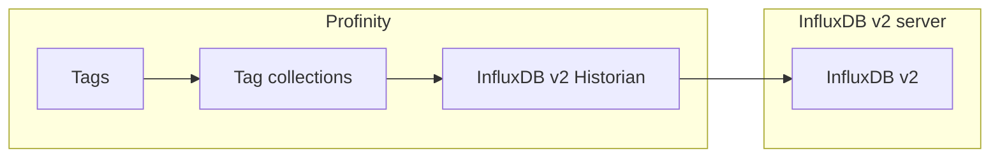

# InfluxDB v2 Historian

The **InfluxDB v2 Historian** writes the values of the tags in the [collections](../../Tags/Collections.md) you select to an InfluxDB v2 server, and allows that history to be read back out through the APIs.
It sits in the **Historians** category.
Each recorded value belongs to a [tag](../../Tags/index.md), identified by its [tag tree path](../../Tags/Tag_Tree_Path.md).

Use this component if your InfluxDB server stores data in buckets that belong to an organisation.
It authenticates with a token.
InfluxDB Cloud is supported as well as a server you host: enter the Cloud URL and a token in the same way.

<figure markdown>

<figcaption>The InfluxDB v2 Historian writes the tags in the selected collections to the InfluxDB v2 server, and the APIs read the history back</figcaption>
</figure>

!!! info "Licence required"
    The InfluxDB v2 Historian requires the **Historians** licensed feature. Refer to [Licensing](../../Administration/Licensing.md) for the editions that include it.

Use the component only with an InfluxDB v2 server.
The component type must match the InfluxDB version, and a mismatch causes connection failures.
The [InfluxDB v3 Historian](InfluxDB_v3_Historian.md) is documented separately, and [Historians](index.md#which-influxdb-component-do-i-need) explains how to choose.

## Adding an InfluxDB v2 Historian

To start recording, install InfluxDB v2 and confirm that it is running, then:

1. Add an **InfluxDB v2 Historian** to your profile from the **Historians** category.
2. Enter **InfluxDB Bucket**, **InfluxDB Organisation** and **InfluxDB Token**.
3. Under **Collections**, add at least one tag collection. The component does not start until one is configured.
4. In **Influx Server URL**, enter the endpoint URL that InfluxDB is running on, or keep the default `http://localhost:8086/`.

Settings cannot be saved while a required field is empty.

| Setting | Default | Purpose |
|---|---|---|
| **InfluxDB Bucket** | None | The InfluxDB bucket that the data is stored in. Required. |
| **InfluxDB Organisation** | None | The InfluxDB organisation that owns the bucket. Required. |
| **InfluxDB Token** | None | The security token of the InfluxDB user that Profinity connects as. Required, and stored encrypted. |
| **Influx Server URL** | `http://localhost:8086/` | The endpoint URL that InfluxDB is running on. |
| **Dashboard URL** | Blank | The URL of the InfluxDB dashboard. Optional, and leaving it blank shows no dashboard link. |
| **InfluxDB Health Check** | On | Checks the health of the InfluxDB server when the component connects. Turn it off for InfluxDB Cloud. |
| **Collections** | None | The tag collections whose tags are recorded. At least one collection must be configured before the component starts. |
| **Logging Interval (Sec)** | 10 | The interval, in seconds, at which data is sent. The minimum is 1. |
| **Logging mode** | `Snapshot` | Sets what is sent on each interval: `Snapshot`, `On Change` or `Everything`. Refer to [Logging Modes](../Loggers/InfluxDB_Prometheus_Logger.md#logging-modes). |
| **Allow Retrieval** | On | Allows data to be retrieved through this historian using the APIs. |
| **Designated tag historian reader** | Off | Makes this historian the store that long-range tag and history queries are read from. Enable it on one component in the profile only, and it takes effect only while **Allow Retrieval** is on. Refer to [Historians](index.md#designating-the-historian-that-is-read-from). |

InfluxDB Cloud does not support the InfluxDB Health Check API, so turn off **InfluxDB Health Check** when InfluxDB Cloud stores your data.
For the full procedure, refer to [How to Log Data to the Cloud (InfluxDB)](../../How_To_Guides/Log_Data_to_Cloud_Influx.md).

## If data does not arrive

The [Profinity System Logs](../../Getting_Started/Profinity_Log.md) name the cause.

| Log message | Meaning |
|---|---|
| `Credential validation failed` (likely invalid token) | The token is wrong or lacks access. |
| `Health check failed` | The server did not answer the health endpoint. Turn **InfluxDB Health Check** off for InfluxDB Cloud. |
| `Failed to start the InfluxDB logger` | The connection failed for another reason. Check the **Influx Server URL** first. |

For the steps to set up data logging, refer to [How to Configure Data Logging](../../How_To_Guides/Configure_Data_Logging.md).
InfluxDB v1 servers use the **InfluxDB v1 Logger**, which is described in [InfluxDB and Prometheus Logging](../Loggers/InfluxDB_Prometheus_Logger.md).
