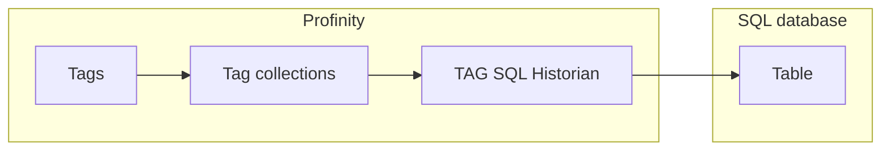

# TAG SQL Historian

The **TAG SQL Historian** writes the values of the tags in the [collections](../../Tags/Collections.md) you select to a table in a SQL database, and allows that history to be read back out through the APIs.
It sits in the **Historians** category.
Use it when the history needs to live in a database that you already operate and query with ordinary SQL tools, rather than in a time-series database such as [InfluxDB](../Loggers/InfluxDB_v1_Logger.md).
Each row the historian writes belongs to one [tag](../../Tags/index.md), identified by its [tag tree path](../../Tags/Tag_Tree_Path.md).

<figure markdown>

<figcaption>The TAG SQL Historian writes the tags in the selected collections to a table in the SQL database, and the APIs read the history back</figcaption>
</figure>

!!! info "Licence required"
    The TAG SQL Historian requires the **Historians** licensed feature. Refer to [Licensing](../../Administration/Licensing.md) for the editions that include it.

## Adding the historian {#adding-a-tag-sql-historian}

To start recording, add the component and point it at a database:

1. Add a **TAG SQL Historian** to your profile from the **Historians** category.
2. Choose the **Database Provider** and enter its **Connection String**.
3. Under **Collections**, add at least one tag collection. The component does not start until one is configured.
4. Save the settings. With **Auto Create Table** on, the historian creates the table when it starts.

The following tables describe every setting.

### Connection settings

| Setting | Purpose |
|---|---|
| **Database Provider** | The SQL engine to connect to: **SQLite**, **SQL Server / Azure SQL**, **PostgreSQL**, **MySQL** or **Oracle**. Defaults to SQLite. |
| **Connection String** | The connection string for the chosen database provider, in that provider's own format. Required, and stored encrypted at rest. |
| **Table Name** | The table the historian writes rows to, which may contain letters, digits, and underscores only and cannot start with a digit. Defaults to `TagChangeLog`. |
| **Auto Create Table** | Creates the table when the historian starts, if it does not already exist. Enabled by default. |

### Logger settings

| Setting | Purpose |
|---|---|
| **Collections** | The tag collections whose tags are recorded. |
| **Logging mode** | Chooses between **Snapshot**, **On Change** and **Everything**. Defaults to Snapshot. Refer to [Logging modes](../Logging_Modes.md) for what each mode writes. |
| **Auto Connect** | On by default. Starts the historian when the profile is loaded. When off, start it with **Start Logger**. |
| **Update Interval (Seconds)** | The interval that controls snapshot timing, or how often changes and samples are flushed to the database. Defaults to 10, and accepts 1 to 86400. |
| **Designated tag historian reader** | Makes this historian the store that long-range tag and history queries are read from. Enable it on one component in the profile only. Refer to [Historians](index.md#designating-the-historian-that-is-read-from). |

## Table layout

Every sample is written with its quality. A Stale sample keeps its last value, and a tag that is Unavailable or Bad is written with its quality and an empty value, so the table shows the gap.

When **Auto Create Table** is enabled the historian creates a table with the following columns, and the names are the same on every provider.

| Column | Contents |
|---|---|
| `Id` | An automatically generated row identifier. |
| `RecvTime` | The time the value was received. |
| `TagId` | The path of the tag. |
| `ValueType` | The data type of the value. |
| `Value` | The recorded value. |
| `UtcTimestamp` | The UTC timestamp of the sample. |
| `Quality` | The data quality of the sample: Good, Stale, Unavailable or Bad. |
| `Reason` | Why the sample was recorded. |
| `Message` | An optional message. |

For example, a motor speed tag is stored as this row:

| Column | Example |
|---|---|
| `Id` | `1` |
| `RecvTime` | `2026-10-18T09:15:02.1234567+10:00` |
| `TagId` | `Inverter/DBC/Status/Speed` |
| `ValueType` | `Double` |
| `Value` | `23.4` |
| `UtcTimestamp` | `2026-10-18T09:15:02.0000000Z` |
| `Quality` | `Good` |
| `Reason` | `ok` |
| `Message` | empty |

A row for a tag that is Unavailable or Bad has the same layout with an empty `ValueType` and `Value`, and its `Quality` says why there is no reading.

The columns follow the same field set as the tag change file logger described in [Tag file and SFTP loggers](../Loggers/Tag_File_and_SFTP_Loggers.md), so history written by either can be interpreted in the same way.
If you create the table yourself, disable **Auto Create Table** and make sure the account in the connection string can insert into and read from it.

## Example connection strings

The connection string uses the format of the chosen provider.
The examples use placeholder names and passwords.

| Provider | Example |
|---|---|
| SQLite | `Data Source=/var/lib/prohelion/profinity/history.db`. SQLite creates the file at the path you give, so use a full path to a folder the Profinity service can write to. |
| SQL Server / Azure SQL | `Server=dbhost,1433;Database=Profinity;User Id=profinity;Password=<password>;Encrypt=True` |
| PostgreSQL | `Host=dbhost;Port=5432;Database=profinity;Username=profinity;Password=<password>` |
| MySQL | `Server=dbhost;Port=3306;Database=profinity;User ID=profinity;Password=<password>` |
| Oracle | `User Id=profinity;Password=<password>;Data Source=dbhost:1521/ORCLPDB1` |

The account in the connection string needs permission to insert into and select from the table.
With **Auto Create Table** on, it also needs permission to create the table, and you can remove that permission after the first start.

## If the historian does not start

Settings cannot be saved without a connection string (`You must provide a connection string for the database.`) or with an invalid table name (`Table name must use letters, digits, and underscore only, and cannot start with a digit.`).

If the settings save but no rows arrive, the Profinity system logs (refer to [Logs](../../Administration/Logs_Config.md)) show one of two messages:

- The component name followed by `could not connect` and the reason, for a connection that failed. The historian shows **Error** and retries every 5 seconds until the database is reachable.
- `Failed to write to the` followed by the component name, for a failed write.

Check the connection string, that the database is reachable from the Profinity server and that the account can write to the table.

!!! warning "Moving a component starts a new history in this historian"
    This historian records history under the tag's path, so moving a component changes its tag paths and the history recorded under the old paths is not carried across. Queries for the new path return a new series with no earlier points.
    The InfluxDB historians and loggers and the Prometheus logger identify a tag by its component, message and signal instead, so their history carries on after a move. Refer to [Change the path on a deployed component](../../Tags/Nest_a_Component_in_the_Tag_Tree.md#change-the-path-on-a-deployed-component).

For the steps to set up data logging, refer to [How to Configure Data Logging](../../How_To_Guides/Configure_Data_Logging.md).
