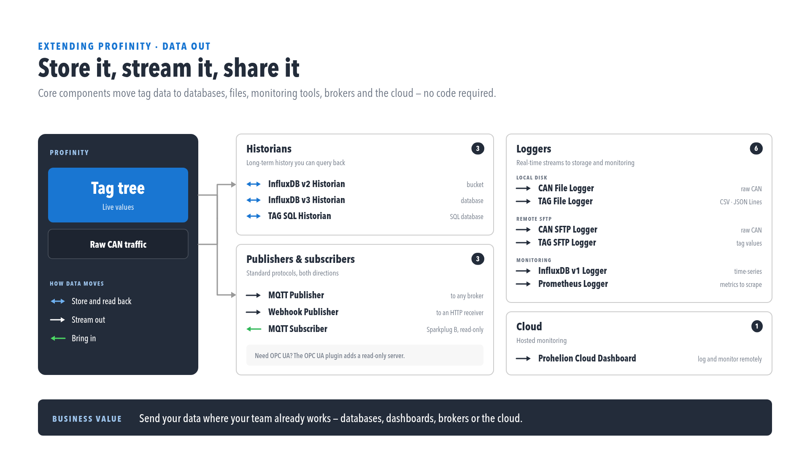

# Historians

A **historian** is a logging component that writes the history of your [tags](../../Tags/index.md) to a database.
Unlike a [logger](../Loggers/index.md), it also allows that history to be read back through the APIs.
[Dashboards](../../Customising_Profinity/Dashboards/index.md), trend charts and integrations that ask for long-range tag history are answered from the historian, so a profile that needs more than the recent in-memory values needs one.
Each historian selects the tags it records through [collections](../../Tags/Collections/index.md), and requires the **Historians** licensed feature, included in the **Desktop**, **Server** and **Enterprise** editions.
[Licensing](../../Licensing.md) shows whether it is available on your instance.

<figure markdown>

<figcaption>Data out of Profinity. Historians (InfluxDB v2, InfluxDB v3, TAG SQL) store and read data back.
Publishers and subscribers (Message Queuing Telemetry Transport, or MQTT, and Webhook) stream it in both directions.
Loggers (file, Secure Shell File Transfer Protocol (SFTP), InfluxDB v1, Prometheus) stream it out, and a Prohelion Cloud dashboard gives hosted monitoring.</figcaption>
</figure>

- [InfluxDB historians](InfluxDB_Historians.md): store history in an InfluxDB v2 server (bucket and organisation) or an InfluxDB v3 server (database), and choose the one that matches your server version.
- [TAG SQL Historian](TAG_SQL_Historian.md): store history in a SQLite, SQL Server / Azure SQL, PostgreSQL, MySQL, or Oracle table.
- [Designated historian](Designated_Historian.md): choose which historian answers long-range history queries.
