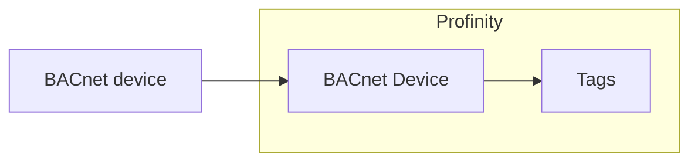

# BACnet

The **BACnet Device** component is a Building Automation and Control Networks (BACnet) over IP client.
It connects to one BACnet device on your network and polls the present-value of the objects you list in its point map.
It publishes each one as a Profinity tag.
BACnet is used for building automation and heating, ventilation, and air conditioning (HVAC) systems.

<figure markdown>

<figcaption>The BACnet Device component in Profinity polls the objects in its point map from one BACnet device and publishes each as a Profinity tag</figcaption>
</figure>

!!! info "Licence required"
    The BACnet plugin requires the **Industrial Protocols** licensed component group, and [Industrial protocols](index.md) explains how to obtain, install, and licence it.

Add a BACnet Device to your [Profile](../../Getting_Started/Profiles.md) from the **Industrial Protocols** group in the component catalogue, as described in [How to add a component to your profile](../../How_To_Guides/Add_Component_to_Profile.md).
Add one component for each BACnet device you want to read.
You can change the settings in the Communications settings section later from the component's **Change Settings** menu action.

The component supports BACnet/IP only, not BACnet MS/TP (Master-Slave/Token-Passing).
It reads and writes the device at the **Remote host** address you configure.
It does not discover devices on the network with the BACnet Who-Is request.

## Communications settings

| Setting | Description |
|---|---|
| **Name** | The name of the component. Must be unique within the profile. |
| **Local UDP port** | The User Datagram Protocol (UDP) port Profinity uses locally. Between `1` and `65535`. The default is `47808`, the standard BACnet/IP port (`0xBAC0` in hexadecimal). |
| **Remote host** | The IP address of the BACnet device. Required, and it is the address Profinity sends every request to. The default is `127.0.0.1`. |
| **Device instance** | The BACnet device instance number, as held in the device's own Device object. Between `0` and `4194302`. The default is `0`. |
| **Poll interval (ms)** | How often the point map is read, in milliseconds. Between `50` and `600000`. The default is `1000`. |
| **Request timeout (ms)** | How long Profinity waits for the device to answer a request, in milliseconds. Between `50` and `60000`. The default is `1000`. |
| **Reconnect delay (ms)** | How long Profinity waits between connection attempts, in milliseconds. Between `0` and `600000`. The default is `2000`. |
| **Auto Connect** | Connects to the device automatically when the profile is loaded. Off by default, as described in [Connections and reconnecting](../Connections_and_Reconnecting.md#the-auto-connect-switch). |

Set **Device instance** to the instance of the device you are connecting to, even when that instance is `0`.
A BACnet configuration tool or the device's own display shows the instance.
Profinity sends every request to the **Remote host**.
Each time it connects, it reads the Device object of the device at that address and compares the two numbers.
It does not connect while they differ, so a changed address never leads to another device being read.

Profinity keeps trying to connect when the device is down at start and after a connection is lost, as described in [Connections and reconnecting](../Connections_and_Reconnecting.md).

## Point map

The point map lists the BACnet objects to read.
Each row becomes one tag.

| Column | Description |
|---|---|
| **Name** | The name of the tag, published under the component's `Points` tags. Use a unique name for each row. |
| **Object type** | The type of BACnet object: `AnalogInput`, `AnalogOutput`, `AnalogValue` (the default), `BinaryInput`, `BinaryOutput` or `BinaryValue`. |
| **Instance** | The BACnet object instance number. |
| **Writable** | Allows Profinity to write to the object's present-value from the tag. Off by default. |
| **Unit** | An optional unit label for the tag. |

Analog objects are published as number tags, and binary objects are published as boolean tags.
Profinity reads and writes the object's `present-value` property, and it polls each object on the **Poll interval (ms)** rather than subscribing to changes.

!!! warning "Writing to a device"
    A write can change how the building plant behaves, so turn **Writable** on only for points that must be controlled from Profinity.

## Dashboard

The component dashboard shows the connection **STATUS** and whether the device is **CONNECTED**.
It also shows the number of values read (**RECEIVED**) and values written (**SENT**).
Use the **Connect / Disconnect** menu action to start or stop polling manually.
Viewing the dashboard requires the **Security administration** permission, described under [Roles and permissions](../../Administration/Users_and_Access/Roles_and_Permissions.md).

Polled values behave like any other tag, so they can be shown on a [dashboard](../Dashboard/Dashboard_Component.md), logged, watched by a rule, or read by a script.

## If a point shows bad quality

If a point cannot be read, its tag is marked as bad quality.
The usual causes are:

- A wrong **Remote host**.
- An **Object type** or **Instance** that the device does not have.
- A device that does not answer within the **Request timeout (ms)**.

Check these before reading the [Log](../../Administration/Logs_Config.md).
Refer to [Connections and reconnecting](../Connections_and_Reconnecting.md) for how the Log records failed reads and recovery.

A **Device instance** that differs from the device at the **Remote host** puts the component in the **Error** status and marks every point as bad quality.
The component shows and logs a message of the form `The device at 192.168.1.20 reports Device instance 1234, but Device instance is set to 0`.
Profinity tries again every **Reconnect delay**, so correcting the setting or the device connects it without a restart.
Set **Device instance** to the number in the message, or correct the **Remote host** if the address now belongs to a different device.

Profinity reads the Device object to check the instance.
BACnet requires every device from protocol revision 4 (2004) onwards to answer this read.
A device older than that, or one that does not allow its Device object to be read, answers with a BACnet error.
The component shows that error as the reason.
A device that does not answer the read puts the component in **Error** in the same way, with a message that the device did not answer.
Profinity tries again every **Reconnect delay**.
A device that is replaced on the same address after it was connected is caught at the next failed read, and the component then shows **Error** until the instance matches.
