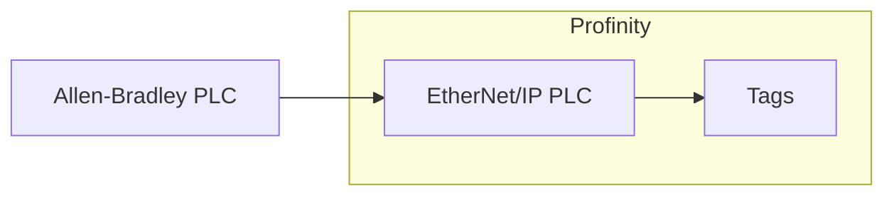

# EtherNet/IP

The **EtherNet/IP PLC** component is a Common Industrial Protocol (CIP) tag client for Allen-Bradley (Rockwell) programmable logic controllers (PLCs).
It connects to one PLC and polls the PLC tags you list in its point map, publishing each one as a Profinity tag.
It supports ControlLogix, CompactLogix, Micro800, PLC-5 and SLC controllers.

<figure markdown>

<figcaption>The EtherNet/IP PLC component in Profinity polls the PLC tags in its point map from one PLC and publishes each as a Profinity tag</figcaption>
</figure>

!!! info "Licence required"
    The EtherNet/IP plugin is not part of the standard installation, and it requires the **Industrial Protocols** licensed component group.
    Refer to [Industrial Protocols](index.md) for how to obtain, install, and licence it.

Add an EtherNet/IP PLC to your [Profile](../../Getting_Started/Profiles.md) from the **Industrial Protocols** group in the component catalogue, as described in [Adding Components to Your Profile](../../Getting_Started/Adding_New_Components.md).
Add one component for each PLC you want to read.
The settings below can be changed later from the component's **Change Settings** menu action.

You list each PLC tag by name in the point map.
The component does not browse the PLC's CIP objects to discover tags for you.

## Communications settings

| Setting | Description |
|---|---|
| **Name** | The name of the component. Must be unique within the profile. |
| **Gateway** | The IP address of the PLC, or of the gateway module that the PLC sits behind. Required. The default is `127.0.0.1`. |
| **CIP path** | The route to the PLC's CPU (central processing unit), as comma-separated values passed to the PLC library as entered. The default is `1,0`, which is the backplane (`1`) and slot `0`; for a CPU in slot 2 of the same chassis, enter `1,2`. Leave it empty to send no path. For a CPU reached through a bridge module, enter the route as pairs of port and address, one pair for each hop, as the PLC library expects. A PLC-5, SLC or MicroLogix controller on EtherNet/IP needs no path: the PLC library ignores a path for these controllers unless it is a route through a DH+ bridge, so the default `1,0` does no harm, and you can clear it. Micro800 controllers ignore this setting even when it is filled in. |
| **PLC kind** | The family of PLC: `ControlLogix` (the default), `CompactLogix`, `Micro800`, `PLC-5` or `SLC`. |
| **Poll interval (ms)** | How often the point map is read, in milliseconds. Between `50` and `600000`. The default is `1000`. |
| **Request timeout (ms)** | How long Profinity waits for the PLC to answer a request, in milliseconds. Between `50` and `60000`. The default is `1000`. |
| **Reconnect delay (ms)** | How long Profinity waits between connection attempts, in milliseconds. Profinity keeps trying when the device is down at start and after a connection is lost, as described in [Connections and reconnecting](../Connections_and_Reconnecting.md). Between `0` and `600000`. The default is `2000`. |
| **Auto Connect** | Connects to the PLC automatically when the profile is loaded. Off by default. |

## Point map

The point map lists the PLC tags to read.
Each row becomes one tag.

| Column | Description |
|---|---|
| **Name** | The name of the tag, published under the component's `Points` tags. Use a unique name for each row. |
| **PLC tag** | The tag name in the PLC. For ControlLogix, CompactLogix and Micro800 this is the Logix tag name. For PLC-5 and SLC it is the file and element, for example `N7:0`. |
| **Data type** | How the value is read: `Boolean`, `Word`, `SignedWord`, `Dword` (the default), `SignedDword` or `Real`. |
| **Writable** | Allows Profinity to write the PLC tag from the Profinity tag. Off by default. |
| **Unit** | An optional unit label for the tag. |

The data types map to the element size in the PLC, and to the type of the Profinity tag.

| Data type | Size | Profinity tag |
|---|---|---|
| `Boolean` | 1 byte | Boolean |
| `Word` / `SignedWord` | 2 bytes (unsigned / signed) | Integer |
| `Dword` / `SignedDword` | 4 bytes (unsigned / signed) | Integer |
| `Real` | 4 bytes (floating point) | Number |

Choose a data type that matches the PLC tag's type, otherwise the value is misread.
Each row reads one element of the size given for its data type.

!!! warning "Writing to a PLC"
    A write can change the controlled process, so turn **Writable** on only for tags that must be set from Profinity.

## Dashboard

The component dashboard shows the connection **STATUS**, whether the PLC is **CONNECTED**, and the number of messages **RECEIVED** and **SENT**.
Use the **Connect / Disconnect** menu action to start or stop polling manually.
Viewing the dashboard requires the **Security administration** permission, described under [Roles and Permissions](../../Administration/Users_and_Access/Roles_and_Permissions.md).

Polled values behave like any other tag, so they can be shown on a [dashboard](../Dashboard/index.md), logged, watched by a rule, or read by a script.

## If a point shows bad quality

If a point cannot be read, its tag is marked as bad quality.
The usual causes are a **PLC tag** name that does not exist in the PLC, a **Data type** that does not match the PLC tag's type, a **CIP path** that does not lead to the CPU, and a **PLC kind** that does not match the controller.
Check these before reading the [Log](../../Getting_Started/Profinity_Log.md) for the reason.
The Log records the first failed read of an outage as a warning, repeat failures in the same outage at debug level, and the first success afterwards at information level, as described in [Connections and reconnecting](../Connections_and_Reconnecting.md).
The first success is the first poll in which every point reads correctly.
