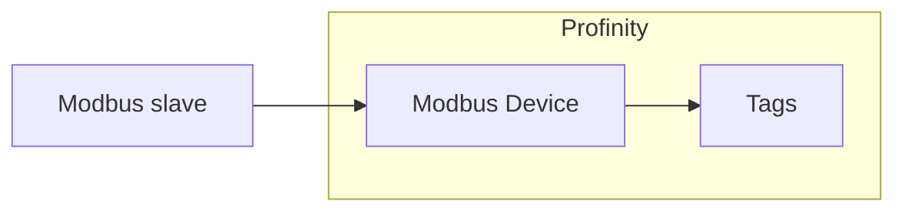

# Modbus

The **Modbus Device** component is a Modbus master.
It connects to one Modbus slave over Transmission Control Protocol (TCP) or over a serial line using Remote Terminal Unit (RTU) framing, and polls the coils and registers you list in its point map, publishing each one as a Profinity tag.
Modbus is used for industrial devices and distributed input/output (I/O).
Profinity acts as a Modbus master only, and it does not act as a Modbus slave or server.

<figure markdown>

<figcaption>The Modbus Device component in Profinity polls the coils and registers in its point map from one Modbus slave and publishes each as a Profinity tag</figcaption>
</figure>

!!! info "Licence required"
    The Modbus plugin is not part of the standard installation, and it requires the **Industrial Protocols** licensed component group.
    Refer to [Industrial Protocols](index.md) for how to obtain, install, and licence it.

Add a Modbus Device to your [Profile](../../Getting_Started/Profiles.md) from the **Industrial Protocols** group in the component catalogue, as described in [Adding Components to Your Profile](../../How_To_Guides/Add_Component_to_Profile.md).
Add one component for each slave you want to read.
The settings below can be changed later from the component's **Change Settings** menu action.

## Communications settings

Which settings apply depends on the **Connection Mode**.

| Setting | Applies to | Description |
|---|---|---|
| **Name** | Both | The name of the component. Must be unique within the profile. |
| **Connection Mode** | Both | `TCP` (the default) or `RTU`. |
| **Host** | TCP | The IP address of the slave. Required. The default is `127.0.0.1`. |
| **Port** | TCP | The TCP port. Between `1` and `65535`. The default is `502`. |
| **Serial Port** | RTU | The serial port the slave is connected to. Required for RTU. |
| **Baud Rate** | RTU | The serial baud rate. The default is `9600`. |
| **Parity** | RTU | The serial parity. The default is `None`. |
| **Data Bits** | RTU | `7` or `8`. The default is `8`. |
| **Stop Bits** | RTU | The number of stop bits. The default is `One`. |
| **Unit ID** | Both | The Modbus unit (slave) address. Between `0` and `255`. The default is `1`. |
| **Poll interval (ms)** | Both | How often the point map is read, in milliseconds. Between `50` and `600000`. The default is `1000`. |
| **Request timeout (ms)** | Both | How long Profinity waits for the slave to answer a request, in milliseconds. Between `50` and `60000`. The default is `1000`. |
| **Reconnect delay (ms)** | Both | How long Profinity waits between connection attempts, in milliseconds. Profinity keeps trying when the device is down at start and after a connection is lost, as described in [Connections and reconnecting](../Connections_and_Reconnecting.md). Between `0` and `600000`. The default is `2000`. |
| **Auto Connect** | Both | Connects automatically when the profile is loaded. Off by default. |

Match the serial settings to those configured on the slave.
If they differ, the slave does not answer.

## Point map

The point map lists the coils and registers to read.
Each row becomes one tag.

| Column | Description |
|---|---|
| **Name** | The name of the tag, published under the component's `Points` tags. Use a unique name for each row. |
| **Table** | The Modbus table to read: `Coil`, `DiscreteInput`, `HoldingRegister` (the default) or `InputRegister`. |
| **Address** | The zero-based protocol address. Register `40001` in a manufacturer's manual is address `0` of the holding registers when the manual uses one-based numbering. |
| **Data type** | How the value is decoded: `Boolean`, `Word` (the default), `SignedWord`, `Dword`, `SignedDword` or `Real`. |
| **Scale** | A factor that reads are multiplied by. Writes are divided by the same factor. The default is `1`. |
| **Writable** | Allows Profinity to write the value from the tag. Off by default. |
| **Unit** | An optional unit label for the tag. |

Registers are read as big-endian values.
`Word` and `SignedWord` use one register, and `Dword`, `SignedDword` and `Real` use two consecutive registers starting at the address, with the first register holding the high word.
The component has no word-swap option, so a device that sends the low word first returns wrong 32-bit values.
`Real` is a 32-bit floating point value.

The **Scale** suits devices that report fixed-point values: a temperature held as tenths of a degree uses a scale of `0.1`.

A `Coil` or `DiscreteInput` row always reads a single on/off bit, and its **Data type** is not used.
A `Boolean` row on a `HoldingRegister` or `InputRegister` table reads one register and is true when the register is not zero.

Only the `HoldingRegister` and `Coil` tables can be written.
`DiscreteInput` and `InputRegister` points are always read-only, even if **Writable** is on.

!!! warning "Writing to a device"
    Leave **Writable** off for any point that Profinity should only monitor, because a write changes the device.

## Dashboard

The component dashboard shows the connection **STATUS** (Connected or Disconnected), whether the device is **CONNECTED**, and the number of messages **RECEIVED** and **SENT**.
Use the **Connect / Disconnect** menu action to start or stop polling manually.
Viewing the dashboard requires the **Security administration** permission, described under [Roles and Permissions](../../Administration/Users_and_Access/Roles_and_Permissions.md).

Polled values behave like any other tag, so they can be shown on a [dashboard](../Dashboard/Dashboard_Component.md), logged, watched by a rule, or read by a script.

## If a point shows bad quality

If a point cannot be read, its tag is marked as bad quality.
The usual causes are an address that is one higher or lower than the device manual states, a **Unit ID** that differs from the slave, serial settings that differ from the slave, and a **Data type** that does not match the register.
Check these before reading the [Log](../../Administration/Logs_Config.md) for the reason.
The Log records the first failed read of an outage as a warning, repeat failures in the same outage at debug level, and the first success afterwards at information level, as described in [Connections and reconnecting](../Connections_and_Reconnecting.md).
The first success is the first poll in which every point reads correctly.
