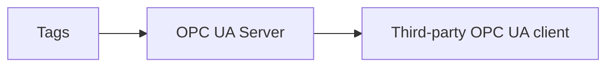

# OPC UA Server

The **OPC UA Server** listens for Open Platform Communications Unified Architecture (OPC UA) clients and exposes this profile's tag tree to them as a read-only address space.
Use it to let third-party OPC UA clients, such as a supervisory control and data acquisition (SCADA) or historian system, read the live values held in this Profinity profile.
The OPC UA plugin also provides the [OPC UA Client](OPC_UA_Client.md), and the two components can be used on their own or together.

<figure markdown>

<figcaption>The OPC UA Server exposes the Profinity tag tree to third-party OPC UA clients as a read-only address space</figcaption>
</figure>

!!! info "Licence required"
    The OPC UA plugin requires the **Industrial Protocols** licensed component group, and [Install an industrial protocol plugin](Install_an_Industrial_Protocol_Plugin.md) explains how to obtain, install, and licence it.

Add the server to your [Profile](../../Getting_Started/Profiles.md) from the **Industrial Protocols** group in the component catalogue, as described in [How to add a component to your profile](../../How_To_Guides/Add_Component_to_Profile.md).
You can change the settings in the Settings section later from the component's **Change Settings** menu action.

## Settings

| Setting | Description |
|---|---|
| **Name** | The name of the component. Must be unique within the profile. |
| **Bind URL** | The endpoint address that the server listens on, and the address clients connect to. Required, and must start with `opc.tcp://`. The default is `opc.tcp://127.0.0.1:4840/Profinity`, which accepts clients on this computer only. |
| **Auto Connect** | Starts the server automatically when the profile is loaded. Off by default, as described in [Connections and reconnecting](../Connections_and_Reconnecting.md#the-auto-connect-switch). |
| **Trust all client certificates** | Skips validation of connecting clients' certificates. Off by default. Turn it on only on a trusted network. |

For where the server keeps its certificates and how to trust one explicitly, refer to [OPC UA certificates](OPC_UA_Certificates.md).

## What the server exposes

The server publishes the readable scalar values in the profile's tag tree.
Each tag appears as a node with the NodeId `ns=2;s=` followed by the tag's full tag ID, which is the tag's [tag tree path](../../Tags/Selecting_Tags/Tag_Tree_Path.md).

Clients cannot write to the address space, so the server cannot be used to change values in Profinity.
The server accepts anonymous connections without message security only.

The server builds the address space once, when it starts, from the tags that are readable at that moment:

- Tags added to the profile after that do not appear until you restart the server.
- A tag with no sample or a null value reads as `BadNoData` to the client.

## Listening address

With the default **Bind URL**, the server listens on the loopback address `127.0.0.1` only, so only clients on the Profinity computer can connect.
The server uses no security policy and accepts anonymous clients, so allow other computers only on a network you trust.

To accept remote clients, replace the host in the **Bind URL** with the IP address or host name of the Profinity computer that those clients can reach, for example `opc.tcp://192.168.1.20:4840/Profinity`:

- An IP address listens on that address only.
- A host name listens on every address of the computer.
- When the address changes, Profinity replaces the server certificate if it does not name the new address.

A **Bind URL** with a host of `0.0.0.0` or `localhost` is treated in the same way as the default and listens on `127.0.0.1` only.

## Dashboard

The component has a dashboard showing its **STATUS**, whether it is **LISTENING**, and the number of client requests **RECEIVED** and responses **SENT** since the server last started listening.
To check that the server works, look for the status **Listening** and **LISTENING** true.
Then connect a client to the **Bind URL** and browse **Objects > Profinity**, which is the `Profinity` folder with NodeId `ns=2;s=Profinity`.
Read a tag at `ns=2;s=` followed by its full tag ID.
Viewing the dashboard requires the **Security administration** permission, described under [Roles and permissions](../../Administration/Users_and_Access/Roles_and_Permissions.md).

## If a client cannot read a tag

Check the usual causes in this table before reading the [Log](../../Administration/Logs_Config.md) for the reason.

| Symptom | Cause | Fix |
|---|---|---|
| A client on another computer cannot connect. | The default **Bind URL** listens on `127.0.0.1` only. | Replace the host in the **Bind URL** with an address the clients can reach, as described under Listening address. |
| A tag added to the profile is missing from the address space. | The server builds the address space once, when it starts. | Restart the server. |
| A tag reads as `BadNoData`. | The tag has no sample or a null value. | Check that the tag has a value in Profinity. |
| A client cannot write a value. | The address space is read-only. | Change the value at its source in Profinity instead. |
| A connection fails on a certificate. | The refused certificate is in the `rejected` folder. | Move the certificate into `trusted` once you have confirmed it, as described in [OPC UA certificates](OPC_UA_Certificates.md). |
