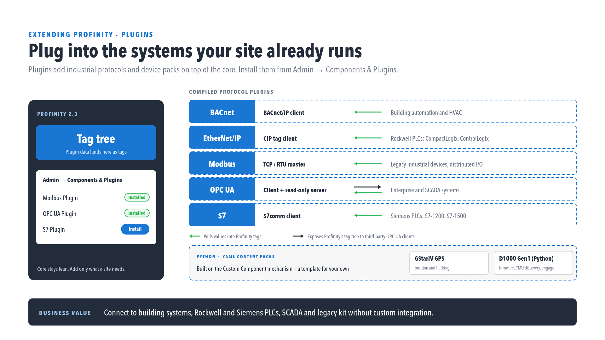

# Industrial protocols

Profinity connects to the industrial systems a site already runs through a set of protocol plugins.
Each plugin brings data in as ordinary Profinity tags, and the OPC UA plugin can also expose Profinity's tag tree to third-party clients.

The plugins are not included in the standard Profinity installation.
Prohelion supplies them on request, so [contact Prohelion](https://www.prohelion.com/contact-us/) to arrange access to the protocols you need.
Install each one like any other [DLL plugin](../../Administration/Install_and_Manage_Plugins.md), and then add its components from the **Industrial Protocols** group, as described in [Adding Components to Your Profile](../../How_To_Guides/Add_Component_to_Profile.md).

<figure markdown>

<figcaption>Protocol plugins and Profinity tags</figcaption>
</figure>

!!! info "Licence required"
    The protocol plugins also require the **Industrial Protocols** licensed component group, an add-on to your Desktop, Server, or Enterprise edition.
    Installing a plugin does not make its components available without it.
    Refer to [Licensing](../../Licensing.md) to check your instance, where the group is listed as **Industrial Protocols** under **Licensed component groups**.

## Available protocol plugins

Each plugin has its own page describing its settings and point map, and each page lists every supported device family.
The OPC UA plugin has one page for each component, and [OPC UA certificates](OPC_UA_Certificates.md) covers the certificate folders that both components use.

| Plugin | Role | Typical use |
|---|---|---|
| [BACnet](BACnet.md) | BACnet/IP client that polls values into Profinity tags | Building automation and heating, ventilation, and air conditioning (HVAC) systems |
| [EtherNet/IP](EtherNet_IP.md) | Common Industrial Protocol (CIP) tag client that polls values into Profinity tags | Rockwell programmable logic controllers (PLCs) such as ControlLogix, CompactLogix, Micro800, PLC-5 and SLC |
| [Modbus](Modbus.md) | TCP and RTU master that polls values into Profinity tags | Industrial devices and distributed input/output (I/O) |
| [OPC UA Client](OPC_UA_Client.md) | Client that polls values from a remote OPC UA server into Profinity tags | Enterprise and supervisory control and data acquisition (SCADA) system integration |
| [OPC UA Server](OPC_UA_Server.md) | Read-only server that exposes Profinity's tag tree to third-party OPC UA clients | Enterprise and SCADA system integration |
| [S7](S7.md) | S7comm client that polls values into Profinity tags | Siemens PLCs such as S7-300, S7-400, S7-1200 and S7-1500 |

Every protocol component has **Auto Connect** off by default.
The components, what they connect to, and how a point map row identifies a value are:

| Plugin | Component | Connects to | A point map row identifies a value by |
|---|---|---|---|
| BACnet | **BACnet Device** | One BACnet device, over BACnet/IP only and not BACnet MS/TP | **Object type** and **Instance** |
| EtherNet/IP | **EtherNet/IP PLC** | One PLC | **PLC tag** |
| Modbus | **Modbus Device** | One Modbus slave, over TCP or over a serial line using RTU framing | **Table** and **Address** |
| OPC UA | **OPC UA Client** | A remote OPC UA server | **NodeId** |
| OPC UA | **OPC UA Server** | Listens for OPC UA clients | Not applicable, because it exposes the readable scalar tags in the profile's tag tree |
| S7 | **S7 PLC** | One PLC | **Area** and **Offset**, and **DB number** when the area is `DataBlock` |

For a Siemens S7-1200 or S7-1500, the S7 plugin reads absolute addresses, and the OPC UA client reads symbolic tags by name from the PLC's own OPC UA server.

Once polled, a value from any of these protocols behaves the same as a tag from a CAN device.
It can be shown on a [dashboard](../../Customising_Profinity/Dashboards/index.md) that you build, included in a [collection](../../Tags/Collections/index.md), watched by a rule, or read by a [script](../../Developing_with_Profinity/Scripting/index.md).
The dashboard each component shows for itself is described on its own page, and viewing it needs the **Security administration** permission, which is set under [Roles and Permissions](../../Administration/Users_and_Access/Roles_and_Permissions.md).
The polling components of all five plugins connect, retry, and log failures in the way described in [Connections and reconnecting](../Connections_and_Reconnecting.md).

To build your own component instead, refer to [Component Types](../../Developing_with_Profinity/Custom_Components/Component_Types.md) for how a compiled plugin compares with a Custom Component pack, and to [Component Pack CLI](../../Developing_with_Profinity/SDK/Component_Pack_CLI.md).
