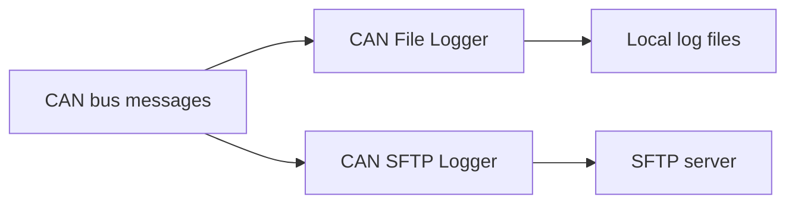
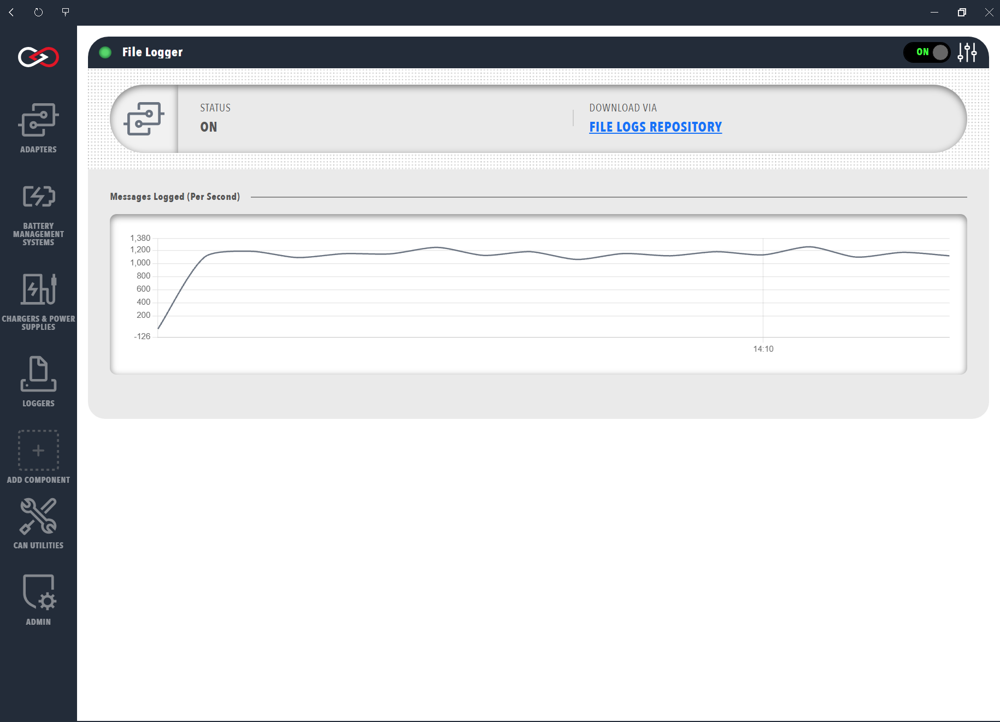

# CAN file and SFTP loggers

The **CAN File Logger** and the **CAN SFTP Logger** record native CAN bus messages to a file.
The CAN File Logger stores the file on the local file system of the machine running Profinity.
The CAN SFTP Logger transmits it to a remote Secure Shell (SSH) File Transfer Protocol (SFTP) server.
Each is added to a [Profile](../../Getting_Started/Profiles.md) as its own component under **Loggers** and is included in every edition.
Profinity can also [log and replay messages](../../CAN_Utilities/Logging_Replaying_CAN_Bus_Messages.md) from a CAN bus network.

<figure markdown>

<figcaption>The CAN File Logger records CAN bus messages to log files on the local file system, and the CAN SFTP Logger transmits them to an SFTP server</figcaption>
</figure>

Both loggers have **Auto Connect**, which is on by default, so a logger begins logging when the Profile loads.
Refer to [Connections and reconnecting](../Connections_and_Reconnecting.md) for how it behaves.
They record the bus, so they do not use tag collections.

Both loggers have these settings:

- **Update Interval (Seconds)** sets the seconds between background updates. It defaults to 10 and accepts values from 1 to 86400.
- **File Format** chooses the layout of the text file, which always uses a `.txt` extension. **Prohelion**, the default, writes a line for every packet with a Sent or Received column. **Tritium** writes the same fields without that column.

The CAN File Logger has no destination setting.
It creates its files under the Profinity CAN bus log directory (`can_bus_logs/`), in a folder named after the Profile and the component.
Refer to the [artefacts directory](../../Installation/Artifacts_Directory.md) for where that directory sits on each platform.
The CAN SFTP Logger needs the remote server settings described in [File logger rotation, archive, and SFTP settings](File_Logger_Rotation_Archive_and_SFTP.md), which also covers rotating, archiving, and compressing the log files.

## Download the logged files

Once a log file has been created, select the link on the Logger Dashboard to download it from Profinity.
A CAN File Logger shows this link as **FILE LOGS REPOSITORY**.

<figure markdown>

<figcaption>Download Log File</figcaption>
</figure>

To take the same data further, refer to [How to configure data logging](../../How_To_Guides/Configure_Data_Logging.md).
