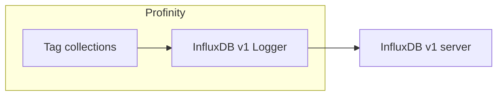

# InfluxDB v1 Logger

The **InfluxDB v1 Logger** sends the values of the [tags](../../Tags/index.md) in selected [tag collections](../../Tags/Collections/index.md) to an InfluxDB v1 server.
A logger only writes data out.
The InfluxDB v2 and v3 components are [historians](../Historians/index.md), which also let the data be read back, and they are documented in the Historians section.

<figure markdown>

<figcaption>The InfluxDB v1 Logger pushes the selected tag collections to an InfluxDB v1 server</figcaption>
</figure>

<figure markdown>

<figcaption>InfluxDB dashboard showing pack voltage and pack current logged by Profinity</figcaption>
</figure>

[InfluxDB](https://www.influxdata.com) both stores and visualises data.
InfluxDB v1, v2 and v3 are separate products with different APIs, authentication methods and configuration requirements, and using the wrong component type results in connection failures.
Profinity provides a separate component for each InfluxDB version, so the version of InfluxDB in use must be known before a component is added to a [profile](../../Getting_Started/Profiles.md).
The v2 and v3 components are registered as the **InfluxDB v2 Historian** and the **InfluxDB v3 Historian**, which write data in the same way and additionally allow it to be read back through the APIs, and they are documented in [InfluxDB historians](../Historians/InfluxDB_Historians.md).
The [Loggers](index.md) page compares this logger with the others.

## Add the logger

InfluxDB v1 uses username and password authentication and the concept of databases and retention policies.
To log data to InfluxDB v1, install InfluxDB v1 and confirm that it is running, then add an **InfluxDB v1 Logger** to the profile.
Enter the **InfluxDB Database**, add at least one tag collection under **Collections**, and set the other settings as needed.

| Setting | Default | Purpose |
|---|---|---|
| **InfluxDB Database** | None | The InfluxDB database that the data is stored in. Required. |
| **InfluxDB Username** | Blank | The username for InfluxDB authentication. Leave blank for unsecured connections. |
| **InfluxDB Password** | Blank | The password for InfluxDB authentication. Leave blank for unsecured connections. |
| **InfluxDB Retention Policy** | `autogen` | The InfluxDB retention policy used when writing data. |
| **Influx Server URL** | `http://localhost:8086/` | The endpoint URL that InfluxDB is running on. |
| **Dashboard URL** | Blank | The URL of the InfluxDB dashboard. Optional, and leaving it blank shows no dashboard link. |
| **InfluxDB Health Check** | On | Performs a health check on the connection at regular intervals. Turn it off for InfluxDB Cloud. |
| **Collections** | None | The tag collections whose tags are logged. At least one collection must be configured before the component starts. |
| **Update Interval (Seconds)** | 10 | The interval, in seconds, at which log data is sent, from 1 to 86400. |
| **Logging mode** | **Snapshot** | Sets what is sent on each interval: **Snapshot**, **On Change** or **Everything**. Refer to [Logging modes](../Logging_Modes.md). |
| **Auto Connect** | On | Starts the logger when the profile is loaded. |

The **Logging mode** setting applies to this logger, the InfluxDB v2 Historian, the InfluxDB v3 Historian and the other collection-based loggers, and nothing is logged until at least one tag collection is selected in **Collections**.
[Logging modes](../Logging_Modes.md) defines the three modes, **Snapshot** (the default), **On Change** and **Everything**.

Every sample is written with its quality in a `quality` field. A Good sample also has a `value` field, and a Stale sample keeps its last `value` with quality Stale. A tag that is Unavailable or Bad is written as a gap, with a `quality` field and no `value`, so a chart can show the gap instead of an invented reading. Only tags that hold a number are written, and a query for readings should ask for the `value` field.

## What is stored

Each sample is stored as one point in a measurement named after the profile. For example, a motor speed signal on a component called `Inverter` is stored like this:

| Part | Example | Meaning |
|---|---|---|
| Tag `component` | `Inverter` | The component that owns the tag. |
| Tag `message` | `Status` | The CAN message the signal belongs to. |
| Tag `signal` | `Speed` | The signal name. |
| Tag `full_tag_id` | `Inverter/DBC/Status/Speed` | The tag's path when the sample was written. |
| Field `value` | `23.4` | The reading. |
| Field `quality` | `Good` | The quality of the reading. |

In InfluxDB line protocol, that point is:

```text
MyProfile,profile=MyProfile,component=Inverter,message=Status,signal=Speed,full_tag_id=Inverter/DBC/Status/Speed value=23.4,quality="Good" 1792315200000000000
```

The `component`, `message` and `signal` tags identify the tag in the history.
A CAN signal is stored under its component, message and signal names from its DBC file, and a component property is stored with the `message` `_Property_` and its dotted name as the `signal`, for example `Settings_Name`.
Any other tag is stored with the `message` `_TagPath_`, and its place inside its component, joined with underscores, as the `signal`.
Characters other than letters and digits in these names are replaced with underscores.

InfluxDB Cloud does not support the InfluxDB Health Check API, and **InfluxDB Health Check** is on by default, so set it to off when InfluxDB Cloud is used to store the data.

## If data does not arrive

When these settings are correct, data flows into InfluxDB v1.
If it does not, check the Profinity system logs for more details, as described in [Logs](../../Administration/Logs_Config.md).
If the logger cannot reach InfluxDB, it shows **Error**, writes the reason to the system logs once, and retries every 5 seconds until the problem clears.

For the steps to set up logging and to send data to InfluxDB Cloud, refer to [How to configure data logging](../../How_To_Guides/Configure_Data_Logging.md) and [How to log data to the cloud (InfluxDB)](../../How_To_Guides/Log_Data_to_Cloud_Influx.md).
