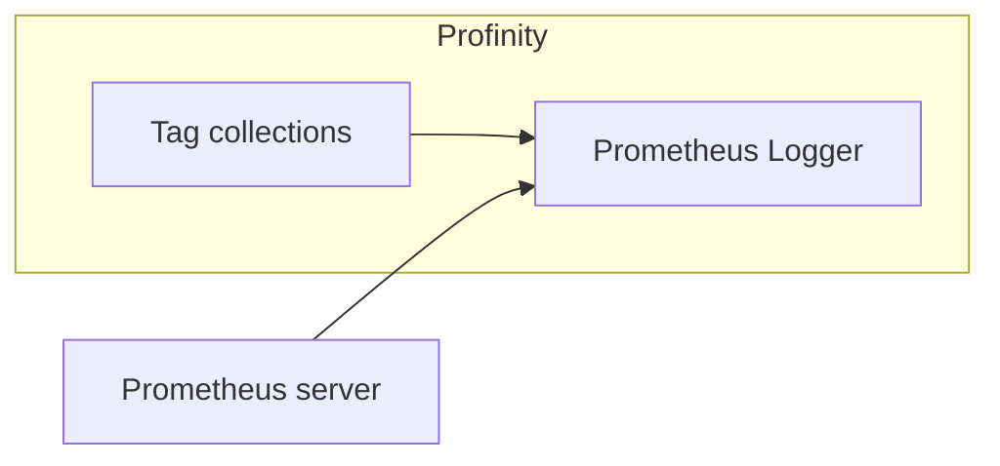

# Prometheus Logger

The **Prometheus Logger** serves the values of the [tags](../../Tags/index.md) in selected [tag collections](../../Tags/Collections/index.md) to [Prometheus](https://prometheus.io).
A logger only writes data out.

<figure markdown>

<figcaption>The Prometheus Logger serves the selected tag collections to a Prometheus server that calls Profinity to request the latest values</figcaption>
</figure>

Prometheus logging works differently from [InfluxDB logging](InfluxDB_v1_Logger.md).
InfluxDB expects its data to be pushed to it.
Prometheus treats Profinity as a source of data and calls it to request the latest values.
Prometheus stores data only and has no graphing capability out of the box, so it is usually coupled with a tool such as [Grafana](https://grafana.com) for visualisation.

Adding a **Prometheus Logger** to Profinity is all that Prometheus logging needs on the Profinity side.
The **Collections** setting selects the tag collections that are served, and you must select at least one before the component starts.
You can also set the following connection values.

| Setting | Default | Purpose |
|---|---|---|
| **Data endpoint URL** | `metrics/` | The URL path, within the hostname and port, that the Prometheus data is served on. |
| **Server Hostname** | `localhost` | The host name or IP address that the Prometheus endpoint answers to. Refer to [Let another computer read the data](#let-another-computer-read-the-data). |
| **Server Port** | 7065 | The port that the endpoint runs on, from 1 to 65535. |
| **Dashboard URL** | Blank | The full URL of the Prometheus dashboard. Optional, and leaving it blank shows no dashboard link. |
| **Update Interval (Seconds)** | 10 | The seconds between samples, from 1 to 86400. |
| **Auto Connect** | On | Starts the logger when the profile loads. Refer to [Connections and reconnecting](../Connections_and_Reconnecting.md). |

A tag that is not Good quality is reported as NaN.

Once the Prometheus Logger is active, Prometheus can call Profinity on the data endpoint URL to receive data.
With all settings left at their defaults, the data is served at:

```text
http://localhost:7065/metrics
```

Configuring Prometheus to receive and display this data is covered in the Prometheus documentation.

## Let another computer read the data {#let-another-computer-read-the-data}

With **Server Hostname** set to `localhost`, only a scraper on the same computer can read the data.
To let a scraper on another computer connect, enter the host name or IP address of the Profinity computer, or `+` to answer on every address.
On Windows, listening on anything other than `localhost` needs a URL reservation or administrator rights.
For example, run this command to reserve the URL:

```text
netsh http add urlacl url=http://+:7065/metrics user=DOMAIN\user
```

Replace `7065` with your **Server Port**, and `DOMAIN\user` with the account that runs Profinity.
Alternatively, run Profinity with administrator rights.

## What Prometheus receives

Each tag in the selected collections is served as one gauge.
The name is the profile, component, message and signal joined with underscores, and the labels identify the tag.
For example, a motor speed signal on a component called `Inverter` is served like this:

```text
# HELP MyProfile_Inverter_Status_Speed Inverter/DBC/Status/Speed
# TYPE MyProfile_Inverter_Status_Speed gauge
MyProfile_Inverter_Status_Speed{profile="MyProfile",component="Inverter",transmitter="",message="Status",signal="Speed",full_tag_id="Inverter_DBC_Status_Speed"} 23.4
```

Characters other than letters and digits in names and labels are replaced with underscores, which is why the `full_tag_id` label shows underscores where the tag's path has slashes.
The value is the latest reading, or `NaN` when the tag is not Good quality.

## If Prometheus shows no data

If the logger cannot open its Prometheus endpoint, for example because the port is in use, it shows **Error**.
It writes the reason to the Profinity system logs once, and retries every 5 seconds until the problem clears.
Refer to [Logs](../../Administration/Logs_Config.md) for where to read them.

If Prometheus shows no data, check three things:

- The logger is running.
- The scraper uses the same hostname, port and endpoint path as the logger.
- At least one collection with tags is selected.

For the steps to set up logging, refer to [How to serve data to Prometheus](../../How_To_Guides/Log_Data_to_Prometheus.md).
