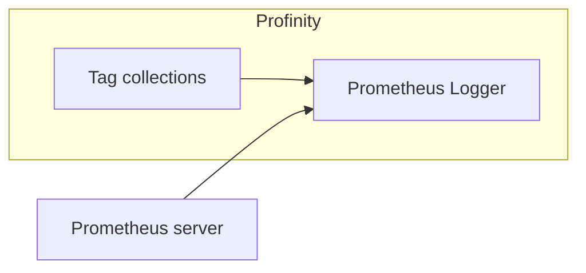

# Prometheus Logger

The **Prometheus Logger** serves the values of the [tags](../../Tags/index.md) in selected [tag collections](../../Tags/Collections.md) to [Prometheus](https://prometheus.io).
A logger only writes data out.

<figure markdown>

<figcaption>The Prometheus Logger serves the selected tag collections to a Prometheus server that calls Profinity to request the latest values</figcaption>
</figure>

Prometheus logging works differently from [InfluxDB logging](InfluxDB_v1_Logger.md).
InfluxDB expects its data to be pushed to it, whereas Prometheus treats Profinity as a source of data and calls it to request the latest values.
Prometheus stores data only and has no graphing capability out of the box, so it is usually coupled with a tool such as [Grafana](https://grafana.com) for visualisation.

Adding a **Prometheus Logger** to Profinity is all that is required on the Profinity side to set up Prometheus logging.
The **Collections** setting selects the tag collections that are served, and at least one collection must be selected before the component starts.
The following connection values can also be set.

| Setting | Default | Purpose |
|---|---|---|
| **Data endpoint URL** | `metrics/` | The URL path, within the hostname and port, that the Prometheus data is served on. |
| **Server Hostname** | `localhost` | The host name or IP address that Profinity's Prometheus endpoint answers to. With `localhost`, only a scraper on the same computer can read it. To let a scraper on another computer connect, enter the computer's host name or IP address, or `+` to answer on every address. On Windows, listening on anything other than `localhost` needs a URL reservation, for example `netsh http add urlacl url=http://+:7065/metrics user=DOMAIN\user`, or running Profinity with administrator rights. |
| **Server Port** | 7065 | The port that the endpoint runs on, from 1 to 65535. |
| **Dashboard URL** | Blank | The full URL of the Prometheus dashboard. Optional, and leaving it blank shows no dashboard link. |
| **Update Interval (Seconds)** | 10 | The interval, in seconds, between samples, from 10 to 86400. |
| **Auto Connect** | On | Starts the logger automatically when the profile is loaded. |

A tag that is not Good quality is reported as NaN.

Once the Prometheus Logger is active, Prometheus can call Profinity on this URL to receive data.
With all settings left at their defaults, for example, the data is served at:

```text
http://localhost:7065/metrics
```

Configuring Prometheus to receive and display this data is covered in the Prometheus documentation.

## If Prometheus shows no data

If the logger cannot open its Prometheus endpoint (for example the port is in use), it shows **Error**, writes the reason to the Profinity system logs (refer to [Logs](../../Administration/Logs_Config.md)) once, and retries every 5 seconds until the problem clears.
If Prometheus shows no data, check that the logger is running, that the scraper is configured with the same hostname, port and endpoint path, and that at least one collection with tags is selected.

For the steps to set up logging, refer to [How to configure data logging](../../How_To_Guides/Configure_Data_Logging.md).
