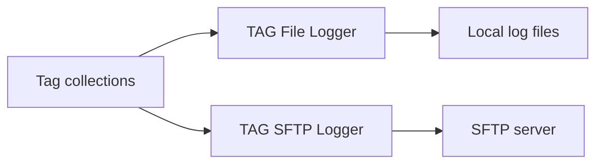

# Tag file and SFTP loggers

The **TAG File Logger** and the **TAG SFTP Logger** write the values of the [tags](../../Tags/index.md) in selected [tag collections](../../Tags/Collections/index.md) to a file as comma-separated values (CSV) or JSON Lines.
The TAG File Logger writes the file to the local file system of the machine running Profinity.
The TAG SFTP Logger transmits it to a remote Secure Shell (SSH) File Transfer Protocol (SFTP) server.
Each is added to a [Profile](../../Getting_Started/Profiles.md) as its own component under **Loggers** and is included in every edition.
A logger only writes data out for later retrieval, so history that Profinity must read back belongs in a [historian](../Historians/index.md).

<figure markdown>

<figcaption>The TAG File Logger writes the values in tag collections to log files on the local file system, and the TAG SFTP Logger transmits them to an SFTP server</figcaption>
</figure>

Both loggers have **Auto Connect**, which is on by default, so a logger begins logging when the Profile loads.
Refer to [Connections and reconnecting](../Connections_and_Reconnecting.md) for how it behaves.

The TAG File Logger has no destination setting.
It creates its files under the Profinity tag log directory (`tag_logs/`), in a folder named after the Profile and the component.
Refer to the [artefacts directory](../../Installation/Artifacts_Directory.md) for where that directory sits on each platform.
The TAG SFTP Logger needs the remote server settings described in [File logger rotation, archive, and SFTP settings](File_Logger_Rotation_Archive_and_SFTP.md), which also covers rotating, archiving, and compressing the log files.

## Settings

Both loggers log the values of the tags in the collections selected in **Collections**.
Every sample is written with its quality.
A Stale tag keeps its last value, and a tag that is Unavailable or Bad is written with its quality and an empty value.
A logger with no collection selected does not start and its status stays **Off**, so create and select a collection first.

| Setting | Purpose |
|---|---|
| **Collections** | The tag collections whose member values are logged. At least one collection must be configured before the logger starts. |
| **Update Interval (Seconds)** | The seconds between writes. The default is 10, and the value must be between 1 and 86400. Refer to [Logging modes](../Logging_Modes.md) for how each mode uses it. |
| **Logging mode** | **Snapshot**, **On Change** or **Everything**. The default is **Snapshot**. Refer to [Logging modes](../Logging_Modes.md) for what each mode writes. |
| **File Format** | **CSV** or **JSON Lines**. The default is **CSV**. Refer to [File formats](#file-formats). |

### File formats {#file-formats}

- **CSV** writes one row per sample, with the header `Recv time,TagId,ValueType,Value,UtcTimestamp,Quality,Reason,Message`. The file uses a `.txt` extension.
- **JSON Lines** writes one JSON object per line. The file uses a `.jsonl` extension.

`Recv time` is the local time the line was written.
`UtcTimestamp` is the timestamp carried by the tag sample, so the two can differ.

## What a logged line looks like

Each sample is one line.
For example, a motor speed tag is written like this in CSV:

```text
Recv time,TagId,ValueType,Value,UtcTimestamp,Quality,Reason,Message
2026-10-18T09:15:02.1234567+10:00,Inverter/DBC/Status/Speed,Double,23.4,2026-10-18T09:15:02.0000000Z,Good,ok,
```

and like this in JSON Lines, where the `t` field is the time the line was written:

```json
{"t":"2026-10-18T09:15:02.1234567+10:00","tagId":"Inverter/DBC/Status/Speed","valueType":"Double","value":23.4,"utcTimestamp":"2026-10-18T09:15:02.0000000Z","quality":"Good","reason":"ok","message":null}
```

A tag that is Unavailable or Bad is written with its quality and an empty value, so the file shows the gap.

## Download the logged files

Once a log file has been created, select the link on the Logger Dashboard to download it from Profinity.
A TAG File Logger shows this link as **TAG LOGS REPOSITORY**.

To take the same data further, refer to [How to configure data logging](../../How_To_Guides/Configure_Data_Logging.md), or [How to log data to the cloud (InfluxDB)](../../How_To_Guides/Log_Data_to_Cloud_Influx.md).
