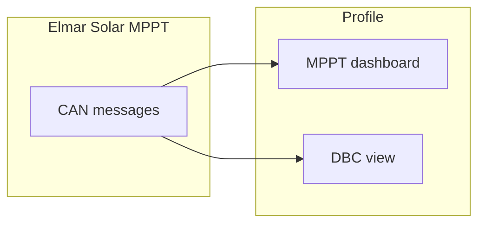
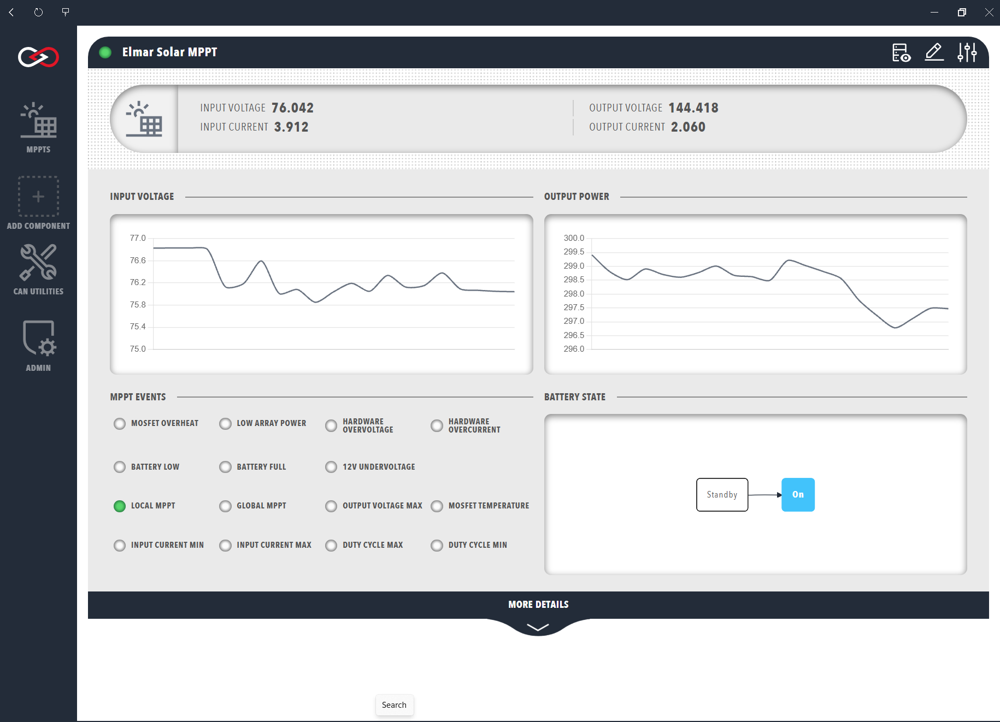

# Elmar Solar MPPT

Profinity monitors the Elmar Solar Maximum Power Point Tracker (MPPT) Series A and B.
They use the CAN database (DBC) file described in the [Elmar MPPT DBC](../../../../Solar_Charge_Controllers/DBC.md) documentation.
Elmar Solar makes MPPTs that optimise the output of solar arrays.
The Elmar range distributed by Prohelion consists of the Elmar 3A MPPT, the Elmar Race MPPT and the Elmar Best MPPT.
The [Solar Charge Controllers by Elmar](../../../../Solar_Charge_Controllers/index.md) documentation describes them.

## Add the MPPT to a profile

To monitor an Elmar Solar MPPT, add an Elmar Solar MPPT tracker to the [Profile](../../Getting_Started/Profiles.md).
Profinity prompts for the information in the following table.
The **Change Settings** button on the MPPT dashboard changes these details later.

| Parameter | Description | Default |
|---|---|---|
| **Name** | The name of the component. Must be unique. | The component name |
| **Milliseconds Valid** | The timeout of the device in milliseconds, from 1 to 60000, or -1 for no timeout. | 5000 |
| **Base Address** | The CAN address of the MPPT, as described in the Elmar MPPT DBC. | `0x300` |

If the network receives no traffic from the device within the **Milliseconds Valid** time, Profinity treats the connection as lost.

Once the MPPT is added to the Profile, the Elmar Solar MPPT dashboard is available in the sidebar.
The dashboard displays input and output voltage graphs, error status indicators and, under the **MORE DETAILS** banner, temperature readings.

<figure markdown>

<figcaption>The Elmar Solar MPPT sends CAN messages that the MPPT dashboard in the Profile decodes, and the same raw data is available in the DBC view</figcaption>
</figure>

<figure markdown>

<figcaption>Elmar Solar MPPT</figcaption>
</figure>

The raw CAN data from an Elmar Solar MPPT is also available in the [DBC view](../../CAN_Utilities/CAN_Bus_DBC.md).
The **Messages and Signals** button on the dashboard opens it.

## MPPT data

The summary row of the MPPT dashboard shows the values in the following table.

| Cell | Meaning |
|---|---|
| **INPUT VOLTAGE** | The voltage produced by the connected solar array, in volts. |
| **INPUT CURRENT** | The current delivered by the connected solar array, in amps. |
| **OUTPUT VOLTAGE** | The output voltage of the MPPT, in volts. |
| **OUTPUT CURRENT** | The output current of the MPPT, in amps. |

The dashboard also shows two time-series graphs of the input voltage and output power of the MPPT.
Hover over a graph to see the data in greater resolution.

The **MPPT EVENTS** panel shows status indicators for MPPT events.
The colour of each indicator matches its type, as the following table shows.

| Type | Colour | Indicators |
|---|---|---|
| Error | Red | Low array power, hardware overvoltage, hardware overcurrent, metal-oxide-semiconductor field-effect transistor (MOSFET) overheat, 12 V undervoltage, battery low and battery full |
| Limit | Amber | Input current minimum and maximum, output voltage maximum, duty cycle minimum and maximum, and MOSFET temperature |
| Limit | Green | The local and global MPPT limits |

The events correspond to the `Status` message of the [Elmar MPPT DBC](../../../../Solar_Charge_Controllers/DBC.md).
The message carries the error and limit flags, the mode, and the CAN receive and transmit error counters.
The [Solar Charge Controllers by Elmar](../../../../Solar_Charge_Controllers/index.md) documentation links the datasheet of each product.

A simplified flowchart shows the MPPT state, which is either Standby or On according to the `Mode` signal of the `Status` message.
The grey box marks the current state.

Expand the **MORE DETAILS** banner to see these readings:

- Input, output, and power readings.
- MOSFET, controller, and power connector temperatures.
- The auxiliary 12 V and 3 V supply and battery-side output voltages.

The state of a connected battery is described on the [Prohelion BMU](../Battery_Management_Systems/Prohelion_BMU.md) page.
