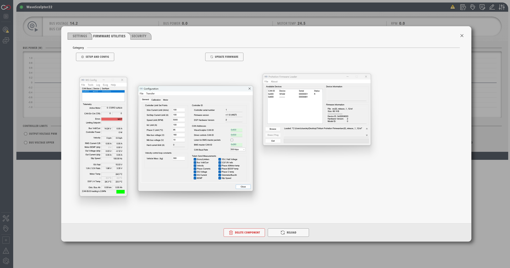

# Update WaveSculptor configuration and firmware

Configure a [WaveSculptor](WaveSculptor.md) with wsConfig, then flash its firmware, from the **Firmware Utilities** tab in the component settings.

## Before you begin

You need a Windows desktop instance of Profinity and a CAN to Ethernet bridge, or a Virtual CAN Bus Adapter, on the CAN bus of the WaveSculptor.

!!! warning "WaveSculptor configuration tools run on Windows only"
    The WaveSculptor configuration and firmware tools (**Setup and Config**, wsConfig and **Update Firmware**) are available only on Windows, and only to the user of the Profinity desktop application.
    A Docker, Linux, or macOS installation has no **Setup and Config** button, so the WaveSculptor must be connected to a Windows desktop instance for the duration of the update.

!!! warning "A CAN to Ethernet bridge is required"
    The configuration tools need a Prohelion or Tritium [CAN to Ethernet Bridge](../../../../Solar_Car_Racing/CAN_Ethernet_Bridge/index.md) on the same CAN bus as the WaveSculptor and the same local network as the PC.
    Where no bridge is available, pair the [Prohelion Virtual CAN Bus Adapter](../CAN_Bus_Protocols/Virtual_CAN_Adapter.md) with another CAN adapter to create a virtual bridge.
    A physical bridge accepts only one TCP connection at a time, as covered under [Multiple TCP clients on one bridge](../../../../Solar_Car_Racing/CAN_Ethernet_Bridge/Common_Problems_And_Solutions.md).

The factory default CAN bus data rate for all Prohelion devices is 500 kbit/s.

## Configure the WaveSculptor

1. Open the settings of the WaveSculptor component and select the **Firmware Utilities** tab.
2. Select **Setup and Config**.
   Profinity runs three steps in order, and stops if one fails: **Check Suitable Available Network** checks that a suitable network is available, **Set Active** sets the WaveSculptor as the active device over a TCP connection, and **Run WaveSculptor Config** launches the Tritium wsConfig program.
3. In wsConfig, set the CAN bus data rate and base address of the WaveSculptor.
4. Set the CAN adapter in the Profile to the same data rate as the WaveSculptor.

<figure markdown>

<figcaption>Configure a WaveSculptor</figcaption>
</figure>

The configuration worked when all three steps complete and wsConfig opens.
If wsConfig does not open, the sequence has stopped before the third step, and the [Profinity log](../../Administration/Logs_Config.md) records that the operation did not run successfully.

- If the sequence stops at **Check Suitable Available Network**, no suitable network is available. Check that the bridge and the PC are on the same local network.
- If it stops at **Set Active**, check that no other client holds the bridge's single TCP connection.

The PhasorSense, ParamExtract, and ImExtract tools are covered in the [configuration software documentation](../../../../Motor_Controllers/Config_Software/index.md).
The procedure for [setting up a motor](../../../../Motor_Controllers/Config_Software/Set_Up_a_Motor.md) is covered there too.

## Flash the WaveSculptor firmware

Flash the firmware once the configuration has been updated.
It needs the same Windows desktop instance and the same CAN to Ethernet bridge or Virtual CAN Adapter as the configuration tool.

1. Select the **Firmware Utilities** tab in the settings.
2. Select **Update Firmware**.
   Profinity sets the WaveSculptor active over UDP rather than TCP, so the update does not use the bridge's single TCP connection.
3. Complete the update in the firmware loader that Profinity starts, because Profinity does not report the result of the flash itself.
   When the loader finishes, check that the [WaveSculptor dashboard](WaveSculptor_Dashboard.md) shows data.
   If it shows none, use the checks on [WaveSculptor motor controller](WaveSculptor.md).
