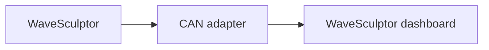

# WaveSculptor motor controller

The WaveSculptor dashboard monitors a Prohelion WaveSculptor22 motor controller and appears as a tab in the sidebar once the controller is added to the [Profile](../../Getting_Started/Profiles.md).
The dashboard decodes the controller with the message and signal names of the [WaveSculptor22 DBC file](../../../../Motor_Controllers/WaveSculptor22/User_Manual/DBC.md).

The WaveSculptor communicates only over CAN and takes its low-voltage supply from the CAN cable.
A [CAN adapter](../CAN_Bus_Protocols/CAN_Bus_Adapters.md) connected to a powered CAN bus is therefore required before the dashboard shows any data.

<figure markdown>

<figcaption>The WaveSculptor sends CAN messages through a CAN adapter, and the WaveSculptor dashboard in the Profile decodes them</figcaption>
</figure>

The WaveSculptor22 component monitors both the WaveSculptor22 and the WaveSculptor200.
The two controllers send the same CAN messages with the same signals, and the WaveSculptor200 [DBC file](../../../../Motor_Controllers/WaveSculptor200/User_Manual/DBC.md) matches the one the component uses, so add the WaveSculptor22 component whichever controller you have.

Profinity requests the settings below when the WaveSculptor is added, and the **Change Settings** button at the top-right of the dashboard changes them later.

| Parameter | Description |
|---|---|
| **Name** | The name of the component. Must be unique. |
| **Milliseconds Valid** | The timeout of the device, which defaults to 5000. If no traffic is received from the device within this time, Profinity treats the connection as lost. |
| **Base Address** | The CAN base address of the WaveSculptor, which defaults to `0x400` and must match the address programmed into the controller. Every WaveSculptor on the same CAN bus requires a different base address, as described in [CAN Bus and Low Voltage](../../../../Motor_Controllers/WaveSculptor22/User_Manual/CAN_Bus_And_Low_Voltage.md). |

If the dashboard shows no data, check that the CAN adapter status is green, that the **Base Address** matches the address programmed into the controller, and that the adapter and the WaveSculptor use the same CAN bit rate (500 kbit/s by default).

The [WaveSculptor dashboard](WaveSculptor_Dashboard.md) page describes the data, limit indicators and error indicators.
To configure the controller or flash its firmware, refer to [Update WaveSculptor configuration and firmware](Update_WaveSculptor_Configuration_and_Firmware.md).
