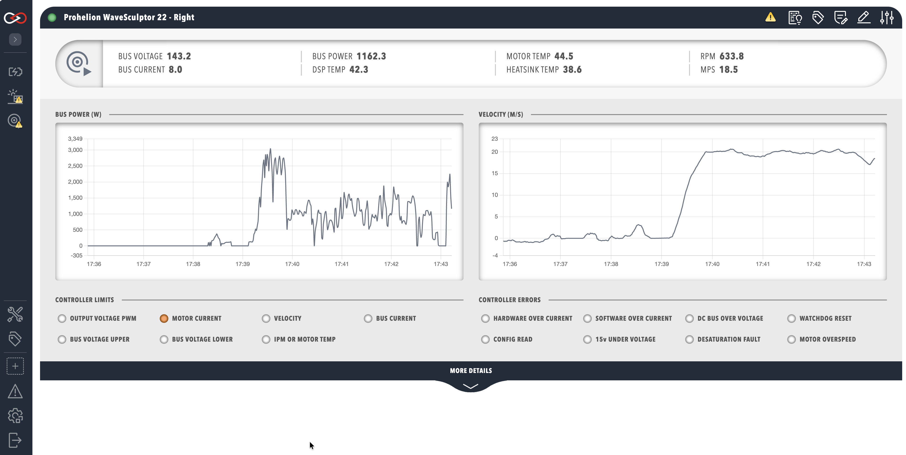

# WaveSculptor dashboard

The WaveSculptor dashboard decodes the CAN messages of a [WaveSculptor](index.md).
It appears as a tab in the sidebar once the controller is added to the [Profile](../../../Getting_Started/Profiles.md).

<figure markdown>

<figcaption>Prohelion WaveSculptor</figcaption>
</figure>

## WaveSculptor data

The top row of the dashboard summarises these values:

- Bus voltage, bus current and bus power.
- Digital signal processor (DSP), motor and heatsink temperatures.
- Motor speed in **RPM**.
- Vehicle speed in **MPS** (metres per second).

A negative bus current or bus power indicates power flowing out of the WaveSculptor, for example during regenerative braking.
Profinity calculates **BUS POWER** as the product of bus voltage and bus current.
**MOTOR TEMP** reads correctly only when a motor temperature sensor is connected and configured, and **MPS** depends on the tyre diameter entered in the WaveSculptor configuration.

The dashboard also shows time-series graphs of bus power and velocity, a **CONTROLLER LIMITS** panel (amber) and a **CONTROLLER ERRORS** panel (red).
An indicator lights when the matching bit of the Status message is set.
Only one control loop limits the motor torque at any one time, so a single limit indicator is lit.
**MOTOR CURRENT** or **VELOCITY** lighting means the setpoint has been reached during normal operation.

| Limit indicator | Meaning |
|---|---|
| **OUTPUT VOLTAGE PWM** | The bus voltage is too low to produce more current and more torque. |
| **MOTOR CURRENT** | The motor current setpoint is being regulated. |
| **VELOCITY** | The velocity setpoint has been reached. |
| **BUS CURRENT** | The bus current setpoint is limiting any further increase in motor torque. |
| **BUS VOLTAGE UPPER** | Regenerative torque is limited by the maximum bus voltage setpoint. |
| **BUS VOLTAGE LOWER** | Drive torque is limited by the minimum bus voltage setpoint. |
| **IPM OR MOTOR TEMP** | A temperature limit is reducing the motor torque. IPM is the intelligent power module. |

| Error indicator | Meaning |
|---|---|
| **HARDWARE OVER CURRENT** | The hardware over current comparator tripped, even if only for an instant. |
| **SOFTWARE OVER CURRENT** | The measured current exceeded the limit in the calibration configuration. |
| **DC BUS OVER VOLTAGE** | The bus voltage exceeded the over voltage limit in the calibration configuration. |
| **WATCHDOG RESET** | The watchdog reset the controller. This is a warning rather than a fault and stays set until the next power cycle. |
| **CONFIG READ** | The stored configuration could not be read at start-up, so default values are in use. |
| **15v UNDER VOLTAGE** | The internal 15 V rail has dropped too low. |
| **DESATURATION FAULT** | On the WaveSculptor22 this indicates an under voltage of the metal-oxide-semiconductor field-effect transistor (MOSFET) driver. |
| **MOTOR OVERSPEED** | The motor speed exceeded the configured maximum by 15%. |

Each limit and error is described in more detail on the [Observation](../../../../../Motor_Controllers/Config_Software/Observation.md) page of the configuration software manual.
The **MORE DETAILS** banner reveals the internal controller state, which is useful for debugging and not needed for general use.
The state includes these values:

- Low-voltage rails.
- Phase currents.
- Direct-quadrature (D-Q) reference frame vectors.
- Slip speed.
- Odometer and serial number.
- CAN error counts.

The default dashboard does not display some signals, such as the motor hall sequence error.
Bind these signals to a lamp in a [custom dashboard](../../../Customising_Profinity/Dashboards/Motor_Controller_Dashboard_Example.md).
