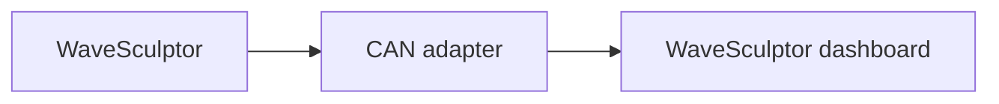

# WaveSculptor motor controller

The WaveSculptor dashboard monitors a Prohelion WaveSculptor22 motor controller.
It appears as a tab in the sidebar once the controller is added to the [Profile](../../../Getting_Started/Profiles.md).
The dashboard decodes the controller with the message and signal names of the CAN database (DBC) file, described on the [WaveSculptor22 DBC file](../../../../../Motor_Controllers/WaveSculptor22/User_Manual/DBC.md) page.

The WaveSculptor communicates only over CAN and takes its low-voltage supply from the CAN cable.
A [CAN adapter](../../CAN_Bus_Protocols/CAN_Bus_Adapters/index.md) connected to a powered CAN bus is therefore required before the dashboard shows any data.

<figure markdown>

<figcaption>The WaveSculptor sends CAN messages through a CAN adapter, and the WaveSculptor dashboard in the Profile decodes them</figcaption>
</figure>

The WaveSculptor22 component monitors both the WaveSculptor22 and the WaveSculptor200.
The two controllers send the same CAN messages with the same signals.
The WaveSculptor200 [DBC file](../../../../../Motor_Controllers/WaveSculptor200/User_Manual/DBC.md) matches the one the component uses.
Add the WaveSculptor22 component whichever controller you have.

Profinity requests the settings in the following table when you add the WaveSculptor.
The **Change Settings** button on the dashboard changes them later.

| Parameter | Description |
|---|---|
| **Name** | The name of the component. Must be unique. |
| **Milliseconds Valid** | The timeout of the device, in milliseconds. The default is 5000. Enter -1 for no timeout. |
| **Base Address** | The CAN base address of the WaveSculptor. The default is `0x400`. It must match the address programmed into the controller. |

If Profinity receives no traffic from the device within the **Milliseconds Valid** time, it treats the connection as lost.
Every WaveSculptor on the same CAN bus requires a different base address, as described in [CAN Bus and Low Voltage](../../../../../Motor_Controllers/WaveSculptor22/User_Manual/CAN_Bus_And_Low_Voltage.md).

If the dashboard shows no data, check these things:

- The CAN adapter status is green.
- The **Base Address** matches the address programmed into the controller.
- The adapter and the WaveSculptor use the same CAN bit rate (500 kbit/s by default).

The [WaveSculptor dashboard](WaveSculptor_Dashboard.md) page describes the data, limit indicators and error indicators.
To configure the controller or flash its firmware, refer to [Update WaveSculptor configuration and firmware](Update_WaveSculptor_Configuration_and_Firmware.md).
