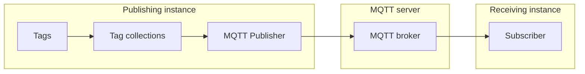

# MQTT Publisher

The **MQTT Publisher** sends the current values of one or more profile [tag collections](../../Tags/Collections/index.md) to a Message Queuing Telemetry Transport (MQTT) broker, either on a fixed interval or whenever a member tag's value changes.
Any system subscribed to the broker receives the data as it is published.

A publisher pushes to a subscriber that is listening now, whereas a [logger](../Loggers/index.md) writes to a file or database for later retrieval.
To bring data from an external source into Profinity instead, use the [MQTT Subscriber](MQTT_Subscriber.md).

<figure markdown>

<figcaption>The MQTT Publisher in the publishing instance sends tag collections to the broker on an MQTT server, on an interval or when a value changes, and the broker delivers them to every subscriber in the receiving instance</figcaption>
</figure>

!!! info "Licence required"
    The MQTT Publisher requires the **Data Relay** licensed feature. Refer to [Licensing](../../Licensing.md) for the editions that include it.

## Quick start

Profinity does not run a broker, so you need one first: a self-hosted MQTT broker or a managed cloud MQTT service.
These steps publish one collection as JSON.

1. Add an **MQTT Publisher** to your profile from the **Publishers & Subscribers** category.
2. Enter the broker address in **Server URL**, for example `mqtt://broker.example.com:1883`.
3. Enter a **Device ID** that no other client on the broker uses.
4. Leave **Payload** as **JSON** and enter a **Destination Topic**, for example `profinity/site1/tags`.
5. Under **Collections**, add a collection and choose it by name.
6. Save the settings.

The publisher does not start until at least one collection is selected and every selected collection exists in the profile.
With **Auto Connect** on, which is the default, it starts when the profile loads, and its status shows **On** while it is running.
To check that it works, subscribe to the topic on your broker.
The data arrives in the form shown in [Payload formats](#payload-formats).

## Settings

### Connection settings

| Setting | Required | Purpose |
|---|---|---|
| **Server URL** | Yes | The broker's connection URL, for example `mqtt://broker.example.com:1883`. The accepted schemes are `mqtt`, `mqtts`, `http` and `https`. |
| **Trust all server certificates** | No | Disables Transport Layer Security (TLS) server certificate validation for this connection. Enable only when connecting to a trusted broker using a self-signed certificate. |
| **Username** / **Password** | No | Credentials for broker authentication, when the broker requires them. The password is stored encrypted and can be left empty for username-only authentication. |
| **Device ID** | Yes | The MQTT client ID this publisher connects with. It must be unique among the clients connected to the broker. It is also used as the **Edge Node ID** when that field is empty. |
| **Payload** | No | **JSON** or **Sparkplug B**, an MQTT payload format for industrial data. Defaults to **JSON**. Refer to [Payload formats](#payload-formats). |
| **Destination Topic** | Yes, for JSON | The topic the flat JSON payload is published to, for example `profinity/site1/tags`. Shown only when **Payload** is **JSON**. A save without it fails with "You must provide a destination topic." |

The URL sets the connection:

- Use `mqtts://` to enable TLS, and `mqtt://` for an unencrypted connection.
- The port comes from the URL. When the URL has no port, the publisher uses 1883 for `mqtt://` and 8883 for `mqtts://`.

### Sparkplug settings

These settings are shown only when **Payload** is **Sparkplug B**:

| Setting | Required | Purpose |
|---|---|---|
| **Group ID** | Yes | The Sparkplug group ID used in the topic path. A save without it fails with "You must provide a Sparkplug Group ID." |
| **Edge Node ID** | No | The Sparkplug edge node ID. Defaults to **Device ID** when left empty. |

### Publishing settings

| Setting | Default | Purpose |
|---|---|---|
| **Collections** | None | The tag collections to publish. Add one or more, and choose each by name in the **Collection** field. An empty entry fails validation with "You must select a collection." |
| **Auto Connect** | On | Starts the publisher when the profile loads. Refer to [Connections and reconnecting](../Connections_and_Reconnecting.md). |
| **Logging mode** | **Snapshot** | **Snapshot**, **On Change** or **Everything**. Refer to [Logging modes](../Logging_Modes.md) for what each mode publishes. |
| **Update Interval (Seconds)** | 10 | From 1 to 86400 seconds. Refer to [Logging modes](../Logging_Modes.md) for how each mode uses it. |

## Payload formats

**JSON** publishes a flat object of tag key to numeric value, with no timestamp, quality, or metadata alongside it.
Each key is the tag path with every character other than a letter or digit replaced by an underscore, so `Vehicles/Car1/Speed` becomes the key `Vehicles_Car1_Speed`:

```json
{
  "Vehicles_Car1_Speed": 87.4
}
```

A sample is included only when it has good quality and holds a finite number.
The payload has no place for quality, so a tag that is stale, lost or not numeric does not appear in it.

**Sparkplug B** follows the [Sparkplug](https://sparkplug.eclipse.org/) convention for MQTT topics and payloads, which industrial platforms use.
The publisher appears to a Sparkplug-aware platform as an edge node, identified by the **Group ID** and **Edge Node ID**.
It announces itself when it connects, and announces itself again when the platform asks.
Sparkplug B is available on the MQTT Publisher only, not on the [Webhook Publisher](Webhook_Publisher.md).

## Status and troubleshooting

The MQTT Publisher shows **On** while it is running, **Off** when it is stopped, and **Error** when the connection to the broker fails or a publish fails.
The status returns to **On** after the next successful publish.

The publisher keeps trying to connect every 5 seconds.
A broker that is down when the publisher starts, or that goes away later, leaves the publisher in **Error** until the broker is back.
You do not need to restart the publisher.
A rejected login is treated the same way, so fixing the credentials needs no restart either.
The log records the reason once for each outage.
Refer to [Connections and reconnecting](../Connections_and_Reconnecting.md) for the full behaviour.

If the status shows **Error**, check the [Logs](../../Administration/Logs_Config.md) for the underlying message, then confirm that:

- The **Server URL** scheme and port match the broker.
- The **Username** and **Password** are accepted.
- No other client on the broker uses the same **Device ID**.
- **Trust all server certificates** is on, if the broker has a self-signed certificate.

To publish to a plain HTTP receiver, use the [Webhook Publisher](Webhook_Publisher.md).
[Rule actions](../../Tags/Rules/Actions/index.md) can also send a one-off MQTT message or webhook, and need the **Tag Rule Actions** licensed feature.
