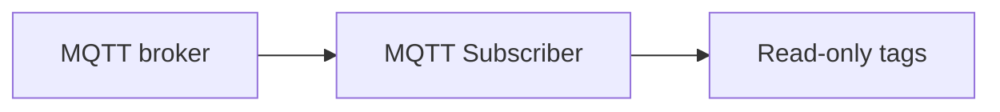

# MQTT Subscriber

The **MQTT Subscriber** connects to a Message Queuing Telemetry Transport (MQTT) broker, subscribes to a [Sparkplug](https://sparkplug.eclipse.org/) B namespace, and writes the incoming metrics into the profile tag tree as read-only tags.
It is the inbound counterpart to the [MQTT Publisher](MQTT_Publisher.md), which only sends, and it sits in the **Publishers & Subscribers** category.

Use it to bring the data of an external Sparkplug edge node, or of a supervisory control and data acquisition (SCADA) or industrial IoT platform, into Profinity as ordinary tags.
The tags can be shown on a [dashboard](../../Customising_Profinity/Dashboards/index.md), logged, used in a rule, or read by a script.

<figure markdown>

<figcaption>The MQTT Subscriber receives Sparkplug metrics from an MQTT broker and writes them into the profile tag tree as read-only tags</figcaption>
</figure>

The MQTT Subscriber is for an external Sparkplug B source, such as a third-party edge device, gateway, or platform like Ignition.
To share tags between two Profinity instances, use [Tag Relay](../Tag_Relays/index.md), which has its own snapshot format and does not use Sparkplug.

!!! info "Licence required"
    The MQTT Subscriber requires the **Data Relay** licensed feature, included in the **Server** and **Enterprise** editions. Without it the feature is unavailable. Refer to [Licensing](../../Administration/Licensing.md) for what each edition includes.

## Quick start {#adding-an-mqtt-subscriber}

Add an **MQTT Subscriber** to your profile from the **Publishers & Subscribers** category, then configure its settings.
The subscriber does not start unless **Server URL**, **Topic filter**, **Host ID** and **Tag path prefix** are all set.

## Settings

### Connection settings

| Setting | Required | Purpose |
|---|---|---|
| **Server URL** | Yes | The broker's connection URL, for example `mqtt://broker.example.com` or `mqtts://broker.example.com`. The accepted schemes are `mqtt` and `mqtts`, and `mqtts://` enables Transport Layer Security (TLS). |
| **Broker port** | No | The broker's port, from 1 to 65535. Defaults to `1883`. A port written in the **Server URL** takes precedence. With an `mqtts://` URL and no port in the URL, leaving **Broker port** at `1883` connects on `8883`, and any other value is used as entered. |
| **Auto Connect** | No | Connects to the broker when the profile is loaded. On by default. With it off, the subscriber waits until you switch it on with **Connect**. |
| **Trust all server certificates** | No | Disables TLS server certificate validation. Enable only when connecting to a trusted broker that uses a self-signed certificate. |
| **Username** / **Password** | No | Credentials for broker authentication, when the broker requires them. The password is stored encrypted. |
| **Client ID** | No | The MQTT client ID. Leave blank to generate one. |

### Sparkplug settings

| Setting | Required | Purpose |
|---|---|---|
| **Topic filter** | Yes | The Sparkplug topic filter to subscribe to. Defaults to `spBv1.0/#`, the whole Sparkplug B namespace. Narrow it to one group, for example `spBv1.0/Plant1/#`, to subscribe to only that group. |
| **Host ID** | Yes | The name this subscriber announces as a Sparkplug primary host application, for example `Profinity`. It is published on `spBv1.0/STATE/{hostId}`. It must not contain `+`, `#` or `/`. |

### Tags settings

| Setting | Required | Purpose |
|---|---|---|
| **Tag path prefix** | Yes | The profile subtree that subscribed metrics are written under, for example `External/Ignition`. The subscriber owns this subtree, so no other component or script should create tags beneath it. Refer to [Tag tree path](../../Tags/Selecting_Tags/Tag_Tree_Path.md) for the path rules. |

## Where tags appear

An incoming metric is written to a path built from the **Tag path prefix** and the Sparkplug group, edge node, device, and metric names:

```
{prefix}/{groupId}/{edgeNodeId}/{deviceId}/{metric segments}
```

For example, with the prefix `External`, group `Plant1`, edge node `Node1`, device `Pump` and metric `Temp/Out`, the tag path is `External/Plant1/Node1/Pump/Temp/Out`.
The device segment is omitted for a node-level metric, which arrives in `NBIRTH` and `NDATA` messages, and is present for a device-level metric, which arrives in `DBIRTH` and `DDATA` messages.
A metric name that contains `/` adds further segments beneath the device.

!!! warning "Subscribed tags are read-only"
    A tag the MQTT Subscriber creates cannot be written to from a dashboard, a script or any other source, and the write is rejected.
    The only thing that updates one of these tags is the next Sparkplug message for that metric.

To react to an incoming value, use a **Run On Tag Change** script watching the tag, which reads the new sample the same way it would for any other tag change and is not given the raw MQTT payload.
Refer to [Script Types](../../Developing_with_Profinity/Scripting/Script_Types/index.md) for the script types.

If an incoming metric's path is already occupied by something that is not one of this subscriber's own tags, such as an existing device tag, a Tag Relay mirror, a script register or a [derived tag](../../Tags/Derived_Tags/index.md), that one metric is skipped and a warning is written to the log.
The rest of the message is still applied.

## Sparkplug behaviour

### Messages applied and ignored

The subscriber applies `NBIRTH`, `NDATA`, `NDEATH`, `DBIRTH`, `DDATA` and `DDEATH` messages, so it handles both node-level and device-level publishers.
It ignores `STATE`, `NCMD` and `DCMD` messages as data, even under the default `spBv1.0/#` filter, so a command or state message is never written to a tag.

### Host state

While connected, the subscriber publishes a retained message `{"online": true, ...}` to `spBv1.0/STATE/{hostId}`.
It publishes `{"online": false, ...}` on a graceful stop or, if the connection drops unexpectedly, through the broker's Last Will.
The retained message stays on the broker while the subscriber is offline, so a Sparkplug-aware consumer can see the last known state.

### Sequence gaps and metric death {#sequence-gaps-and-rebirth}

When a message arrives out of sequence, the subscriber requests a rebirth from the edge node and does not apply the out-of-sequence values as current values.

When a metric dies, or a later birth message omits a metric that was known before, the tag is kept and its quality is set to **Stale**.
History and dashboard bindings against that tag path keep working and show the value as no longer live.
Refer to [Tags](../../Tags/index.md) for how data quality is shown.

### Data types and malformed payloads {#data-types}

The subscriber supports scalar metric types only: boolean, string, the integer widths, float, double, and DateTime.
Dataset, template, bytes, and property-set values are skipped.
A metric that arrives by alias with no earlier birth message is also skipped, because its name is not known.
A payload that cannot be decoded is logged and dropped, and the subscriber stays connected.

## Reconnection

The subscriber keeps trying to connect every 5 seconds, both when the broker is down at start and after a lost connection.
It stays in **Error** until the broker is back, and the log records the reason once for each outage.

## Status and troubleshooting

The MQTT Subscriber shows **On** while it is connected to the broker, **Error** while it is running but not connected, and **Off** when it is stopped.
While it is in **Error**, it retries as described under [Reconnection](#reconnection).

If the status shows **Error**, check the [Logs](../../Administration/Logs_Config.md) for the underlying message, then confirm that the **Server URL** scheme and **Broker port** match the broker, and that the **Username** and **Password** are accepted.
If the component stays **Off**, confirm that **Server URL**, **Topic filter**, **Host ID** and **Tag path prefix** are all set, because the subscriber does not start without them.
If the component is **On** but no tags appear, check that the **Topic filter** covers the group you expect.

Use the [MQTT Publisher](MQTT_Publisher.md) or [Webhook Publisher](Webhook_Publisher.md) to send data out, and [Tag Relays](../Tag_Relays/index.md) to share tags between Profinity instances.
