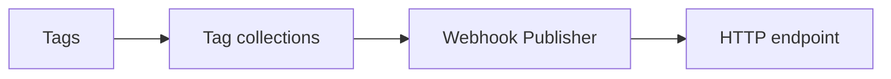

# Webhook Publisher

The **Webhook Publisher** pushes the current values of one or more profile [tag collections](../../Tags/Collections.md) to an HTTP or HTTPS address with an HTTP POST, either on a fixed interval or whenever a member tag's value changes.
It uses the same trigger modes as the [MQTT Publisher](MQTT_Publisher.md).
Use it when the consumer is an ordinary web service rather than an MQTT broker.

It sits in the **Publishers & Subscribers** category rather than **Loggers** because a publisher pushes to a receiver that is listening now, whereas a [logger](../Loggers/index.md) writes to a file or database for later retrieval.

<figure markdown>

<figcaption>The Webhook Publisher sends tag collections to an HTTP or HTTPS endpoint with a POST, on an interval or when a value changes</figcaption>
</figure>

!!! info "Licence required"
    The Webhook Publisher requires the **Data Relay** licensed feature, included in the **Server** and **Enterprise** editions. Without it the feature is unavailable. Refer to [Licensing](../../Administration/Licensing.md) for what each edition includes.

## Quick start {#adding-a-webhook-publisher}

These steps publish one collection to a web service with no authentication.

1. Add a **Webhook Publisher** to your profile from the **Publishers & Subscribers** category.
2. Enter the address of the receiver in **Destination URL**.
3. Under **Collections**, add a collection and choose it by name, then save.

The publisher does not start until at least one collection is selected and every selected collection exists in the profile.
With **Auto Connect** on, which is the default, it starts when the profile loads.

## Settings

### Connection settings

| Setting | Required | Purpose |
|---|---|---|
| **Destination URL** | Yes | The HTTP or HTTPS address the publisher POSTs to on each publish. The URL is stored encrypted and masked on screen, because webhook URLs often embed an access token. A save without it fails with "You must provide a webhook destination URL." |
| **Authentication** | No | **None**, **Bearer token**, **API key header** or **Basic auth**. Defaults to **None**. Refer to [Authentication](#authentication). Selecting a mode shows its credential fields, and each field is required for that mode. |

### Publishing settings {#logger-settings}

| Setting | Default | Purpose |
|---|---|---|
| **Collections** | None | The tag collections to publish. Add one or more, and choose each by name in the **Collection** field. An empty entry fails validation with "You must select a collection." |
| **Logging mode** | **Snapshot** | Chooses between **Snapshot**, **On Change** and **Everything**. Refer to [Logging modes](../Logging_Modes.md) for what each mode publishes. |
| **Update Interval (Seconds)** | 10 | From 1 to 86400 seconds. In **Snapshot** mode this is how often a full publish runs, and in **On Change** and **Everything** modes it is how often accumulated changes are sent. |
| **Auto Connect** | On | Starts the publisher automatically when the profile is loaded. |

## Authentication

The Webhook Publisher adds the selected credential as a header on every request.

| Mode | Fields | Behaviour |
|---|---|---|
| **None** | None | No authentication header is added. |
| **Bearer token** | **Bearer token** | Adds `Authorization: Bearer <token>`. |
| **API key header** | **API key header name**, **API key header value** | Adds a header with the configured name and value, for example `X-Api-Key: <value>`. |
| **Basic auth** | **Basic auth username**, **Basic auth password** | Adds `Authorization: Basic <base64(username:password)>`. |

Whichever mode you choose, the credential is stored encrypted and masked on screen.

!!! warning "Destination addresses are not restricted"
    Anyone who can edit the profile can point a Webhook Publisher at any address the Profinity server can reach, including internal services. Restrict profile editing accordingly.

## Payload format

Each publish sends one POST containing a JSON array of the samples in that batch, never one POST per sample.
Each entry has the same fields that `GET /api/v2/Tags/Sample/{path}` returns for a tag sample, limited to `fullTagId`, `utcTimestamp`, `quality` and `value`.
The API's `reason`, `message` and `metadata` fields are not sent.

```json
[
  {
    "fullTagId": "Vehicles/Car1/Speed",
    "utcTimestamp": "2026-09-24T04:12:03Z",
    "quality": "Good",
    "value": 87.4
  }
]
```

Each entry reports the quality the tag had when the sample was taken. A Stale entry carries its last `value`, and an entry for a tag that is Unavailable or Bad has `quality` and no `value`. Only tags that hold a finite number are included.

## Delivery health

When the destination returns a status other than a success code, cannot be reached, or takes longer than 10 seconds to respond, the publisher makes up to three attempts in total, waiting 1 second before the second attempt and 2 seconds before the third.
The attempt count, timeout and waits cannot be changed in Profinity 2.3.
If all three attempts fail, the batch is not retried further and the publisher reports **Error** until a later publish succeeds.

The publisher shows **On** while it is running, **Off** when it is stopped, and **Error** after a failed delivery.
It also exposes two tags for a dashboard or rule:

| Tag | Meaning |
|---|---|
| `LastDeliverySuccess` | `true` when the most recent delivery succeeded, and `false` otherwise. |
| `LastDeliveryError` | Empty when healthy. After a failed delivery it reads "Webhook delivery failed - see log for details." |

If the status shows **Error**, check the [Logs](../../Administration/Logs_Config.md) for the underlying message, then confirm that:

- The **Destination URL** is correct.
- The receiver accepts the selected **Authentication**. A 401 or 403 response points to a wrong credential.
- The receiver returns a success status.
- The receiver presents a certificate that the Profinity server trusts, for an HTTPS destination. The Webhook Publisher has no option to skip certificate validation.

## Related pages

Use the [MQTT Publisher](MQTT_Publisher.md) to publish to a broker, or the [MQTT Subscriber](MQTT_Subscriber.md) to bring external data in.
A [rule action](../../Tags/Actions.md) can also send a one-off webhook or MQTT message, and needs the **Tag Rule Actions** licensed feature.
