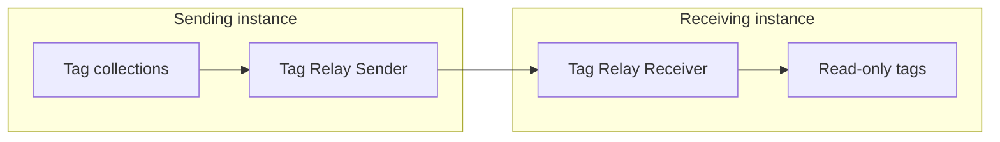

# Tag Relay Sender

The **Tag Relay Sender** exports the [tags](../../Tags/index.md) that belong to the [collections](../../Tags/Collections/index.md) you select.
It sends them to a remote Profinity instance running a [Tag Relay Receiver](Tag_Relay_Receiver.md), either as a full snapshot on a fixed interval (**Snapshot** mode) or as a full snapshot on connect and resync with value-change deltas between those snapshots (**On Change** mode).
Each full snapshot includes tag metadata such as units so tooling on the receiving instance can use it.

It sends over HTTPS or Message Queuing Telemetry Transport (MQTT) and sits in the **Tag Relays** category.
The position of each tag in the exported tree is its [tag tree path](../../Tags/Selecting_Tags/Tag_Tree_Path.md).
The [Tag relay](../../Tags/Tag_Relay.md) page covers the concept of sender and receiver roles.

<figure markdown>

<figcaption>The Tag Relay Sender in the sending instance sends a snapshot of its tag collections to the Tag Relay Receiver in the receiving instance, directly over HTTPS or through an MQTT broker, and the receiver mounts them as read-only tags</figcaption>
</figure>

<figure markdown>

<figcaption>Sender and receiver roles, with per-site tag prefixes on the receiving instance</figcaption>
</figure>

!!! info "Licence required"
    The Tag Relay Sender requires the **Data Relay** licensed feature. Refer to [Licensing](../../Licensing.md) for the editions that include it.

## Quick start {#adding-a-tag-relay-sender}

Only the member tags of the selected collections are sent, so create the collections first, as described in [Collections](../../Tags/Collections/index.md).
To set up a first relay end to end, refer to [Set up a tag relay](Set_Up_a_Tag_Relay.md).

1. Add a **Tag Relay Sender** to your profile from the **Tag Relays** category.
2. Set **Protocol** to **HTTPS** or **MQTT**.
3. Under **Collections**, add one or more collections to export.
   The list shows each collection's display name, with its group path when it sits in a group, as described in [Collections](../../Tags/Collections/index.md).
4. Enter the settings for your protocol, from [HTTPS settings](#https-settings) or [MQTT settings](#mqtt-settings).
5. Save the settings.
   With **Auto Connect** on, which is the default, the sender starts when the profile loads and its status shows **On**.

The sender needs at least one collection to be selected, and every selected collection must exist in the profile, before it can start.
A sender set to HTTPS also needs the **Remote base URL** and **Bearer token**, and a sender set to MQTT also needs the **MQTT broker URL** and **MQTT snapshot topic**.
To check that it works, wait for one publish interval and confirm that the total number of messages sent on the component dashboard has increased.
That total increases when a snapshot or a delta is delivered.

## Settings

### Tag Relay settings

| Setting | Default | Purpose |
|---|---|---|
| **Protocol** | **HTTPS** | **HTTPS** posts to the remote instance's relay API, and **MQTT** publishes a JSON payload on a broker. Defaults to HTTPS. |
| **Mode** | **Snapshot** | **Snapshot** sends the full collection tree on every interval. **On Change** sends a full snapshot on connect and reconnect, flushes value changes as deltas on the change interval, and sends another full snapshot on the resync interval so a rebooted receiver can rebuild tags that have not changed. Defaults to Snapshot. |
| **Sender tag path prefix** | None | Optional. Added as outer path segments on the exported tree, beneath the receiver's own **Receiver tag path prefix**. For an example, refer to [Set up a tag relay](Set_Up_a_Tag_Relay.md). |
| **Exclude relay-managed nodes** | On | Excludes tags that were received from another Tag Relay, so that mirrored data is not sent on again in a loop. Enabled by default. |
| **Snapshot / change interval (seconds)** | `60` | In Snapshot mode, how often a full snapshot is sent. In On Change mode, how often pending value changes are flushed as a delta. From 5 to 86400 seconds. Defaults to 60. |
| **Resync interval (seconds)** | `300` | On Change only. How often a full snapshot with metadata is sent again. Must be at least the change interval. Defaults to 300. |
| **Auto Connect** | On | Starts sending when the profile loads. Enabled by default. Refer to [Connections and reconnecting](../Connections_and_Reconnecting.md). |
| **Collections** | None | One or more profile [tag collections](../../Tags/Collections/index.md) to export. The picker shows display names (and group path); the profile stores the collection id. |

### HTTPS settings

| Setting | Default | Purpose |
|---|---|---|
| **Remote base URL** | None | The remote Profinity base URL, for example `https://receiver:443/`. Required when the protocol is HTTPS. |
| **Bearer token** | None | A JSON Web Token (JWT) for a user on the remote instance with the **Receive external tags** permission, or for an Admin user. Use the token of a service account created on the receiving instance, so the relay keeps working without anyone signing in again. Required when the protocol is HTTPS, and stored encrypted. |
| **Trust all server certificates** | Off | Disables Transport Layer Security (TLS) server certificate validation. Enable only when connecting to a trusted receiver that uses a self-signed certificate. |

### MQTT settings

| Setting | Default | Purpose |
|---|---|---|
| **MQTT broker URL** | None | The broker's connection URL. Use an `mqtts://` scheme to enable TLS. Required when the protocol is MQTT. |
| **MQTT broker port** | `1883` | The broker's port. Defaults to `1883`. A port in the broker URL takes precedence. With an `mqtts://` URL that has no port, leaving this at `1883` connects on `8883`. |
| **Trust all server certificates** | Off | Disables TLS server certificate validation. Enable only when connecting to a trusted broker that uses a self-signed certificate. |
| **MQTT username** / **MQTT password** | None | Credentials for broker authentication, when the broker requires them. The password is stored encrypted. |
| **MQTT client id** | None | Optional. Leave blank to generate a client ID. Each client on the broker needs a different ID. |
| **MQTT snapshot topic** | None | The topic for UTF-8 JSON envelopes, for example `profinity/relay/site1`. Snapshots use a `tree` property and deltas use an `items` property on the same topic. Required when the protocol is MQTT. The receiver must subscribe to the same topic. |

## Example

This example is for illustration only.
It shows a sender that publishes one collection to a broker every 60 seconds in Snapshot mode.
Add it to the `components` list in `profile.yaml`, or enter the same values in the component settings.

```yaml
- component:
    type: TagRelaySender
    id: TagRelaySender1
    name: Tag Relay Sender
    tagTreeParentPath: /
    protocol: Mqtt
    mode: Snapshot
    snapshotIntervalSeconds: 60
    autoConnect: true
    mqttBrokerUrl: mqtt://BROKER_HOST
    mqttBrokerPort: 1883
    mqttSnapshotTopic: profinity/relay/site1
    collections:
    - collectionName: COLLECTION_NAME
```

Replace `BROKER_HOST` with the host name or address of your MQTT broker.
Replace `COLLECTION_NAME` with the name of a collection that exists in the profile.
The receiver must subscribe to the same `mqttSnapshotTopic` value.

## Running the sender

The component shows **On** while it is running and **Off** when it is stopped.
The component has **Start Sender** and **Stop Sender** actions, and a toggle that combines the two.
Its dashboard shows its status and the total number of messages sent.

The status shows whether the sender is running, not whether the last snapshot was delivered, so a sender that shows **On** can still be failing to deliver.
The total number of messages sent increases when a snapshot or a delta is delivered.

## Troubleshooting

The sender logs the reason when it refuses to start.
Check the [Logs](../../Administration/Logs_Config.md) first.
When the receiver or broker answers and refuses a snapshot, the log holds a warning for the first refusal of an outage, and records later refusals in the same outage at debug level only.

| What you see | Cause | What to do |
|---|---|---|
| The sender shows **Error**. | The sender is running but cannot reach its MQTT broker. It retries every second, and the log records the first failure of the outage as an error. | Check the broker URL, port, credentials, and TLS settings. Refer to [Connections and reconnecting](../Connections_and_Reconnecting.md). |
| The sender does not start. | No collection is selected. | Select at least one collection under **Collections**. |
| The sender does not start. | A selected collection does not exist. | Select only collections that exist in the profile. |
| The sender does not start. | The protocol is HTTPS, and the **Remote base URL** or **Bearer token** is missing. | Enter the **Remote base URL** and **Bearer token**. |
| The sender does not start. | The protocol is MQTT, and the **MQTT broker URL** or **MQTT snapshot topic** is missing. | Enter the **MQTT broker URL** and **MQTT snapshot topic**. |
| The sender shows **On**, but the total number of messages sent stays at zero. | Over HTTPS, the warning shows 401 or 403. The token is missing or invalid, or the user does not have the **Receive external tags** permission. | Correct the **Bearer token**, or grant the **Receive external tags** permission. Refer to [Roles and permissions](../../Administration/Users_and_Access/Roles_and_Permissions.md). |
| The sender shows **On**, but the total number of messages sent stays at zero. | Over HTTPS, the warning shows 409. The receiver rejected the batch because of a [collision](../../Tags/Tag_Relay.md#collision-rules) with a tag that relay does not own. | Refer to the [collision rules](../../Tags/Tag_Relay.md#collision-rules). |
| The sender shows **On**, but the total number of messages sent stays at zero. | Over HTTPS, the warning shows 400. The receiver rejected the request, which includes a request body over 5 MB. | Check that the request body is 5 MB or smaller. |
| The sender shows **On**, but the total number of messages sent stays at zero. | Over HTTPS, a failure to reach the receiver, such as a name lookup, connection, or certificate failure, is logged as a warning each time a snapshot is attempted. | Check the **Remote base URL**. Turn on **Trust all server certificates** only for a trusted receiver that uses a self-signed certificate. |
| The sender shows **On**, but the total number of messages sent stays at zero. | Over MQTT, the broker answers and refuses the snapshot. | Check the Logs and the MQTT broker settings. |
| The sender delivers, but nothing appears on the receiver. | The receiver uses a different protocol. | Set the receiver to the same protocol as the sender. |
| The sender delivers, but nothing appears on the receiver. | Over MQTT, the receiver subscribes to a different topic from the **MQTT snapshot topic**. | Make the receiver subscribe to the **MQTT snapshot topic**. |

To grant the **Receive external tags** permission that the HTTPS receiver needs, refer to [Roles and permissions](../../Administration/Users_and_Access/Roles_and_Permissions.md).
