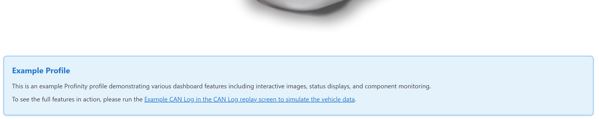

# HTML component

An HTML component displays custom HTML, including images from `/Profile/Images`, or instead shows an OpenStreetMap view that follows a Global Positioning System (GPS) position.
The component sanitises the HTML before it is displayed, so scripts and form controls are removed.

<figure markdown>

<figcaption>HTML component displaying custom HTML content with rich text formatting</figcaption>
</figure>

Use an HTML component for custom content, rich text formatting, embedded images, documentation snippets, and a live map of a GPS position.
Use [Readouts](../Data/Readouts.md), [Tables](../Data/Tables.md), and similar components for structured data, and [Actions](../Interactive/Actions.md) and [Toggles](../Interactive/Toggles.md) for interactive elements.

## Parameters

| Parameter | Type | Required | Default | Description |
|-----------|------|----------|---------|-------------|
| `class` | string | No | None | CSS class added to the content container |
| `content` | string | Yes | None | HTML snippet to display. Refer to [Allowed HTML](#allowed-html) for the tags and attributes that survive sanitising |
| `map` | object | No | None | Switches the component to a map view that follows a GPS position. Refer to [Map parameters](#map-parameters) |

The web interface accepts but ignores `id`.

The content is not displayed when `map` is set with both position sources.

### Allowed tags and attributes {#allowed-html}

The web interface removes everything that is not on an allowed list before it displays `content`:

- Tags: `p`, `div`, `span`, `img`, `a`, `h1` to `h6`, `ul`, `ol`, `li`, `table`, `thead`, `tbody`, `tr`, `th`, `td`, `strong`, `em`, `b`, `i`, `u`, `br`, `hr`, `blockquote`, `pre`, `code`, and `iframe`
- Attributes: `src`, `alt`, `href`, `class`, `style`, `title`, `width`, `height`, `colspan`, `rowspan`, `align`, `valign`, `target`, `rel`, `name`, `loading`, `referrerpolicy`, `sandbox`, `allow`, and `allowfullscreen`
- Removed: `script`, `link`, `embed`, `object`, `form`, `input`, `button`, every event handler attribute such as `onclick`, and every `data-` attribute

A link whose address begins with a single `/` navigates inside the web interface, and any other link opens normally.

### Referencing profile assets in HTML

Use `/Profile/Images/{filename}` in the `src` attribute of an `img` element to show an image from the profile.
Add style rules to the `profile.css` file in the `/Profile/Styles` directory.
The web interface loads the file when it is present.
Apply the rules with the `class` attribute in the HTML.
The `profile.css` file can load further stylesheets with CSS `@import`.
Refer to a content file as `/Profile/Content/{filename}`.

### Map parameters

When both `latSource` and `lonSource` are set, the component shows an OpenStreetMap view centred on the position, with a marker, instead of `content`.
The map is loaded from `openstreetmap.org`, so the browser that displays the dashboard needs internet access.
The map is displayed as stale when a position source has no data.
Set `content` to an empty string when `map` is used, because `content` is required.

Each position source is a full tag path that names the component, as in the map example.
Profinity expands relative `DBC/` and `Properties/` paths only for the `source` of a binding, so a relative path does not work in a position source.

| Parameter | Type | Required | Default | Description |
|-----------|------|----------|---------|-------------|
| `latSource` | string | Yes | None | Full tag path of the latitude, which starts with the name of the component |
| `lonSource` | string | Yes | None | Full tag path of the longitude, which starts with the name of the component |
| `fixSource` | string | No | None | Full tag path of the GPS fix quality. The map is displayed as stale when the fix value is missing or is not greater than `0` |
| `zoom` | integer | No | `14` | OpenStreetMap zoom level |

## Example

The first example displays custom content with an image from the profile:

``` yaml
dashboard:
  items:
    - row:
        items:
          - html:
              class: "info-box"
              content: |
                <div class="info-box__header">System Information</div>
                <div class="info-box__content">
                  <p>This dashboard monitors system status.</p>
                  
                </div>
```

The second example displays a map:

``` yaml
dashboard:
  items:
    - row:
        items:
          - html:
              content: ""
              map:
                latSource: GPS Receiver/DBC/Position/Latitude
                lonSource: GPS Receiver/DBC/Position/Longitude
                fixSource: GPS Receiver/DBC/Position/FixQuality
                zoom: 15
```
