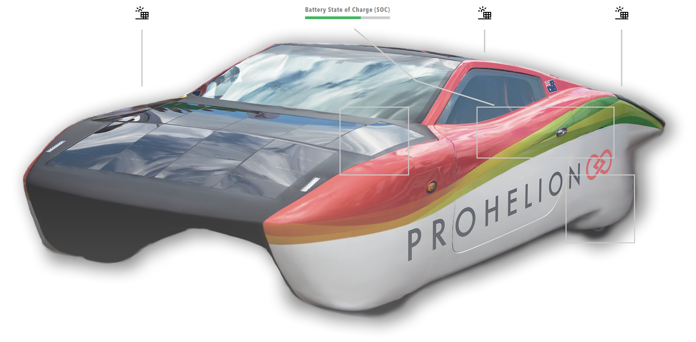

# Image component

An interactive image is a base image from the `/Profile/Images` directory with overlay elements positioned on it, such as clickable regions, icons, buttons, live data values, points, and annotation lines.

<figure markdown>

<figcaption>Interactive image component showing clickable regions, icons, data values, and annotation lines</figcaption>
</figure>

Use an interactive image for device diagrams, system layouts, interactive schematics and visual data overlays.
Use the [HTML](../Content/HTML.md) component with an `img` element for a simple static image, the [Charts](../Data/Charts.md) component for charts, and the [3D model](Model.md) component for a three-dimensional view.

The base image carries seven kinds of overlay element:

- Regions are clickable rectangles that navigate to another page or run an action.
- Icons and buttons are positioned graphics and controls that can run an action.
- Data values display live system data.
- Points anchor annotation lines.
- Annotation lines connect elements and may bend at waypoints called elbows.
- Layers are named groups of overlay elements that the user shows and hides.

Icons can be an emoji, a Scalable Vector Graphics (SVG) path or an image file.
Every overlay element is positioned relative to the base image.
The action invocation, layer, icon source, display type and annotation line parameters are shared with the [3D model](Model.md) component.
They are described on [Overlay elements](Overlay_Elements.md).

## Parameters

| Parameter | Type | Required | Default | Description |
|-----------|------|----------|---------|-------------|
| `id` | string | No | None | Set as the `id` attribute of the image container |
| `class` | string | No | None | Cascading Style Sheets (CSS) class added to the image container |
| `label` | string | No | None | Not used by the web interface |
| `image` | string | Yes | None | Filename of the base image in `/Profile/Images`, given directly with no `value` wrapper |
| `layers` | array | No | None | Named layers for visibility toggles. Refer to [Layers](Overlay_Elements.md#layers) |
| `regions` | array | No | None | Clickable regions. Refer to [Regions](#regions) |
| `icons` | array | No | None | Icons on the image. Refer to [Icons](#icons) |
| `buttons` | array | No | None | Buttons on the image. Refer to [Buttons](#buttons) |
| `dataValues` | array | No | None | Data overlays. Refer to [Data values](#data-values) |
| `points` | array | No | None | Anchor points for annotation lines. Refer to [Points](#points) |
| `annotationLines` | array | No | None | Lines connecting elements. Refer to [Annotation lines](Overlay_Elements.md#image-annotation-lines) |
| `bind` | array | No | None | [Data binding](../../Data_Binding/index.md) whose value replaces the overlay data of the image, using the same structure as the parameters above |
| `enabled` | boolean | No | `true` | Not used by the web interface |
| `unit` | string | No | None | Not used by the web interface. Set `unit` on each data value instead |
| `precision` | number | No | None | Not used by the web interface. Set `precision` on each data value instead |

## Base image

The base image is the foundation of an interactive image component.
Store the image file in the profile's `/Profile/Images` directory (refer to [Image storage](#image-storage)).
Refer to it by filename only.

```yaml
image:
  image: "device-diagram.png"
```

Regions, icons, buttons, data values, points and elbows are all positioned relative to this base image.

## Regions

Regions are clickable rectangular areas on the image.
Regions can navigate to other pages or run actions.
A region also takes the [Region parameters](Overlay_Elements.md#region-parameters) that the 3D model shares.

| Parameter | Type | Required | Default | Description |
|-----------|------|----------|---------|-------------|
| `x` | number | No | None | Left edge of the region as a percentage of the image width, from `0` to `100` |
| `y` | number | No | None | Top edge of the region as a percentage of the image height, from `0` to `100` |
| `width` | number | No | None | Width of the region as a percentage of the image width |
| `height` | number | No | None | Height of the region as a percentage of the image height |
| `coordinates` | string | No | None | Older form of the rectangle, written as `xywh=x,y,width,height`. Use `x`, `y`, `width` and `height` instead. Refer to the note after this table |
| `visibleBorder` | boolean | No | `true` | Whether to show the border of the region |

Profinity still reads `coordinates` when `x`, `y`, `width` and `height` are not all set.
Write the four values of `coordinates` as percentages in plain numbers, without a `%` or `px` suffix.

A region that navigates to another page:

```yaml
regions:
  - id: "battery-region"
    x: 20
    y: 15
    width: 30
    height: 20
    action:
      invoke: Navigate
      target: "/component?componentId=Battery%20Pack"
    label: "View Battery Pack"
    visibleBorder: true
```

A region that runs an action:

```yaml
regions:
  - id: "reset-region"
    x: 60
    y: 40
    width: 10
    height: 8
    action:
      invoke: Component
      actionId: "reset-system"
    label: "Reset System"
```

## Icons

Icons are positioned elements that can display an emoji, an SVG path or an image file.
Icons can run an action when clicked and display a tooltip on hover.
An icon also takes the [Icon parameters](Overlay_Elements.md#icon-parameters) that the 3D model shares.

| Parameter | Type | Required | Default | Description |
|-----------|------|----------|---------|-------------|
| `x` | number | Yes | None | Horizontal position as a percentage of the image width, from `0` to `100` |
| `y` | number | Yes | None | Vertical position as a percentage of the image height, from `0` to `100` |
| `label` | string | No | None | Tooltip text displayed on hover |

An emoji icon:

```yaml
icons:
  - id: "status-emoji"
    x: 50
    y: 50
    icon: "🔋"
    size: 48
    label: "Battery Status"
```

An image file icon:

```yaml
icons:
  - id: "solar-icon"
    x: 25
    y: 25
    icon: "solar-panel.svg"
    size: 64
    label: "Solar Panel"
    action:
      invoke: Navigate
      target: "/component?componentId=Solar%20Panel"
```

An SVG path icon:

```yaml
icons:
  - id: "custom-icon"
    x: 75
    y: 75
    icon: "M 10 10 L 90 90 M 90 10 L 10 90"
    size: 40
    color: "#FF0000"
    label: "Custom Icon"
```

## Buttons

Buttons are dashboard-style buttons positioned on the image.
They run an action when clicked.
A button also takes the [Button parameters](Overlay_Elements.md#button-parameters) that the 3D model shares.

| Parameter | Type | Required | Default | Description |
|-----------|------|----------|---------|-------------|
| `x` | number | Yes | None | Horizontal position as a percentage of the image width, from `0` to `100` |
| `y` | number | Yes | None | Vertical position as a percentage of the image height, from `0` to `100` |

A button that runs an action:

```yaml
buttons:
  - id: "unlock"
    x: 70
    y: 40
    label: "Unlock"
    action:
      invoke: Component
      actionId: "unlock"
```

## Data values

Data values display real-time data from the Profinity system.
A data value also takes the [Data value parameters](Overlay_Elements.md#data-value-parameters) that the 3D model shares, including `bind` and `displayType`.

| Parameter | Type | Required | Default | Description |
|-----------|------|----------|---------|-------------|
| `x` | number | Yes | None | Horizontal position as a percentage of the image width, from `0` to `100` |
| `y` | number | Yes | None | Vertical position as a percentage of the image height, from `0` to `100` |
| `label` | string | No | The `id` | Label displayed above the value. The label can be bound with the `label` target |
| `maxValue` | number | No | None | Maximum of the bar chart scale. A `graph` data value needs a `maxValue` greater than `0` to draw the bar |
| `value` | number or string | No | None | Static value shown when the data value is not bound |

Refer to [Display types](Overlay_Elements.md#display-types) for an example of each display type.

## Points

Points are anchor points for annotation lines.
They can be displayed as visual markers or used as connection points for annotation lines.
A point also takes the [Point parameters](Overlay_Elements.md#point-parameters) that the 3D model shares.

| Parameter | Type | Required | Default | Description |
|-----------|------|----------|---------|-------------|
| `x` | number | Yes | None | Horizontal position as a percentage of the image width, from `0` to `100` |
| `y` | number | Yes | None | Vertical position as a percentage of the image height, from `0` to `100` |
| `size` | number | No | `8` | Diameter of the dot in pixels. A value of `0` hides the dot while the point remains available as an anchor |

A visible point:

```yaml
points:
  - id: "anchor-point"
    x: 50
    y: 50
    size: 8
    color: "#0000FF"
```

An invisible anchor point:

```yaml
points:
  - id: "connection-point"
    x: 30
    y: 40
    size: 0
```

## Example

This example combines every overlay type on one image.
Tag paths such as `DBC/Voltage/Value` are placeholders, so replace them with tags from your own component.

```yaml
dashboard:
  items:
    - row:
        items:
          - image:
              image: "battery-system.png"
              layers:
                - id: "Hotspots"
                  label: "Hotspots"
              regions:
                - id: "battery-region"
                  x: 20
                  y: 15
                  width: 10
                  height: 8
                  action:
                    invoke: Navigate
                    target: "/component?componentId=Battery%20Pack"
                  label: "Battery Pack"
                  visibleBorder: true
                  layer: "Hotspots"
                - id: "charger-region"
                  x: 20
                  y: 40
                  width: 10
                  height: 8
                  action:
                    invoke: Navigate
                    target: "/component?componentId=Charger"
                  label: "Charger"
              icons:
                - id: "status-icon"
                  x: 50
                  y: 20
                  icon: "Lock.svg"
                  size: 24
                  label: "Battery Status"
                  action:
                    invoke: Navigate
                    target: "/component?componentId=Battery%20Pack"
              buttons:
                - id: "unlock"
                  x: 70
                  y: 40
                  label: "Unlock"
                  action:
                    invoke: Component
                    actionId: "unlock"
              dataValues:
                - id: "voltage"
                  x: 10
                  y: 10
                  label: "Voltage"
                  bind:
                    - target: value
                      source: 'DBC/Voltage/Value'
                  displayType: "text"
                  unit: "V"
                  precision: 2
                - id: "soc"
                  x: 10
                  y: 30
                  label: "SOC"
                  bind:
                    - target: value
                      source: 'DBC/PackStateOfCharge/SOCPercent'
                  displayType: "graph"
                  maxValue: 100
                  unit: "%"
                  precision: 1
                - id: "status"
                  x: 50
                  y: 30
                  label: "Status"
                  bind:
                    - target: color
                      source: 'Properties/StatusColourText'
                  displayType: "status"
                  lampColor: "grey"
              points:
                - id: "anchor-1"
                  x: 25
                  y: 75
                  size: 8
                  color: "#FF0000"
              annotationLines:
                - id: "status-line"
                  fromId: "status-icon"
                  toId: "status"
                  elbows:
                    - x: 50
                      y: 25
                - id: "data-line"
                  fromId: "anchor-1"
                  toId: "voltage"
```

## Coordinates

Every position on an interactive image is a percentage of the displayed image.
The value `0` is the left edge or top edge, and `100` is the right edge or bottom edge.
The percentage rule applies to these properties:

- The `x` and `y` of regions, icons, buttons, data values and points.
- The `width` and `height` of regions.
- The elbows of annotation lines.

Because positions are percentages, the overlays stay aligned when the image is scaled.
The `size` of an icon and of a point is the only measurement in pixels.

Write each position as a plain number such as `50` or `12.5`, without a `%` or `px` suffix.
A string such as `"50%"` or `"120px"` is not a number.
A region whose `x`, `y`, `width` and `height` are not all numbers is not drawn from those properties.

A value above `100` places the element outside the image, so keep every position between `0` and `100`.

## Image storage

Store image files, both base images and icon files, in the profile's `/Profile/Images` directory.
Refer to them by filename only, never by full path.

The [Base image](#base-image) section shows how the dashboard YAML refers to an image.

## Working with overlays

Regions and icons display their `label` as a tooltip on hover.
A button displays its `label` as its caption.
A data value displays no tooltip because it shows its data directly.

Give every element an `id` that is unique within the image, as described in [Shared element parameters](Overlay_Elements.md#shared-element-parameters).
Give regions and icons a `label` so that the tooltip says what the element does.
Give a status data value a `label` as well, because the colour of a lamp alone does not state the status.
