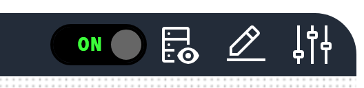

# Actions component
An action is a clickable button or icon that runs an action on a component, runs a system action, navigates to another location, or sends an HTTP request.

<figure markdown>

<figcaption>Actions component showing interactive buttons for system controls and navigation</figcaption>
</figure>

Use an action for system controls, navigation buttons, data refresh and other commands that the user starts with a click.
Use a [Toggle](Toggles.md) for a switch that alternates between two states.

## Parameters

| Parameter | Type | Required | Default | Description |
|-----------|------|----------|---------|-------------|
| `class` | string | No | None | CSS classes applied to the button or icon |
| `label` | string | No | None | Caption of the button, also used as the title of the confirmation dialog and as the caption of the progress bar |
| `image` | string | No | None | Icon name, for example `Renew` or `Settings`, shown on `icon` and `button` actions. An icon filename such as `nav_battery_active.svg` is also accepted. Refer to [Icon component](../Content/Icon.md) for how to find icon names |
| `imageAlt` | string | No | None | Accessible label for the icon |
| `mode` | string | Yes | None | Display mode, one of `icon`, `button` or `auto`. `auto` displays a button when `label` is set and an icon otherwise |
| `invoke` | string | No | `Component` | How a click is carried out, one of `Component`, `System`, `Endpoint` or `Navigate`. Refer to [Invoke types](#invoke-types) |
| `actionId` | string | Conditional | None | Name of the action to run. Required when `invoke` is `Component` or `System`. Refer to [Action names](#action-names) |
| `target` | string | Conditional | None | Location to navigate to. Required when `invoke` is `Navigate` |
| `endpointAction` | object | Conditional | None | Details of the HTTP request. Required when `invoke` is `Endpoint`. Refer to [Endpoint action parameters](#endpoint-action-parameters) |
| `value` | object | No | None | Payload posted with the action request |
| `trackProgress` | boolean | No | `false` | Shows a progress bar and polls the progress of the action while it runs |
| `confirmMessage` | string | No | None | Message of a confirmation dialog that the user must accept before the action runs |
| `restartingOnSuccess` | boolean | No | `false` | After the action succeeds, shows a wait dialog and polls until the Profinity engine is running again. Use the parameter for actions that restart the engine |
| `enabled` | boolean | No | `true` | Whether the button can be clicked. The state can be bound with the `enabled` target |
| `bind` | array | No | None | [Data binding](../../Data_Binding/index.md). The `enabled`, `tooltip` and `classes` targets are handled |

`id`, `hyperlink`, `openHyperLinkInNewWindow`, and `visible` are accepted but have no effect.
To navigate, use `invoke: Navigate` with `target`.
To control the visibility of an action, use a binding on the component that contains the action.

In `auto` mode the label decides the display, so an action with a label is displayed as a button and an action without a label is displayed as an icon.
An `image` value that matches no known icon is loaded as an image file from the `/Profile/Images` directory.

### Invoke types

The regions, icons, and buttons of an [Image](../Images_and_Models/Image.md) or [3D model](../Images_and_Models/Model.md) component, and a [Toggle](Toggles.md), use the same invoke types through an action invocation object.
Refer to [Action invocation](../Images_and_Models/Overlay_Elements.md#action-invocation) for its parameters.

| Invoke | Behaviour |
|--------|-----------|
| `Component` | Runs the action named by `actionId` on the component that owns the dashboard, and posts `value` with the request. This is the default |
| `System` | Runs the system-level action named by `actionId` on the Profinity engine. The available system actions are `UPDATE PROFINITY`, `INSTALL PROFINITY` and `RESTART PROFINITY` |
| `Navigate` | Navigates the web interface to `target`, without a request to the server |
| `Endpoint` | Describes an HTTP request in `endpointAction`. The browser sends the request, on an action button or on a region, icon, or button of an [Image](../Images_and_Models/Image.md) or [3D model](../Images_and_Models/Model.md) component |

### Endpoint action parameters

| Parameter | Type | Required | Default | Description |
|-----------|------|----------|---------|-------------|
| `method` | string | Yes | None | HTTP method of the request |
| `url` | string | Yes | None | Relative or absolute address that the request is sent to |
| `label` | string | No | None | Caption of the button for the request |
| `description` | string | No | None | Supporting text beside the button |
| `image` | string | No | None | Carbon icon name shown on the button |
| `imageAlt` | string | No | None | Accessible label for the icon |
| `confirmMessage` | string | No | None | Message of a confirmation dialog shown before the request is sent |
| `successKinds` | array of string | No | None | What the interface does after the request succeeds, using the values `Toast`, `ReloadSettings`, `ShowServiceAccountTokenDialog` and `RefreshOnClose` |

Endpoint actions run from the browser.
The browser sends the HTTP request itself, with the signed-in user's credentials.
An action button with `invoke: Endpoint` therefore works the same way as an `Endpoint` on a region, icon, or button of an [Image](../Images_and_Models/Image.md) or [3D model](../Images_and_Models/Model.md) component.
If the request fails, the browser shows an error message with the reason.

## Examples

A button with a label and an icon:

``` yaml
dashboard:
  items:
    - row:
        items:
          - action:
              label: "Refresh Data"
              mode: "button"
              invoke: Component
              actionId: "Refresh"
              image: "Renew"
              imageAlt: "Refresh"
```

An icon without a label:

``` yaml
dashboard:
  items:
    - row:
        items:
          - action:
              mode: "icon"
              invoke: Component
              actionId: "Settings"
              image: "Settings"
              imageAlt: "Settings"
```

A system action with a confirmation dialog that waits for the engine to restart:

``` yaml
dashboard:
  items:
    - row:
        items:
          - action:
              label: "Restart Profinity"
              mode: "button"
              invoke: System
              actionId: "RESTART PROFINITY"
              confirmMessage: "Restart Profinity now?"
              restartingOnSuccess: true
```

A long-running action with a progress bar:

``` yaml
dashboard:
  items:
    - row:
        items:
          - action:
              label: "Update Firmware"
              mode: "button"
              invoke: Component
              actionId: "Update Firmware"
              trackProgress: true
              confirmMessage: "Update the firmware now?"
```

A button that navigates to another location:

``` yaml
dashboard:
  items:
    - row:
        items:
          - action:
              label: "View Battery Pack"
              mode: "button"
              invoke: Navigate
              target: "/component?componentId=Battery%20Pack"
```

## Action names

A `Component` action runs one of the actions that the component named by the dashboard offers.
The Actions API lists those names at `/api/v2/Actions/{componentId}`.
A `System` action runs one of `UPDATE PROFINITY`, `INSTALL PROFINITY` or `RESTART PROFINITY`.
A `System` action with any other name is rejected with the message "No system action of that id was found".
A user who lacks the permission that an action requires is refused when the action is clicked.
