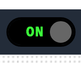

# Toggles component
A toggle is an on/off switch that runs an action each time it is clicked, while [data binding](../../Data_Binding/index.md) shows whether the feature is currently on or off.

<figure markdown>

<figcaption>Toggles component displaying switch controls for enabling or disabling features</figcaption>
</figure>

Use a toggle for feature switches, enable and disable controls, and any action that alternates between two states.
Use an [Action](Actions.md) for a one-way command such as a refresh.

## Parameters

| Parameter | Type | Required | Default | Description |
|-----------|------|----------|---------|-------------|
| `class` | string | No | None | CSS classes added to the toggle |
| `label` | string | Yes | None | Two captions separated by a vertical bar, written as `ON|OFF`. The text before the bar is shown at the left of the switch and the text after it at the right |
| `action` | object | Yes | None | Action invocation that is submitted when the toggle is clicked. Refer to [Toggle action invocation](../Images_and_Models/Overlay_Elements.md#toggle-action-invocation) |
| `value` | object | No | None | Payload posted with the action request |
| `enabled` | boolean | No | `true` | Whether the toggle can be clicked. The state can be bound with the `enabled` target |
| `bind` | array | No | None | Data binding. The `enabled` and `classes` targets are handled |

`id` and `visible` are accepted but have no effect.

A toggle shows whether the feature is on or off only when its `classes` target is bound.
Bind the `classes` target to a boolean, and map `true` to `on` and `false` to `off`.

## Example

``` yaml
dashboard:
  items:
    - row:
        items:
          - toggle:
              label: "ON|OFF"
              action:
                invoke: Component
                actionId: "Auto Refresh"
              bind:
                - target: classes
                  source: 'Properties/AutoRefreshActive'
                  toType: boolean
                  mapToText:
                    falseValue: off
                    trueValue: on
```
